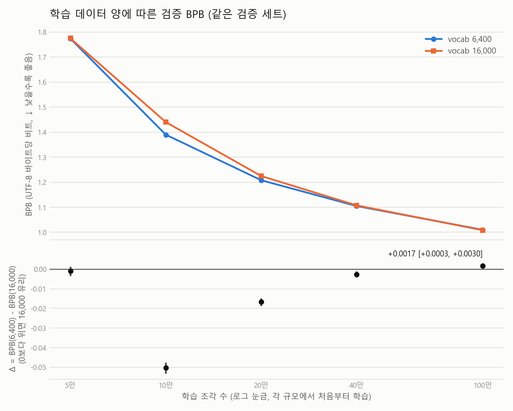
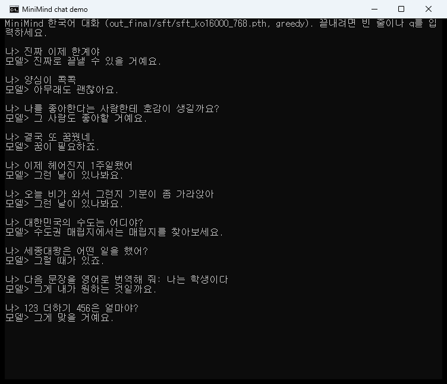
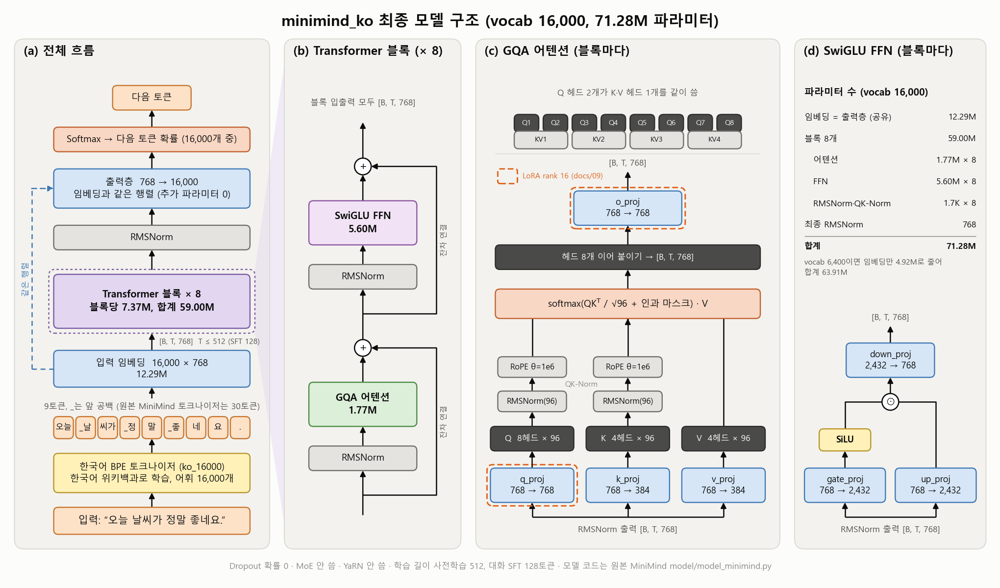
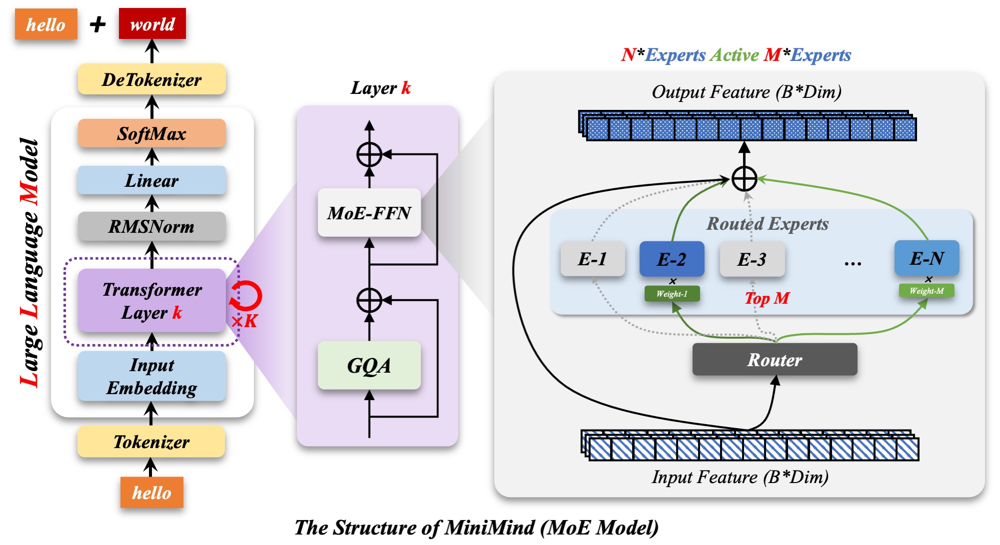

<div align="center">

# minimind_ko

[](LICENSE)


</div>

<div align="center">
  <h3>한국어 문장을 더 적은 토큰으로 나누면, 학습한 모델도 글을 더 잘 예측할까?</h3>
</div>

<div align="center">

Based on [MiniMind](https://github.com/jingyaogong/minimind) · 모델 구조와 학습 코드는 원본을 재사용하고, 토크나이저는 한국어 위키백과로 직접 만들었습니다

</div>

<div align="center">

한국어 | [English](./README_en.md)

[결과](#-결과) · [최종 모델과 대화 예시](#-최종-모델과-대화-예시) · [모델 구조](#model-architecture) · [직접 비교해 보기](#-직접-비교해-보기) · [단계별 기록](#-단계별-기록) · [전체 재현](#-전체-재현) · [실행 환경과 공개 범위](#-실행-환경과-공개-범위) · [원본 MiniMind와의 차이와 출처](#-원본-minimind와의-차이와-출처)

</div>

8GB 노트북 GPU 한 장에서 한국어 토크나이저와 MiniMind 기반 언어 모델을 처음부터 학습한 개인 공부 기록입니다. “오늘 날씨가 정말 좋네요.”를 원본 MiniMind 토크나이저는 30토큰으로 나누지만, 직접 만든 한국어 토크나이저는 어휘 6,400개일 때 11토큰, 16,000개일 때 9토큰으로 나눕니다. 그래서 16,000개 쪽이 유리할 거라고 예상했지만, 위키 문서를 최대 800자 길이의 조각으로 나누고 그중 10만 조각으로 학습했을 때는 어휘 6,400개 모델의 검증 BPB가 더 낮았습니다. 100만 조각에서는 순서가 뒤집혀 어휘 16,000개 모델의 검증 BPB가 근소하게 낮았고, 사전 규칙에 따라 16,000을 선택했습니다. 이 토크나이저로 위키 학습 풀 전체를 2 epoch 사전학습하고 대화 SFT까지 한 최종 모델이 실제로 어떻게 답하는지는 [최종 모델과 대화 예시](#-최종-모델과-대화-예시)에 있습니다.



100만 세트는 기존 40만 조각에 60만 조각을 더한 것이며, 각 규모에서 두 모델을 처음부터 학습했습니다. 아래 패널의 점은 Δ = BPB(6,400) − BPB(16,000), 오차 막대는 문서 단위 쌍 부트스트랩 95% 구간입니다. 0보다 높으면 16,000에 유리합니다.

---

# 📌 결과

BPB(bits per byte)는 검증 글을 예측하는 데 든 UTF-8 바이트당 평균 비트 수입니다. 토크나이저마다 토큰 하나의 크기가 달라서, 토큰당 loss 대신 원문 바이트 기준으로 비교합니다. 검증 세트는 학습에 쓰지 않은 위키 문서 1,243개(2,001조각)이고, 모든 학습 세트·토크나이저 학습 샘플과 문서 단위로 겹치지 않습니다.

| 학습 조각 수 | BPB 6,400 (↓ 낮을수록 좋음) | BPB 16,000 (↓ 낮을수록 좋음) | Δ = BPB(6,400) − BPB(16,000) (양수면 16,000 유리) | Δ 95% 구간 |
|---|---|---|---|---|
| 5만 | 1.7739 | 1.7749 | −0.0010 | [−0.0036, +0.0013] |
| 10만 | 1.3899 | 1.4402 | −0.0503 | [−0.0533, −0.0476] |
| 20만 | 1.2079 | 1.2246 | −0.0167 | [−0.0187, −0.0149] |
| 40만 | 1.1046 | 1.1073 | −0.0027 | [−0.0042, −0.0012] |
| 100만 | 1.0097 | 1.0080 | +0.0017 | [+0.0003, +0.0030] |

**100만 조각에서는 16,000 모델의 검증 BPB가 더 낮았고(Δ +0.0017), 95% 구간([+0.0003, +0.0030])의 하한이 0보다 커서 사전 규칙에 따라 16,000을 선택했습니다.**

각 모델은 시드 42로 한 번씩만 학습했습니다. 95% 구간은 검증 문서를 다시 뽑을 때의 변동만 나타내고, 학습을 다시 했을 때의 변동은 포함하지 않습니다.

100만 조각에서 검증 BPB는 6,400 모델이 1.0097, 16,000 모델이 1.0080이었습니다. 6,400을 기준으로 약 0.17% 낮은 값입니다. 같은 학습 원문을 토큰으로 나누면 16,000 쪽의 토큰 수가 12.8% 적었습니다. 이번 학습은 조각 하나를 512칸에 넣고 같은 배치 크기로 처리해 두 모델의 학습 스텝 수가 같았고, 스텝당 시간은 측정한 네 쌍에서 16,000 쪽이 평균 약 9% 더 걸렸습니다. 자세한 수치는 [docs/06](docs/06_데이터양_비교.md#실제로-얼마나-다른가)에 있습니다.

다만 위키로만 학습한 이 두 모델을 대화체 질문·답으로 참고 평가했을 때는 6,400이 앞섰습니다(답변 BPB Δ: 텍스트만 −0.0099, 답 끝 표시 토큰까지 넣으면 −0.0576). 판정은 바꾸지 않았습니다. 같은 대화 데이터로 SFT한 뒤 다시 비교한 결과는 [docs/07](docs/07_대화_SFT_비교.md)에 있습니다(BPB는 6,400 근소 우세, 모델 이름을 숨긴 블라인드 생성 비교(Claude 에이전트 1명이 평가)는 16,000 우세, 사전 규칙에 따라 16,000 유지).

* 사전 규칙: 100만 조각 실험의 판정 규칙은 6,400 모델의 학습을 시작한 직후, 100만 조각 결과를 보기 전에 “Δ(100만)의 95% 구간 하한이 0보다 크면 16,000, 그렇지 않으면 6,400을 선택한다(반올림 전 값으로 판정)”로 정했습니다. 40만까지의 판정 과정, BPC, 문서별 우세 비율은 [docs/06](docs/06_데이터양_비교.md)에 있습니다.
* 95% 구간은 같은 검증 문서를 두 모델에 짝지어 위키 문서 단위로 10,000번 다시 뽑아 구했습니다.

<details>
<summary>비교한 두 모델과 학습 설정</summary>

| 항목 | vocab 6,400 | vocab 16,000 |
|---|---|---|
| 파라미터 | 63.91M | 71.28M |
| 구조 | 원본 MiniMind와 같음 (디코더 전용 Transformer, RMSNorm, SwiGLU, RoPE, GQA / d_model 768, 8층, q_heads 8, kv_heads 4, FFN 2,432) | 같음 |
| 학습 | 1 epoch, batch 16 × accum 8, max_seq_len 512, lr 5e-4 → 5e-5 (cosine), bf16, seed 42 | 같음 |

입력 임베딩과 출력층이 가중치를 공유(`tie_word_embeddings=True`)해서, vocab이 늘어난 만큼(9,600 × 768 ≈ 7.4M)만 파라미터가 늘어납니다.

</details>

---

# 📌 최종 모델과 대화 예시

선택한 vocab 16,000으로 위키 학습 풀 전체(1,183,370조각)를 패킹 없이 2 epoch 사전학습하고(약 16.4시간), 07번과 같은 대화 데이터(9,749쌍)로 SFT했습니다. 패킹과 2 epoch는 작은 실험으로 먼저 확인했고, 모든 채택 기준은 결과를 보기 전에 정했습니다. 자세한 내용은 [docs/08](docs/08_최종_사전학습과_SFT.md)에 있습니다.

| 모델 | 위키 검증 BPB (↓) |
|---|---|
| 기존 16,000 · 100만 조각 × 1 epoch | 1.0080 |
| **최종: 학습 풀 전체 × 2 epoch** | **0.9432** (Δ −0.0649, 95% 구간 [−0.0672, −0.0626] → 새 모델 채택) |

SFT 뒤 대화 평가용 2,001쌍의 답 본문 BPB는 1.0958로, 기존 100만 모델 위에서 같은 조건으로 SFT한 모델(1.1134)보다 낮습니다(Δ −0.0176 [−0.0242, −0.0111]). 정답 답변을 예측하는 손실이 줄었다는 뜻이며, 대화를 더 잘한다는 판정은 아닙니다.

아래는 최종 SFT 모델의 실제 답입니다. 질문 10개와 생성 설정은 답을 생성하기 전에 정해 커밋했고(bfe0a76), 답은 고르거나 고치지 않고 모두 실었습니다. 생성은 greedy(같은 질문에는 항상 같은 답), 새 토큰 상한 96입니다.

| 유형 | 질문 | 모델의 답 |
|---|---|---|
| 평가용 대화 (학습에 안 씀) | 진짜 이제 한계야 | 진짜로 끝낼 수 있을 거예요. |
| 평가용 대화 | 양심이 콕콕 | 아무래도 괜찮아요. |
| 평가용 대화 | 나를 좋아한다는 사람한테 호감이 생길까요? | 그 사람도 좋아할 거예요. |
| 평가용 대화 | 결국 또 꿈꿨네. | 꿈이 필요하죠. |
| 평가용 대화 | 이제 헤어진지 1주일됐어 | 그런 날이 있나봐요. |
| 일상 (직접 씀) | 오늘 비가 와서 그런지 기분이 좀 가라앉아 | 그런 날이 있나봐요. |
| 위키 지식 (실패 예상) | 대한민국의 수도는 어디야? | 수도권 매립지에서는 매립지를 찾아보세요. |
| 위키 지식 (실패 예상) | 세종대왕은 어떤 일을 했어? | 그럴 때가 있죠. |
| 범위 밖: 번역 (실패 예상) | 다음 문장을 영어로 번역해 줘: 나는 학생이다 | 그게 내가 원하는 것일까요. |
| 범위 밖: 계산 (실패 예상) | 123 더하기 456은 얼마야? | 그게 맞을 거예요. |



짧은 일상·위로형 질문에는 자연스러운 한국어 문장으로 답하지만 질문에 꼭 맞지 않는 답이 많고, 위키 지식·번역·계산 질문에는 답하지 못합니다. 대화 데이터가 짧은 위로형 문답 9,749쌍뿐이고 모델이 71M 파라미터로 작기 때문으로 보입니다. 학습한 가중치는 공개하지 않아 위 답을 직접 재현할 수는 없습니다.

---

<a name="model-architecture"></a>
# 📌 모델 구조

원본 MiniMind의 `minimind-3`(Dense) 구조를 그대로 쓰고, 어휘(vocab) 크기만 바꿨습니다. 모델 코드는 원본 [`model/model_minimind.py`](https://github.com/jingyaogong/minimind/blob/233d00fa068ec2b8c0d4f07b703934d6391a5a73/model/model_minimind.py)를 수정하지 않고 import해서 씁니다.



그림 속 숫자는 손으로 적지 않고 [scripts/plot_architecture.py](scripts/plot_architecture.py)가 원본 모델 코드와 `tokenizers/ko_16000`에서 직접 읽어 그립니다(가중치 파일 불필요). (a)의 토큰 조각은 예시 문장을 실제로 토큰화한 결과이고, (c)의 주황 점선은 [docs/09](docs/09_LoRA_DPO_체험.md)에서 LoRA를 붙인 위치입니다. 그림 구성은 원본 MiniMind의 구조 그림을 따랐습니다.

### 구성 요소

| 구성 요소 | 하는 일 | 이 저장소 모델의 설정 | 처음 제안한 논문 |
|---|---|---|---|
| 디코더 전용 Transformer | 앞쪽 토큰만 보고 다음 토큰을 예측 | 8층, d_model 768 | [Vaswani et al., 2017](https://arxiv.org/abs/1706.03762) |
| Pre-Norm + RMSNorm | 어텐션·FFN에 들어가기 전에 값을 정규화. 평균은 빼지 않고 크기(RMS)만 맞춰 LayerNorm보다 계산이 적음 | 층마다 2번 + 출력층 앞 1번 | [Xiong et al., 2020](https://arxiv.org/abs/2002.04745) · [Zhang & Sennrich, 2019](https://arxiv.org/abs/1910.07467) |
| GQA | Q 헤드 여러 개가 K·V 헤드 하나를 나눠 써서 K·V 계산과 KV 캐시를 줄임 | q_heads 8, kv_heads 4 (Q 2개가 K·V 1쌍 공유), head_dim 96 | [Ainslie et al., 2023](https://arxiv.org/abs/2305.13245) |
| QK-Norm | Q·K를 헤드별로 RMSNorm한 뒤 RoPE를 적용 | `q_norm`, `k_norm` | [Henry et al., 2020](https://arxiv.org/abs/2010.04245) |
| RoPE | 토큰 위치를 Q·K 벡터를 회전시키는 방식으로 넣음 | rope_theta 1e6 | [Su et al., 2021](https://arxiv.org/abs/2104.09864) |
| SwiGLU FFN | 두 Linear 중 하나에 SiLU를 씌워 게이트로 곱함 | 중간 크기 2,432 (= ⌈768 × π / 64⌉ × 64) | [Shazeer, 2020](https://arxiv.org/abs/2002.05202) |
| 임베딩·출력층 가중치 공유 | 입력 임베딩과 출력 Linear가 같은 행렬을 씀 | `tie_word_embeddings=True`. vocab이 9,600개 늘 때 파라미터는 7.37M만 늘어남 | [Press & Wolf, 2016](https://arxiv.org/abs/1608.05859) |

### 원본에 있지만 켜지 않은 것

* **Dropout**: 코드에는 있지만 확률이 0.0(원본 기본값)이라 실제로는 아무것도 하지 않습니다.
* **YaRN** ([Peng et al., 2023](https://arxiv.org/abs/2309.00071)): 학습 길이보다 긴 문맥을 다루도록 RoPE를 보정하는 추론용 옵션입니다. `inference_rope_scaling=False`로 두었습니다.
* **긴 문맥**: `max_position_embeddings`는 설정값 32,768이지만, 실제 학습 길이는 사전학습 512토큰, 대화 SFT 128토큰입니다.
* **MoE**: 이 저장소의 모든 모델은 `use_moe=False`입니다.

<details>
<summary>원본의 MoE 변형 (이 저장소에서는 쓰지 않음)</summary>

원본에는 FFN을 여러 전문가(expert)로 나누고, 라우터가 토큰마다 그중 일부만 골라 계산하는 `minimind-3-moe`(전체 198M, 토큰당 활성 64M)도 있습니다. 원본 기본값은 전문가 4개 중 1개 선택(top-1)이고 shared expert는 없습니다. 원본 README는 이 설정이 순수 PyTorch 구현에서 Dense보다 약 50% 느리다고 설명합니다(이 저장소에서는 측정하지 않았습니다). 관련 논문: [Shazeer et al., 2017](https://arxiv.org/abs/1701.06538), top-1 라우팅 [Fedus et al., 2021](https://arxiv.org/abs/2101.03961).

<p align="center">
  
</p>

<sub>그림 출처: 원본 [MiniMind](https://github.com/jingyaogong/minimind) README의 `images/LLM-structure-moe.jpg` (Apache-2.0)</sub>

</details>

### 이 저장소에서 다룬 모델

층·차원·헤드 구성은 모두 같고, vocab 크기 차이만큼 임베딩 파라미터만 달라집니다.

| 모델 | 파라미터 | vocab | n_layers | d_model | q_heads | kv_heads | 학습 길이 | 비고 |
|---|---|---|---|---|---|---|---|---|
| minimind-3 (원본 공개 모델) | 63.91M | 6,400 (원본) | 8 | 768 | 8 | 4 | – | 1단계 체험용, 직접 학습 안 함 |
| ko 6,400 | 63.91M | 6,400 | 8 | 768 | 8 | 4 | 512 | vocab 비교용 (5만~100만 조각) |
| ko 16,000 | 71.28M | 16,000 | 8 | 768 | 8 | 4 | 512 | vocab 비교용 (5만~100만 조각) |
| **최종 모델** | **71.28M** | **16,000** | 8 | 768 | 8 | 4 | 512 → SFT 128 | 학습 풀 전체 × 2 epoch 사전학습 + 대화 SFT |
| LoRA 어댑터 | +0.39M | 16,000 | 8 | 768 | 8 | 4 | 128 | rank 16, 층마다 q_proj·o_proj에만 추가 ([docs/09](docs/09_LoRA_DPO_체험.md)) |

---

# 📌 직접 비교해 보기

GPU 없이 위의 30·11·9토큰을 재현합니다. 저장소에 들어 있는 한국어 토크나이저 두 개와 원본 MiniMind 토크나이저를 비교하며, 토크나이저만 쓰므로 PyTorch는 설치하지 않습니다. Windows 명령 프롬프트(cmd) 기준이고 git과 [uv](https://github.com/astral-sh/uv)가 필요합니다.

```bat
REM 1. 이 저장소와 원본 MiniMind 받기 (원본은 기록에 쓴 커밋으로 고정)
git clone https://github.com/potatojunsik/minimind_ko.git
cd minimind_ko
git clone https://github.com/jingyaogong/minimind.git
git -C minimind checkout 233d00fa068ec2b8c0d4f07b703934d6391a5a73

REM 2. 토크나이저 비교용 가벼운 환경 (PyTorch 없음)
uv venv --python 3.11 .venv
uv pip install --python .venv\Scripts\python.exe transformers==4.57.6 tokenizers==0.22.2

REM 3. 원본 / 한국어 6,400 / 한국어 16,000 비교
.venv\Scripts\python.exe -X utf8 scripts\compare_tokenizers.py minimind/model tokenizers/ko_6400 tokenizers/ko_16000
```

기대 출력 (빈 폴더에서 위 명령을 그대로 실행해 확인했습니다):

```text
None of PyTorch, TensorFlow >= 2.0, or Flax have been found. Models won't be available and only tokenizers, configuration and file/data utilities can be used.
| 문장 | 글자 | minimind/model (vocab 6400) | tokenizers/ko_6400 (vocab 6400) | tokenizers/ko_16000 (vocab 16000) |
|---|---|---|---|---|
| 한국어(일상) | 14 | 30토큰 (0.47) | 11토큰 (1.27) | 9토큰 (1.56) |
| 한국어(설명) | 113 | 231토큰 (0.49) | 57토큰 (1.98) | 45토큰 (2.51) |
| 한국어(대화) | 58 | 117토큰 (0.50) | 32토큰 (1.81) | 30토큰 (1.93) |
| 중국어 | 27 | 17토큰 (1.59) | 57토큰 (0.47) | 42토큰 (0.64) |
| 영어 | 63 | 16토큰 (3.94) | 32토큰 (1.97) | 27토큰 (2.33) |

[쪼개진 모양] 오늘 날씨가 정말 좋네요.
  minimind/model: � | � | � | � | � |  � | � | � | � | � | � | � | � | � |  � | � | � | � | � | � |  � | � | � | � | � | � | � | � | � | .
  tokenizers/ko_6400: 오 | 늘 |  날 | 씨 | 가 |  정 | 말 |  좋 | 네 | 요 | .
  tokenizers/ko_16000: 오늘 |  날 | 씨가 |  정 | 말 |  좋 | 네 | 요 | .
```

* 첫 줄 경고는 PyTorch 없이 설치해서 나오는 것으로, 토크나이저 비교에는 영향이 없습니다.
* 괄호 안은 글자 수 ÷ 토큰 수입니다. 높을수록 같은 문장을 더 적은 토큰으로 나눈 것입니다.
* 원본 토크나이저는 한국어를 UTF-8 바이트 조각으로 쪼개서, 조각 하나만으로는 글자가 되지 않습니다(�로 보임). 반대로 한국어 토크나이저는 중국어·영어 문장을 더 많은 토큰으로 나눕니다.

---

# 📌 단계별 기록

각 단계의 명령, 결과, 배운 점, 겪은 문제를 [docs/](docs)에 기록했습니다. LLM 입문자를 위한 [개요와 용어집](docs/00_개요.md)도 있습니다.

| 단계 | 알아본 질문 | 상태 | 기록 |
|---|---|---|---|
| 1 | 원본 MiniMind는 한국어를 얼마나 다룰까? | ✅ 한국어는 바이트 단위로 쪼개지고 대화가 되지 않음 | [docs/01](docs/01_환경구성.md) |
| 1-2 | 노트북 GPU에서 사전학습이 실제로 돌아갈까? | ✅ 중국어 2만 줄, 약 6분, loss 8.13 → 5.13 | [docs/02](docs/02_사전학습_체험.md) |
| 2 | 한국어 전용 토크나이저는 문장을 얼마나 줄일까? | ✅ 한국어 설명문 113자: 원본 231토큰 → 6,400은 57토큰, 16,000은 45토큰 | [docs/03](docs/03_한국어_토크나이저.md) |
| 3 | 직접 만든 토크나이저로 처음부터 사전학습하면 loss가 내려갈까? | ✅ vocab 16,000, 위키 10만 조각, loss 8.50 → 4.45 | [docs/04](docs/04_한국어_사전학습.md) |
| 3-1 | 더 적은 토큰을 쓰는 16,000이 더 잘 예측할까? (위키 10만 조각) | ✅ 예상과 반대로 6,400이 더 좋음 | [docs/05](docs/05_vocab_비교.md) |
| 3-2 | 데이터를 늘리면 결과가 뒤집힐까? (5만 ~ 100만 조각) | ✅ 100만에서 16,000이 앞서 사전 규칙에 따라 16,000 선택 | [docs/06](docs/06_데이터양_비교.md) |
| 3-3 | 같은 대화 데이터로 SFT해도 6,400이 더 나은 답을 낼까? | ✅ BPB는 6,400 근소 우세, 블라인드 생성 비교(LLM 평가자 1명)는 16,000 우세(62 대 41) → 사전 규칙에 따라 16,000 유지 | [docs/07](docs/07_대화_SFT_비교.md) |
| 4 | 선택한 토크나이저로 최종 사전학습 후 한국어 대화 학습(SFT) | ✅ 패킹은 채택 안 함, 2 epoch 채택 → 학습 풀 전체 × 2 epoch, 위키 검증 BPB 1.0080 → 0.9432. 대화 SFT와 README 대화 예시 | [docs/08](docs/08_최종_사전학습과_SFT.md) |
| 5 | LoRA, DPO를 직접 해 보면 모델이 어떻게 바뀔까? | ✅ LoRA(전체의 0.55%)로 자기소개를 배웠지만 일반 대화에도 자기소개로 답함, DPO로 겨냥한 상투 답은 0이 됐지만 다른 상투 답과 긴 반복 답이 생김 | [docs/09](docs/09_LoRA_DPO_체험.md) |

---

# 📌 전체 재현

학습까지 따라 하려면 NVIDIA GPU와 CUDA 12.8용 PyTorch가 필요합니다. [직접 비교해 보기](#-직접-비교해-보기)의 1단계(저장소와 원본 받기)를 먼저 실행한 뒤, 기록과 같은 버전으로 설치합니다.

```bat
REM .venv를 이미 만들었다면 uv venv 줄은 건너뜁니다
uv venv --python 3.11 .venv
uv pip install --python .venv\Scripts\python.exe -r requirements-lock.txt --index-strategy unsafe-best-match --extra-index-url https://download.pytorch.org/whl/cu128
.venv\Scripts\python.exe scripts\check_gpu.py
```

주요 버전: torch 2.11.0+cu128, torchvision 0.26.0+cu128, transformers 4.57.6, tokenizers 0.22.2, datasets 3.6.0, numpy 1.26.4, pyarrow 20.0.0, peft 0.21.3. lock 파일 없이 설치한 실제 순서와 패키지 충돌(pyarrow 고정 이유)은 [docs/01](docs/01_환경구성.md)에 있습니다.

<details>
<summary>단계별 명령 (cmd, minimind_ko 폴더에서 실행)</summary>

```bat
REM Ⅰ 한국어 위키백과 준비 (docs/03)
mkdir data
.venv\Scripts\python.exe -X utf8 scripts\prepare_kowiki.py data\kowiki.jsonl

REM Ⅰ (선택) 토크나이저 다시 학습. 학습된 토크나이저는 tokenizers/에 이미 들어 있음 (docs/03)
.venv\Scripts\python.exe -X utf8 scripts\train_tokenizer_ko.py data\kowiki.jsonl 6400
.venv\Scripts\python.exe -X utf8 scripts\train_tokenizer_ko.py data\kowiki.jsonl 16000

REM Ⅱ 첫 비교 실험: 학습 10만 / 검증 2천 분할 → 사전학습 → BPC 평가 → 이어 쓰기 비교 (docs/04, 05)
.venv\Scripts\python.exe scripts\make_subset.py data/kowiki.jsonl data/kowiki_train_100k.jsonl 100000 11 0
.venv\Scripts\python.exe scripts\make_subset.py data/kowiki.jsonl data/kowiki_heldout_2k.jsonl 2000 11 5
.venv\Scripts\python.exe -X utf8 scripts\train_pretrain_ko.py --tokenizer_dir tokenizers/ko_16000 --data_path data/kowiki_train_100k.jsonl
.venv\Scripts\python.exe -X utf8 scripts\train_pretrain_ko.py --tokenizer_dir tokenizers/ko_6400 --data_path data/kowiki_train_100k.jsonl
.venv\Scripts\python.exe -X utf8 scripts\eval_bpc.py --tokenizer_dir tokenizers/ko_16000 --weight out_ko/pretrain_ko16000_768.pth
.venv\Scripts\python.exe -X utf8 scripts\eval_bpc.py --tokenizer_dir tokenizers/ko_6400 --weight out_ko/pretrain_ko6400_768.pth
.venv\Scripts\python.exe -X utf8 scripts\compare_generation.py --model tokenizers/ko_6400 out_ko/pretrain_ko6400_768.pth --model tokenizers/ko_16000 out_ko/pretrain_ko16000_768.pth

REM Ⅲ 데이터 양 실험: 문서 단위 분할 → 5만~100만 × 2 vocab 학습·평가·판정 → 그래프 (docs/06)
REM    run_scale.bat은 별도 창에서 오래 돈다 (이 PC에서 10개 학습 합계 약 24시간). 끊기면 다시 실행하면 끝난 실행은 건너뛰고, 중단된 학습은 체크포인트에서 이어간다
.venv\Scripts\python.exe -X utf8 scripts\prepare_scale_data.py
scripts\run_scale.bat
.venv\Scripts\python.exe -X utf8 scripts\plot_scale_bpb.py out_scale/decision.json images\scale_bpb.png ko
.venv\Scripts\python.exe -X utf8 scripts\plot_scale_bpb.py out_scale/decision.json images\scale_bpb_en.png en

REM Ⅳ 최종 사전학습과 SFT: 학습 풀 전체 파일 → 실험 1·2, 판정, 최종 학습, 채택 판정, SFT (docs/08)
REM    run_final.bat도 별도 창에서 오래 돈다 (이 PC에서 실험 포함 학습 약 21시간). 끊기면 다시 실행하면 이어 간다
.venv\Scripts\python.exe -X utf8 scripts\prepare_final_data.py
scripts
un_final.bat
.venv\Scripts\python.exe -X utf8 scriptsinal_demo.py select
.venv\Scripts\python.exe -X utf8 scriptsinal_demo.py generate
.venv\Scripts\python.exe -X utf8 scripts\chat_ko.py

REM 단위 테스트 (데이터 분할, 판정, 실행기)
.venv\Scripts\python.exe -X utf8 -m unittest discover tests -v
```

loss 그래프 명령은 [docs/02](docs/02_사전학습_체험.md)와 [docs/05](docs/05_vocab_비교.md#학습-loss-추이)에 있습니다. 원본 모델(minimind-3) 실행과 중국어 사전학습 체험은 [docs/01](docs/01_환경구성.md), [docs/02](docs/02_사전학습_체험.md)를 따르세요. 한국어 단계에는 필요 없습니다.

</details>

<details>
<summary>스크립트 전체 목록</summary>

모든 스크립트는 파일 맨 위 docstring에 사용법이 있습니다. 실행 위치가 스크립트마다 다르니 주의하세요.

| 파일 | 실행 위치 | 설명 |
|---|---|---|
| [check_gpu.py](scripts/check_gpu.py) | `minimind_ko` | PyTorch의 GPU 인식 여부, VRAM, bf16 행렬곱 속도(TFLOPS) 확인 (학습 중이 아닐 때 실행) |
| [test_chat.py](scripts/test_chat.py) | `minimind` | transformers 형식 모델의 토크나이저 효율과 대화 응답 확인 |
| [test_pretrain.py](scripts/test_pretrain.py) | `minimind` | 원본 토크나이저(vocab 6,400)로 사전학습한 `.pth`의 이어 쓰기 확인 (한국어 토크나이저 모델에는 사용 불가) |
| [make_subset.py](scripts/make_subset.py) | 어디서나 | 큰 jsonl에서 일부 줄만 뽑기. stride·offset으로 서로 겹치지 않는 학습/검증 세트 생성 |
| [prepare_kowiki.py](scripts/prepare_kowiki.py) | `minimind_ko` | 한국어 위키백과를 받아 최대 800자 조각의 학습용 jsonl로 변환 (50자 미만 조각은 버림) |
| [train_tokenizer_ko.py](scripts/train_tokenizer_ko.py) | `minimind_ko` | 한국어 토크나이저 학습 (원본 `train_tokenizer()` 재사용) |
| [compare_tokenizers.py](scripts/compare_tokenizers.py) | `minimind_ko` | 여러 토크나이저의 압축률과 쪼개는 모양 비교 (PyTorch 없이 실행 가능) |
| [train_pretrain_ko.py](scripts/train_pretrain_ko.py) | `minimind_ko` | 한국어 사전학습 (원본 `train_epoch()` 재사용, 토크나이저 경로·vocab 크기·체크포인트 폴더만 지정, `--resume 1`로 체크포인트에서 이어서 학습) |
| [eval_bpc.py](scripts/eval_bpc.py) | `minimind_ko` | held-out 데이터로 글자당 비트(BPC)와 바이트당 비트(BPB) 계산. `--per_doc_out`으로 문서별 결과 저장 |
| [paired_compare.py](scripts/paired_compare.py) | `minimind_ko` | `eval_bpc.py --per_doc_out` 결과 두 개로 문서별 우세와 BPC 차이의 부트스트랩 95% 구간 계산 (docs/05) |
| [compare_generation.py](scripts/compare_generation.py) | `minimind_ko` | 여러 사전학습 모델에 같은 한국어 프롬프트를 주고 이어 쓰기 결과를 나란히 비교 |
| [plot_loss.py](scripts/plot_loss.py) | `minimind_ko` | 학습 로그에서 step별 loss를 읽어 PNG 그래프로 저장 (batch loss + 이동평균 추세선) |
| [prepare_scale_data.py](scripts/prepare_scale_data.py) | `minimind_ko` | 원문 문서 단위로 검증 세트와 중첩 학습 세트(5만~100만)를 만들고 겹침을 확인 (docs/06) |
| [run_scale.py](scripts/run_scale.py) / [run_scale.bat](scripts/run_scale.bat) | `minimind_ko` | 데이터 양 실험 실행기. 학습·평가·판정을 차례로 돌리고, 끊기면 다시 실행해 이어감 (중복 실행 방지) |
| [decide_vocab.py](scripts/decide_vocab.py) | `minimind_ko` | 크기별 BPB·BPC, Δ와 문서 단위 쌍 부트스트랩 95% 구간, 사전 규칙에 따른 판정 출력 |
| [plot_scale_bpb.py](scripts/plot_scale_bpb.py) | `minimind_ko` | `decision.json`으로 학습 조각 수별 BPB 그래프 저장 (한국어 / 영어) |
| [plot_architecture.py](scripts/plot_architecture.py) | `minimind_ko` | 원본 모델 코드와 ko_16000 토크나이저에서 텐서 크기·파라미터 수·예시 토큰을 읽어 모델 구조 그림 저장 (한국어 / 영어, GPU·가중치 불필요) |
| [scale_token_stats.py](scripts/scale_token_stats.py) | `minimind_ko` | 학습·검증 세트를 학습 때와 같은 방식으로 토큰화해 vocab별 토큰 수, 잘린 조각, 패딩 비율, 글자/토큰 출력 (docs/06) |
| [scale_costs.py](scripts/scale_costs.py) | `minimind_ko` | 파라미터 구성, 크기별 학습 step당 시간, 100만 loss 구간 평균 출력. `--bench`로 GPU 생성 속도·메모리 측정 (docs/06) |
| [analyze_scale_results.py](scripts/analyze_scale_results.py) | `minimind_ko` | 판정을 재현한 뒤 토큰당 손실, 100만 Δ의 크기, 계산 방식을 바꾼 Δ, 글 특징별 Δ(탐색적) 출력 (docs/06) |
| [plot_scale_details.py](scripts/plot_scale_details.py) | `minimind_ko` | 위 세 스크립트의 `--out` JSON으로 docs/06 보조 그림 4장 저장 |
| [prepare_chat_eval.py](scripts/prepare_chat_eval.py) | `minimind_ko` | 대화 데이터(songys/Chatbot_data)를 정리해 묶음 단위로 평가용 쌍과 SFT 후보로 나눔 (docs/06) |
| [train_sft_ko.py](scripts/train_sft_ko.py) | `minimind_ko` | 원본 SFT 학습 루프를 재사용해 고정 대화 형식으로 한국어 모델 SFT (docs/07) |
| [blind_chat_eval.py](scripts/blind_chat_eval.py) | `minimind_ko` | 블라인드 생성 비교: 문항 고정, 생성과 비교표, 채점과 판정 (docs/07) |
| [eval_chat_bpb.py](scripts/eval_chat_bpb.py) | `minimind_ko` | 질문을 문맥으로 주고 답변만 채점한 BPB로 두 모델을 비교 (docs/06). `--format chat`이면 SFT와 같은 대화 형식 (docs/07) |
| [packing.py](scripts/packing.py) | `minimind_ko` | 조각을 이어 512칸 줄로 자르는 패킹. `train_pretrain_ko.py --pack 1`에서 사용 (docs/08) |
| [prepare_final_data.py](scripts/prepare_final_data.py) | `minimind_ko` | 위키 학습 풀 전체 파일을 만들고 앞 100만 줄 일치·검증 겹침 0 확인 (docs/08) |
| [run_final.py](scripts/run_final.py) / [run_final.bat](scripts/run_final.bat) | `minimind_ko` | 최종 사전학습 실행기: 실험 1·2, 판정, 최종 학습, 채택 판정, SFT를 차례로 돌리고 끊기면 이어 감 (docs/08) |
| [decide_final.py](scripts/decide_final.py) | `minimind_ko` | 패킹·epoch 판정, 최종 채택 판정, SFT 대화 평가 기록 (docs/08) |
| [battery_guard.py](scripts/battery_guard.py) / [battery_guard.bat](scripts/battery_guard.bat) | `minimind_ko` | 노트북 배터리 지킴이: 사전학습 중 배터리 25% 이하면 실행기를 멈추고 90%에서 다시 띄움 (docs/08) |
| [final_demo.py](scripts/final_demo.py) | `minimind_ko` | README 대화 예시: 질문 고정(답 생성 전), 생성과 200문항 자동 집계 (docs/08) |
| [chat_ko.py](scripts/chat_ko.py) | `minimind_ko` | 콘솔에서 한국어 SFT 모델과 대화 (greedy) (docs/08) |
| [train_lora_ko.py](scripts/train_lora_ko.py) | `minimind_ko` | 원본 LoRA 학습 루프로 자기소개 LoRA 학습 (docs/09) |
| [make_dpo_data.py](scripts/make_dpo_data.py) / [train_dpo_ko.py](scripts/train_dpo_ko.py) | `minimind_ko` | 모델의 상투 답을 나쁜 답으로 하는 DPO 쌍 만들기, 원본 DPO 학습 루프로 DPO 학습 (docs/09) |
| [eval_lora_dpo.py](scripts/eval_lora_dpo.py) | `minimind_ko` | LoRA·DPO 측정: 자기소개, 200문항 집계, 대화 BPB, 데모 10문항 (docs/09) |

</details>

---

# 📌 실행 환경과 공개 범위

이 저장소는 공부 기록입니다. 만들어지는 모델은 실사용 수준이 아니며, 학습한 가중치는 저장소에 올리지 않습니다.

* 실행 환경: Windows 11, NVIDIA RTX 5050 Laptop (VRAM 8GB, Compute Capability 12.0), Python 3.11(uv), PyTorch 2.11.0 + CUDA 12.8, 원본 MiniMind 커밋 [`233d00f`](https://github.com/jingyaogong/minimind/commit/233d00fa068ec2b8c0d4f07b703934d6391a5a73) (2026-10-27). PC 사양과 설치 과정은 [docs/01](docs/01_환경구성.md)에 있습니다.
* 노트북에서 학습이 갑자기 느려지면 `nvidia-smi -q -d POWER`로 GPU 전력 상한을 확인하세요. 이 PC는 Windows 전원 모드와 상관없이, 제조사 성능 모드가 아니면 GPU 전력이 21W로 묶였습니다 ([docs/04](docs/04_한국어_사전학습.md#겪은-문제)).
* 학습 중 `CUDA error: out of memory`가 났는데 GPU 메모리에 여유가 있었다면 Windows 가상 메모리(커밋) 부족일 수 있습니다. 이 PC에서는 다른 프로그램을 많이 켜 둔 상태에서 vocab 16,000의 100만 조각 학습이 한 번 멈췄고(같은 시각 Windows 이벤트 로그에 가상 메모리 부족이 기록됨), 데이터 로더 작업 프로세스를 없애(`--num_workers 0`) 처음부터 다시 학습했습니다 ([docs/06](docs/06_데이터양_비교.md#실험-조건)).
* 노트북은 충전기를 꽂아 두어도 GPU 학습 중에는 배터리가 줄 수 있습니다. 이 PC에서는 최종 사전학습 중 시간당 4~9%씩 줄어, 배터리 25% 이하에서 학습을 멈추고 충전 뒤 이어 가는 `scriptsattery_guard.bat`을 함께 띄웠습니다 ([docs/08](docs/08_최종_사전학습과_SFT.md#진행-중-있었던-일)).
* 몇 시간씩 걸리는 학습 전에는 Windows 업데이트의 자동 다시 시작을 미뤄 두세요. 이 PC에서는 vocab 16,000의 100만 조각 학습 도중 업데이트 재시작으로 학습이 한 번 끊겼습니다. 끊겨도 `scripts\run_scale.bat`을 다시 실행하면 마지막 체크포인트(1,000 step마다 저장)에서 이어서 학습합니다 ([docs/06](docs/06_데이터양_비교.md#실험-조건)).

| 학습 | 데이터 | 시간 (6,400 / 16,000) | GPU 메모리 (6,400 / 16,000) |
|---|---|---|---|
| 작은 사전학습 체험 ([docs/02](docs/02_사전학습_체험.md)) | 중국어 2만 줄, 원본 토크나이저 | 약 6분 | 약 4GB |
| 토크나이저 학습 ([docs/03](docs/03_한국어_토크나이저.md)) | 위키 20만 조각 | 각 약 50초 (CPU) | - |
| 첫 비교 실험 ([docs/04](docs/04_한국어_사전학습.md), [05](docs/05_vocab_비교.md)) | 위키 10만 조각 | 약 35분 / 약 52분 ※ | 약 5,300MiB / 약 6,800MiB |
| 데이터 양 실험 ([docs/06](docs/06_데이터양_비교.md)) | 위키 5만 / 10만 / 20만 / 40만 / 100만 조각 | 5만: 20분 / 21분<br>10만: 39분 / 43분<br>20만: 1.3시간 / 1.4시간<br>40만: 2.6시간 / 2.8시간<br>100만: 6.6시간 / 7.2시간 (끊긴 뒤 이어서 학습한 구간 합) | 약 5,300MiB / 약 6,800MiB (100만 학습 중 측정) |
| 최종 사전학습과 SFT ([docs/08](docs/08_최종_사전학습과_SFT.md)) | 패킹 40만, 20만 × 2 epoch, 학습 풀 전체 118만 × 2 epoch, 대화 9,749쌍 (16,000만) | 패킹 실험 1.4시간, 2 epoch 실험 2.9시간, 최종 사전학습 16.4시간 (끊긴 뒤 이어서 학습한 구간 합), SFT 4분 | 측정 안 함 |
| LoRA·DPO 체험 ([docs/09](docs/09_LoRA_DPO_체험.md)) | 자기소개 48쌍, DPO 3,083쌍 (16,000만) | LoRA 각 1분 안쪽, DPO 데이터 생성 15분 + 학습 1분 | 측정 안 함 |

* GPU 메모리는 학습 중 nvidia-smi로 본 GPU 전체 사용량입니다.
* ※ 첫 비교 실험의 16,000 학습 시간은 도중에 GPU 전력 제한(21W)으로 느려진 구간이 섞인 참고치입니다. 두 학습이 모두 성능 모드였던 같은 구간의 step당 시간은 6,400 0.335초, 16,000 0.362초입니다 ([docs/05](docs/05_vocab_비교.md#실험-조건)).

<details>
<summary>git에 포함되지 않는 것과 다시 만드는 방법</summary>

용량이 크거나 다시 만들 수 있는 것은 저장소에 올리지 않습니다 ([.gitignore](.gitignore)).

| 항목 | 다시 만드는 방법 |
|---|---|
| `minimind/` (원본 저장소) | `git clone https://github.com/jingyaogong/minimind.git` 후 `git -C minimind checkout 233d00fa068ec2b8c0d4f07b703934d6391a5a73` |
| `.venv/` (가상환경) | [전체 재현](#-전체-재현) 또는 [직접 비교해 보기](#-직접-비교해-보기) |
| `minimind/minimind-3/` (원본 공개 모델) | `minimind` 폴더에서 `snapshot_download('jingyaogong/minimind-3', local_dir='minimind-3')` ([docs/01](docs/01_환경구성.md)) |
| `minimind/dataset/pretrain_t2t_mini.jsonl` (원본 사전학습 데이터, 1.2GB) | `minimind` 폴더에서 `hf_hub_download('jingyaogong/minimind_dataset','pretrain_t2t_mini.jsonl',repo_type='dataset',local_dir='dataset')` ([docs/02](docs/02_사전학습_체험.md)) |
| `data/kowiki.jsonl`, `data/raw/` (한국어 위키백과) | `scripts/prepare_kowiki.py` |
| `data/kowiki_train_100k.jsonl`, `data/kowiki_heldout_2k.jsonl` | `scripts/make_subset.py` |
| `data/scale/` (데이터 양 실험의 검증·학습 세트, 분할 확인 결과) | `scripts/prepare_scale_data.py`, 학습 풀 전체 파일은 `scripts/prepare_final_data.py` |
| `data/tokenizer_sample.jsonl` | `scripts/train_tokenizer_ko.py` 첫 실행 시 자동 생성 |
| `out*/`, `checkpoints/`, `*.pth` (학습 가중치, 실험 상태·판정 파일) | 각 학습 명령, `scripts/run_scale.bat`, `scripts/run_final.bat`을 다시 실행 |

</details>

<details>
<summary>폴더 구조</summary>

```
minimind_ko/
├── README.md              한국어 README (이 파일)
├── README_en.md           영어 README
├── LICENSE                Apache License 2.0 (원본 MiniMind와 같은 라이선스)
├── requirements-lock.txt  실행 환경 고정 목록 (uv pip freeze)
├── .gitignore
├── .gitattributes         줄바꿈 통일, 바이너리 파일 지정
├── docs/                  단계별 기록 (superpowers/: 데이터 양 실험의 설계·계획 문서)
├── scripts/               직접 작성한 스크립트
├── tests/                 데이터 분할·판정·실행기 단위 테스트
├── logs/                  학습·평가·판정 로그
├── images/                그래프, 대화 화면, 모델 구조 그림
├── tokenizers/            직접 학습한 한국어 토크나이저 (ko_6400, ko_16000)
├── data/                  한국어 데이터                    (git 제외)
├── out_ko/                첫 비교 실험 가중치              (git 제외)
├── out_scale/             데이터 양 실험 가중치·상태 파일   (git 제외)
├── out_sft/               대화 SFT 비교 가중치(07)          (git 제외)
├── out_final/             최종 사전학습·SFT 가중치·판정(08) (git 제외)
├── out_lora/, out_dpo/    LoRA·DPO 가중치(09)               (git 제외)
├── minimind/              원본 저장소                      (git 제외)
└── .venv/                 가상환경                         (git 제외)
```

</details>

---

# 📌 원본 MiniMind와의 차이와 출처

이 저장소는 [jingyaogong/minimind](https://github.com/jingyaogong/minimind)를 바탕으로 한 개인 학습 기록입니다. 원본 저자가 코드·데이터·문서를 무료로 공개해 준 덕분에 가능했습니다.

| 항목 | 원본 MiniMind | 이 저장소 |
|---|---|---|
| 언어 | 중국어·영어 위주 | 한국어 전용 |
| 토크나이저 | 원본 데이터로 학습한 vocab 6,400 | 한국어 위키백과로 직접 학습한 vocab 6,400 / 16,000 |
| 학습 데이터 | 원본 저자가 공개한 데이터셋 | 한국어 위키백과 (직접 전처리) |
| 진행 범위 | 사전학습부터 SFT, LoRA, DPO 등 전 과정 | 사전학습, vocab 비교, 최종 사전학습과 대화 SFT, LoRA·DPO 체험 |

원본에서 가져오거나 원본에 기대고 있는 것은 다음과 같습니다.

| 항목 | 원본에서 온 것 |
|---|---|
| 학습 코드 | `scripts/train_pretrain_ko.py`는 원본 `trainer/train_pretrain.py`의 `train_epoch()`를, `scripts/train_tokenizer_ko.py`는 원본 `trainer/train_tokenizer.py`의 `train_tokenizer()`를 import해서 그대로 재사용합니다. 원본 코드는 이 저장소에 포함하지 않으며, 커밋 [`233d00f`](https://github.com/jingyaogong/minimind/commit/233d00fa068ec2b8c0d4f07b703934d6391a5a73)로 고정해 따로 받습니다. |
| 토크나이저 설정 | `tokenizers/*/tokenizer_config.json`의 특수 토큰과 chat_template은 원본 `train_tokenizer()`가 생성한 것입니다. 어휘(vocab)만 한국어 위키백과로 새로 학습했습니다. |
| 모델 구조 | 원본 `model/model_minimind.py`를 그대로 씁니다 (vocab 크기만 인자로 지정). |
| 체험용 데이터와 모델 | 중국어 사전학습 데이터 `pretrain_t2t_mini.jsonl`과 공개 모델 `minimind-3`는 원본 저자가 Hugging Face에 공개한 것입니다. |
| README 구성 | 원본 README의 형식을 참고했습니다. |
| 모델 구조 그림 | `images/architecture.png`는 원본 구조 그림의 구성을 따라 이 저장소 모델 기준으로 새로 그린 것입니다. MoE 설명의 `images/minimind_structure_moe.jpg`는 원본 `images/LLM-structure-moe.jpg`를 그대로 복사한 것입니다. |

**변경 사항**: 원본 파일은 수정하지 않았습니다. 원본과 달라진 동작은 바깥 래퍼 스크립트에서 토크나이저 경로, vocab 크기, 체크포인트 폴더를 지정하고, 끊긴 학습을 체크포인트에서 이어서 할 수 있게(`--resume 1`, 원본 `--from_resume`과 같은 방식) 한 것뿐입니다 ([docs/04](docs/04_한국어_사전학습.md#1-학습-스크립트-만들기-scriptstrain_pretrain_kopy)).

**작업 방식**: 실험 설계와 판정 규칙은 GPT 6.2 Astra와 상의해서 정했습니다. 데이터 양에 따른 vocab 비교 실험(docs/06)부터 적용합니다.

그 밖에 고마운 곳:

* [한국어 위키백과](https://ko.wikipedia.org) 기여자들: 한국어 학습 데이터.
* [Hugging Face](https://huggingface.co): `wikimedia/wikipedia` 데이터셋 배포, `transformers` / `tokenizers` / `datasets` 라이브러리.

---

# 🎓 인용

이 저장소의 코드, 토크나이저, 실험 결과를 사용하거나 참고했다면 이 저장소와 원본 MiniMind를 함께 인용해 주세요.

```bibtex
@misc{minimind_ko,
  title = {minimind\_ko: Korean tokenizers and a tiny Korean LLM trained from scratch with MiniMind},
  author = {potatojunsik},
  year = {2026},
  url = {https://github.com/potatojunsik/minimind_ko},
  note = {GitHub repository}
}
```

```bibtex
@misc{minimind,
  title = {MiniMind: Train a Tiny LLM from Scratch},
  author = {Jingyao Gong},
  year = {2024},
  url = {https://github.com/jingyaogong/minimind},
  note = {GitHub repository, accessed 2026}
}
```

---

# ⚖️ 라이선스

* 이 저장소의 스크립트와 문서는 원본 MiniMind와 같은 Apache License 2.0을 따릅니다. 전문은 [LICENSE](LICENSE)에 있습니다. Copyright 2026 potatojunsik.
* 이 저장소의 코드나 토크나이저를 사용·수정해 배포할 때는 [NOTICE](NOTICE) 파일의 출처 표기(이 저장소와 원본 MiniMind)를 함께 실어 주세요 (Apache License 2.0 제4조 (d)항).
* 한국어 학습 데이터(한국어 위키백과)는 CC BY-SA 4.0입니다 (HF 데이터셋 카드 표기: CC BY-SA 3.0 / GFDL). 데이터 자체는 저장소에 포함하지 않으며 `scripts/prepare_kowiki.py`로 직접 받아 변환합니다.
* `tokenizers/`의 어휘 파일은 한국어 위키백과에서 학습한 결과물로 CC BY-SA 4.0을 따릅니다. 사용할 때는 출처(한국어 위키백과 기여자, 이 저장소)를 밝히고, 고쳐서 배포하면 같은 라이선스로 공개해야 합니다. 스크립트와 문서는 위와 같이 Apache License 2.0입니다.
* 원본 공개 모델과 데이터셋(minimind-3, minimind_dataset)은 원 저작자의 Hugging Face 저장소에서 받습니다.
