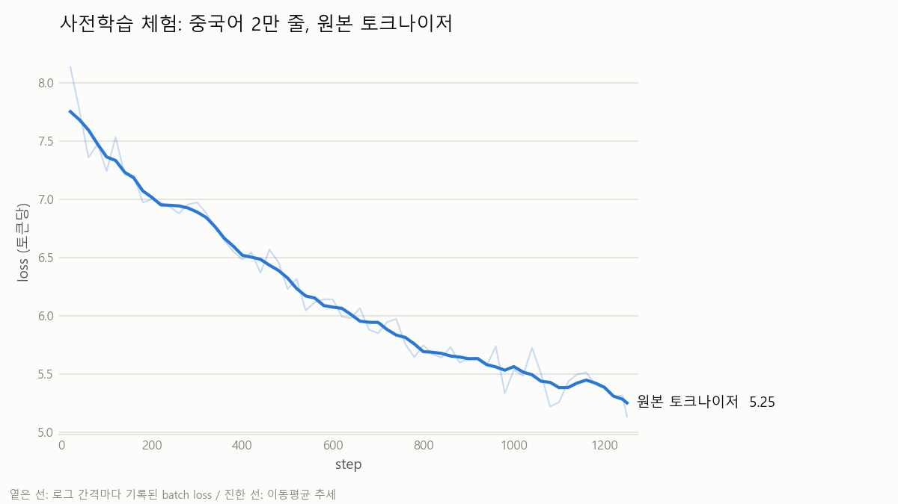
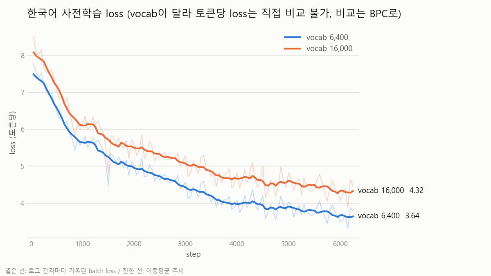

<div align="center">

# minimind_ko

[](LICENSE)


</div>

<div align="center">
  <h3>"A Korean LLM from scratch, on a single laptop GPU"</h3>
</div>

<div align="center">

Based on [MiniMind](https://github.com/jingyaogong/minimind)

</div>

<div align="center">

[한국어](./README.md) | English

</div>

* A personal study log of training a **Korean-only tiny LLM** from scratch, based on [jingyaogong/minimind](https://github.com/jingyaogong/minimind) (a 64M tiny LLM). It was only possible because the original author released the code, data and documentation for free ([Sources and References](#-sources-and-references)).
* All training runs on a single laptop GPU (RTX 5050 Laptop, 8GB VRAM).
* The **tokenizer is trained from scratch** on Korean Wikipedia (vocab 6,400 / 16,000), and the model is pretrained from scratch with that tokenizer.
* The original MiniMind code is **not modified**. The original functions (`train_tokenizer()`, `train_epoch()`) are imported and reused from `scripts/`.
* Each step is recorded in [docs/](docs) (Korean) with commands, results, lessons learned and problems encountered. There is also a [glossary](docs/00_개요.md#용어집) (Korean) for LLM beginners.
* Numbers in the documents (token counts, loss, parameter counts, etc.) are taken from actual logs and script output.

> Note: This is a study / hands-on project. The resulting models are not meant for real use. Licensed under Apache License 2.0, the same as the original MiniMind.

---

# 📌 About

Using an LLM through an API and training one yourself are very different experiences. Models with billions of parameters cannot be trained on a personal PC, but a small model of around 64M parameters like MiniMind lets you run the whole pipeline (tokenizer → pretraining → chat training) on a laptop GPU.

The original MiniMind is built mainly for Chinese and English. Korean sentences are split into byte-level pieces, and the model can barely hold a conversation in Korean ([docs/01](docs/01_환경구성.md), Korean). The starting point of this project is to see for myself: "What happens if we rebuild it from scratch for Korean only?"

---

#### 🎉 What this repository contains

- Step-by-step study notes in [docs/](docs) (Korean; 00 overview & glossary to 05 comparison)
- A script that converts Korean Wikipedia into training data (`scripts/prepare_kowiki.py`)
- Korean tokenizer training / Korean pretraining scripts that reuse the original functions (`scripts/train_tokenizer_ko.py`, `scripts/train_pretrain_ko.py`)
- Scripts for tokenizer comparison, held-out BPC evaluation, continuation comparison and loss plots
- Two Korean tokenizers trained in this project (`tokenizers/`)
- Training logs (`logs/`), loss plots (`images/`), pinned environment (`requirements-lock.txt`)

#### 🎉 Outputs

| Output | Description | Size | In git |
|---|---|---|---|
| [tokenizers/ko_6400](tokenizers/ko_6400) | Byte-level BPE tokenizer trained on Korean Wikipedia | vocab 6,400 | Yes |
| [tokenizers/ko_16000](tokenizers/ko_16000) | Same as above | vocab 16,000 | Yes |
| `out_ko/pretrain_ko16000_768.pth` | Korean pretrained model (vocab 16,000) | 71.28M | No (re-create by training) |
| `out_ko/pretrain_ko6400_768.pth` | Korean pretrained model (vocab 6,400) | 63.91M | No (re-create by training) |

---

#### 📝 Progress

| Step | Description | Status | Notes |
|---|---|---|---|
| 1 | Environment setup, run the original model | ✅ Done | [docs/01](docs/01_환경구성.md) (Korean) |
| 1-2 | Small pretraining trial | ✅ Done | [docs/02](docs/02_사전학습_체험.md) (Korean) |
| 2 | Korean tokenizer | ✅ Done | [docs/03](docs/03_한국어_토크나이저.md) (Korean) |
| 3 | Korean pretraining, vocab 16,000 | ✅ Done | [docs/04](docs/04_한국어_사전학습.md) (Korean) |
| 3-1 | vocab 6,400 vs 16,000 comparison | ✅ Done | [docs/05](docs/05_vocab_비교.md) (Korean) |
| 4 | Korean chat training (SFT) | ⏳ Planned | |
| 5 | (Optional) LoRA, DPO | ⏳ Planned | |

<details open>
<summary> <b>2026-11-18 (Step 3: Korean pretraining)</b> </summary>

- Split Korean Wikipedia chunks into 100k training / 2k validation (0 overlapping lines)
- Measured the token length distribution of the validation set and chose `max_seq_len` 512
- Wrote `scripts/train_pretrain_ko.py` (reuses the original `train_epoch()`, only the tokenizer path and vocab size are changed)
- Finished vocab 16,000 pretraining (71.28M, 6,250 steps, about 52 min, loss 8.50 → 4.45 / last-interval average about 4.3)
- Found that the GPU power limit was capped at 21W during training, which slowed it down; fixed with the laptop maker's performance mode
- Trained vocab 6,400 under the same conditions (63.91M, about 35 min) and compared validation BPC: **at this scale, 6,400 was better** (3.2290 vs 3.2997)

</details>

<details>
<summary> <b>2026-11-18 (Steps 1–2: environment, tokenizer)</b> </summary>

- Set up a Python 3.11 environment with uv, installed PyTorch cu128 for the RTX 5050 (Compute 12.0)
- Ran the original `minimind-3`: Korean is split into bytes and the model cannot chat in Korean
- Small pretraining trial with the original training code on 20k lines of Chinese (about 6 min, loss 8.13 → 5.13)
- Preprocessed Korean Wikipedia (1,185,371 chunks), trained tokenizers with vocab 6,400 / 16,000

</details>

---

# 📌 Quick Start

<details>
<summary>My PC (for reference)</summary>

* OS: Windows 11 Pro
* CPU: Intel Core Ultra 7 255H
* RAM: 32 GB
* GPU: NVIDIA RTX 5050 Laptop (8GB VRAM, Compute Capability 12.0)
* Python: 3.11 (uv virtual environment, separate from the system Python 3.14)
* PyTorch 2.11.0 + CUDA 12.8
* Original MiniMind commit: [`233d00f`](https://github.com/jingyaogong/minimind/commit/233d00fa068ec2b8c0d4f07b703934d6391a5a73) (2026-10-27)

Tip: If training on a laptop suddenly slows down, check the GPU power limit with `nvidia-smi -q -d POWER`. On this PC, the maker's performance mode capped GPU power at 21W, independently of the Windows power mode ([docs/04](docs/04_한국어_사전학습.md#겪은-문제), Korean).

</details>

Commands are for the Windows Command Prompt (cmd). `D:\minimind_ko` is just an example working folder; use any location you like. In Git Bash, change the path separator to `/` ([docs/01](docs/01_환경구성.md#설치-순서), Korean).

## Step 0

```bat
REM Get this repository and the original MiniMind (replace REPO_URL with this repository's URL)
git clone REPO_URL D:\minimind_ko
cd /d D:\minimind_ko
git clone https://github.com/jingyaogong/minimind.git
git -C minimind checkout 233d00fa068ec2b8c0d4f07b703934d6391a5a73

REM Python 3.11 virtual environment (requires uv: https://github.com/astral-sh/uv)
uv venv --python 3.11 .venv

REM Recommended: install exactly the same versions
uv pip install --python .venv\Scripts\python.exe -r requirements-lock.txt --index-strategy unsafe-best-match --extra-index-url https://download.pytorch.org/whl/cu128

REM Check that the GPU is visible
.venv\Scripts\python.exe scripts\check_gpu.py
```

Main versions: torch 2.11.0+cu128, torchvision 0.26.0+cu128, transformers 4.57.6, tokenizers 0.22.2, datasets 3.6.0, numpy 1.26.4, pyarrow 20.0.0, peft 0.21.3

<details>
<summary>The install order actually used at the time (without the lock file)</summary>

```bat
uv pip install --python .venv\Scripts\python.exe torch torchvision --index-url https://download.pytorch.org/whl/cu128
uv pip install --python .venv\Scripts\python.exe -r minimind\requirements.txt peft
uv pip install --python .venv\Scripts\python.exe "pyarrow==20.0.0"
```

* RTX 50 series GPUs need a PyTorch build for CUDA 12.8 or later.
* Why `pyarrow==20.0.0`: `numpy==1.26.4` in requirements.txt conflicts with the latest pyarrow ([docs/01](docs/01_환경구성.md#겪은-문제), Korean).
* Drawing loss plots (`scripts/plot_loss.py`) also needs matplotlib (included in the lock file).

</details>

<details>
<summary>(Optional) Run the original model and the small pretraining trial — docs/01, 02</summary>

```bat
cd /d D:\minimind_ko\minimind
..\.venv\Scripts\python.exe -c "from huggingface_hub import snapshot_download; snapshot_download('jingyaogong/minimind-3', local_dir='minimind-3')"
..\.venv\Scripts\python.exe -X utf8 ..\scripts\test_chat.py ./minimind-3
```

For the small pretraining trial, follow [docs/02](docs/02_사전학습_체험.md) (Korean). It is not needed for the Korean steps.

</details>

## Ⅰ 🔤 Tokenizer

### 1' Prepare Korean Wikipedia

```bat
cd /d D:\minimind_ko
mkdir data
.venv\Scripts\python.exe -X utf8 scripts\prepare_kowiki.py data\kowiki.jsonl
```

### 2' (Optional) Train and compare tokenizers

The trained tokenizers are already in `tokenizers/`, so you do not have to rebuild them.

```bat
.venv\Scripts\python.exe -X utf8 scripts\train_tokenizer_ko.py data\kowiki.jsonl 6400
.venv\Scripts\python.exe -X utf8 scripts\train_tokenizer_ko.py data\kowiki.jsonl 16000
.venv\Scripts\python.exe -X utf8 scripts\compare_tokenizers.py minimind/model tokenizers/ko_6400 tokenizers/ko_16000
```

## Ⅱ 🛠️ Pretraining

### 1' Split training / validation data

```bat
.venv\Scripts\python.exe scripts\make_subset.py data/kowiki.jsonl data/kowiki_train_100k.jsonl 100000 11 0
.venv\Scripts\python.exe scripts\make_subset.py data/kowiki.jsonl data/kowiki_heldout_2k.jsonl 2000 11 5
```

### 2' Pretrain

Weights are saved to `out_ko/pretrain_ko<vocab>_768.pth`. All settings are the script defaults ([docs/04](docs/04_한국어_사전학습.md#4-학습-설정), Korean).

```bat
.venv\Scripts\python.exe -X utf8 scripts\train_pretrain_ko.py --tokenizer_dir tokenizers/ko_16000 --data_path data/kowiki_train_100k.jsonl
.venv\Scripts\python.exe -X utf8 scripts\train_pretrain_ko.py --tokenizer_dir tokenizers/ko_6400 --data_path data/kowiki_train_100k.jsonl
```

## Ⅲ 🧪 Evaluation / Testing

### 1' Validation BPC (bits per character)

```bat
.venv\Scripts\python.exe -X utf8 scripts\eval_bpc.py --tokenizer_dir tokenizers/ko_16000 --weight out_ko/pretrain_ko16000_768.pth
.venv\Scripts\python.exe -X utf8 scripts\eval_bpc.py --tokenizer_dir tokenizers/ko_6400 --weight out_ko/pretrain_ko6400_768.pth
```

### 2' Compare continuations

```bat
.venv\Scripts\python.exe -X utf8 scripts\compare_generation.py --model tokenizers/ko_6400 out_ko/pretrain_ko6400_768.pth --model tokenizers/ko_16000 out_ko/pretrain_ko16000_768.pth
```

### 3' Loss plot

```bat
.venv\Scripts\python.exe -X utf8 scripts\plot_loss.py images\loss_pretrain_small_20k.png "사전학습 체험: 중국어 2만 줄, 원본 토크나이저" "원본 토크나이저=logs\01_pretrain_small_20k.log"
.venv\Scripts\python.exe -X utf8 scripts\plot_loss.py images\loss_pretrain_ko_compare.png "한국어 사전학습 loss (vocab이 달라 토큰당 loss는 직접 비교 불가, 비교는 BPC로)" "vocab 6,400=logs\03_pretrain_ko6400_100k.log" "vocab 16,000=logs\02_pretrain_ko16000_100k.log"
```

(The titles and series names are in Korean, exactly as used for the actual plots: "Pretraining trial: 20k lines of Chinese, original tokenizer" / "original tokenizer", and "Korean pretraining loss (token-level loss is not directly comparable across vocab sizes; compare with BPC)".)

<details>
<summary>All scripts</summary>

Every script has usage instructions in its top docstring (Korean). The working directory differs per script, so please check.

| File | Run from | Description |
|---|---|---|
| [check_gpu.py](scripts/check_gpu.py) | `minimind_ko` | Checks whether PyTorch sees the GPU, VRAM, and bf16 matmul speed (TFLOPS). Run when not training |
| [test_chat.py](scripts/test_chat.py) | `minimind` | Checks tokenizer efficiency and chat responses of a transformers-format model |
| [test_pretrain.py](scripts/test_pretrain.py) | `minimind` | Text continuation with a `.pth` pretrained with the original tokenizer (vocab 6,400). Cannot be used with the Korean tokenizer models |
| [make_subset.py](scripts/make_subset.py) | anywhere | Takes some lines from a large jsonl. stride/offset create non-overlapping training/validation sets |
| [prepare_kowiki.py](scripts/prepare_kowiki.py) | `minimind_ko` | Downloads Korean Wikipedia and converts it to training jsonl in chunks of up to 800 characters |
| [train_tokenizer_ko.py](scripts/train_tokenizer_ko.py) | `minimind_ko` | Trains a Korean tokenizer (reuses the original `train_tokenizer()`) |
| [compare_tokenizers.py](scripts/compare_tokenizers.py) | `minimind_ko` | Compares compression ratio and splitting of several tokenizers |
| [train_pretrain_ko.py](scripts/train_pretrain_ko.py) | `minimind_ko` | Korean pretraining (reuses the original `train_epoch()`, only the tokenizer path and vocab size are changed) |
| [eval_bpc.py](scripts/eval_bpc.py) | `minimind_ko` | Computes bits per character (BPC) on held-out data, to compare models with different vocab sizes |
| [paired_compare.py](scripts/paired_compare.py) | `minimind_ko` | From two `eval_bpc.py --per_doc_out` files, counts per-document wins and computes a bootstrap 95% interval of the BPC difference |
| [compare_generation.py](scripts/compare_generation.py) | `minimind_ko` | Gives the same Korean prompts to several pretrained models and shows their continuations side by side |
| [plot_loss.py](scripts/plot_loss.py) | `minimind_ko` | Reads step-wise loss from a training log and saves a PNG plot (batch loss + moving-average trend) |

</details>

<details>
<summary>What is not in git and how to re-create it</summary>

Large or re-creatable files are not committed ([.gitignore](.gitignore)).

| Item | How to re-create |
|---|---|
| `minimind/` (original repository) | `git clone https://github.com/jingyaogong/minimind.git`, then `git -C minimind checkout 233d00fa068ec2b8c0d4f07b703934d6391a5a73` |
| `.venv/` (virtual environment) | Step 0 |
| `minimind/minimind-3/` (original released model) | In the `minimind` folder: `snapshot_download('jingyaogong/minimind-3', local_dir='minimind-3')` |
| `minimind/dataset/pretrain_t2t_mini.jsonl` (original pretraining data, 1.2GB) | In the `minimind` folder: `hf_hub_download('jingyaogong/minimind_dataset','pretrain_t2t_mini.jsonl',repo_type='dataset',local_dir='dataset')` ([docs/02](docs/02_사전학습_체험.md), Korean) |
| `data/kowiki.jsonl`, `data/raw/` (Korean Wikipedia) | `scripts/prepare_kowiki.py` (Ⅰ-1') |
| `data/kowiki_train_100k.jsonl`, `data/kowiki_heldout_2k.jsonl` | `scripts/make_subset.py` (Ⅱ-1') |
| `data/tokenizer_sample.jsonl` | Created automatically on the first run of `scripts/train_tokenizer_ko.py` |
| `out*/`, `checkpoints/`, `*.pth` (trained weights) | Run each training command again |

</details>

<details>
<summary>Folder structure</summary>

```
minimind_ko/
├── README.md              Korean README
├── README_en.md           English README (this file)
├── LICENSE                Apache License 2.0 (same as the original MiniMind)
├── requirements-lock.txt  Pinned environment (uv pip freeze)
├── .gitignore
├── .gitattributes         Line-ending normalization, binary file settings
├── docs/                  Step-by-step notes (Korean)
├── scripts/               Scripts written for this project
├── logs/                  Training logs
├── images/                Loss plots
├── tokenizers/            Korean tokenizers trained here (ko_6400, ko_16000)
├── data/                  Korean data                  (not in git)
├── out_ko/                Korean pretrained weights    (not in git)
├── minimind/              Original repository          (not in git)
└── .venv/                 Virtual environment          (not in git)
```

</details>

---

# 📌 Data

## Ⅰ Korean Wikipedia

| Item | Value |
|---|---|
| Source | [wikimedia/wikipedia](https://huggingface.co/datasets/wikimedia/wikipedia) `20231101.ko` (3 parquet files, about 780MB) |
| License | CC BY-SA 4.0 (HF dataset card: CC BY-SA 3.0 / GFDL) |
| Articles | 647,897 |
| Preprocessing | Paragraphs grouped into chunks of up to 800 characters; chunks under 50 characters dropped |
| Chunks | 1,185,371 |
| Total characters | 593,722,771 (about 590 million) |
| Format | One `{"text": "..."}` per line (jsonl, 1.35GB) |

## Ⅱ Splits

| File | Lines | How lines are taken | Use |
|---|---|---|---|
| `data/tokenizer_sample.jsonl` | 200,000 | Every 5th line (stops after 200k lines, so in practice lines 0–999,995, the first ~84%) | Tokenizer training |
| `data/kowiki_train_100k.jsonl` | 100,000 | Every 11th line, starting at line 0 | Pretraining |
| `data/kowiki_heldout_2k.jsonl` | 2,000 | Every 11th line, starting at line 5 | Validation (held-out). 0 lines overlap with the training set |

<details>
<summary>Limitations of the split (kept as is, since this is a study project)</summary>

* The validation set only comes from the beginning of the source file (lines 5–21,994).
* Different chunks of the same Wikipedia article can end up in both the training and validation sets.
* The tokenizer training sample contains 400 of the 2,000 validation lines (20%).

See [docs/04](docs/04_한국어_사전학습.md#2-데이터-분할-학습-10만--검증-2천) (Korean) for details.

</details>

---

# 📌 Model

The architecture is the same as the original `minimind-3` (Transformer decoder-only, RMSNorm, SwiGLU, RoPE, GQA); **only the vocab size** is changed to match the tokenizer. The values below were checked against the `MiniMindConfig` defaults in `minimind/model/model_minimind.py` and the training logs. For terms (embedding, lm_head, GQA, RoPE, RMSNorm, SwiGLU, etc.), see the [glossary](docs/00_개요.md#용어집) (Korean).

| Model | params | vocab | d_model | n_layers | q_heads | kv_heads | FFN dim | training max_seq_len |
|---|---|---|---|---|---|---|---|---|
| Original architecture (docs/02 trial) | 63.91M | 6,400 | 768 | 8 | 8 | 4 | 2,432 | 340 |
| ko_16000 | 71.28M | 16,000 | 768 | 8 | 8 | 4 | 2,432 | 512 |
| ko_6400 | 63.91M | 6,400 | 768 | 8 | 8 | 4 | 2,432 | 512 |

* The input embedding and output layer share weights (`tie_word_embeddings=True`), so parameters grow only by the added vocab (9,600 × 768 ≈ 7.4M).

---

# 📌 Experiments

## Ⅰ Training cost

Measured on an RTX 5050 Laptop (8GB VRAM).

| Step | Data | Settings | Time | VRAM |
|---|---|---|---|---|
| Small pretraining trial (docs/02) | 20k lines of Chinese | batch 16, seq 340, 1,250 steps | about 6 min | about 4GB |
| Tokenizer training (docs/03) | 200k Wikipedia chunks | vocab 6,400 / 16,000 | about 50 s each (CPU) | - |
| Korean pretraining ko_16000 (docs/04) | 100k Wikipedia chunks | batch 16 × accum 8, seq 512, 6,250 steps | about 52 min ※ | about 6.8GB |
| Korean pretraining ko_6400 (docs/05) | 100k Wikipedia chunks | Same settings | about 35 min | about 5.3GB |

* VRAM is the total GPU memory use seen in nvidia-smi during training (6,400: about 5,310MB, 16,000: about 6,770MB).
* ※ The 16,000 training time is only a reference value: it includes a period slowed down by the GPU power limit (21W), so it should not be compared directly with 6,400 ([docs/04](docs/04_한국어_사전학습.md#겪은-문제), Korean). In the same interval where both runs were in performance mode (steps 2,850–6,200), time per step was 0.335 s for 6,400 and 0.362 s for 16,000.

## Ⅱ Results

### 1' Tokenizer compression

Numbers in parentheses are characters ÷ tokens (higher means the same sentence uses fewer tokens).

| Sentence | Chars | Original (6,400) | Korean 6,400 | Korean 16,000 |
|---|---|---|---|---|
| Korean (everyday) | 14 | 30 tokens (0.47) | 11 tokens (1.27) | 9 tokens (1.56) |
| Korean (explanatory) | 113 | 231 tokens (0.49) | 57 tokens (1.98) | **45 tokens (2.51)** |
| Korean (conversational) | 58 | 117 tokens (0.50) | 32 tokens (1.81) | 30 tokens (1.93) |
| Chinese | 27 | **17 tokens (1.59)** | 57 tokens (0.47) | 42 tokens (0.64) |
| English | 63 | **16 tokens (3.94)** | 32 tokens (1.97) | 27 tokens (2.33) |

```text
"오늘 날씨가 정말 좋네요." (The weather is really nice today.)
Original      : 30 byte pieces (a single piece is not a complete character)
Korean 6,400  : 오 | 늘 | 날 | 씨 | 가 | 정 | 말 | 좋 | 네 | 요 | .
Korean 16,000 : 오늘 | 날 | 씨가 | 정 | 말 | 좋 | 네 | 요 | .
```

### 2' Pretraining loss

Small pretraining trial (20k lines of Chinese, vocab 6,400). The light line is the batch loss recorded in the log; the dark line is the moving-average trend.



Korean pretraining ko_16000: first logged 8.50 → last 4.45 (average of the last 250 steps: 4.32). Random guessing would be ln(16000) ≈ 9.68 ([docs/04](docs/04_한국어_사전학습.md#6-결과), Korean).

Korean pretraining (vocab 6,400 vs 16,000):



* With different vocab sizes, one token holds a different number of characters, so **per-token loss cannot be compared directly.** The lower loss of 6,400 in the plot is partly because its tokens are smaller. The fair comparison uses bits per character (BPC), below.

### 3' vocab 6,400 vs 16,000 comparison (BPC)

Evaluated on 2,000 validation chunks not used in training (1,257,882 characters). BPC is the average number of bits needed to predict one character; **lower is better** ([docs/05](docs/05_vocab_비교.md), Korean).

| Metric | vocab 6,400 | vocab 16,000 |
|---|---|---|
| **BPC (text+eos)** | **3.2290** | 3.2997 |
| Per-token loss (reference, not directly comparable) | 3.8849 | 4.5627 |
| Average characters per token | 1.741 | 2.001 |
| Lower in per-document comparison | 1,666 of 2,000 (83%) | the rest |
| Parameters | 63.91M | 71.28M |

* **The result was the opposite of what I expected.** I had chosen 16,000 as the main tokenizer based on compression ratio alone, but at this experiment scale (100k Wikipedia chunks, 1 epoch, 6,250 steps), 6,400 had a 0.071 (about 2.1%) lower BPC. The bootstrap 95% interval over validation documents is 0.068–0.074.
* Possible reasons (not verified): with the same data, a larger vocab means each token appears fewer times during training (6,400: about 4,560 times vs 16,000: about 1,600 times). Also, with padding to 512 the compute per step is the same, but 6,400 trains on about 14% more real tokens per step.
* In short, **a smaller vocab can be better with small data**; it does not mean 16,000 is inherently worse. Only one training seed was used, and the result may change with more data and longer training.

### 4' Continuation examples

A model that has only been pretrained does not know how to chat, so we give it the beginning of a sentence and let it continue.

<details>
<summary>Small pretraining trial (Chinese data, docs/02)</summary>

```text
[입력] 人工智能是
[출력] 人工智能是人工智能的。…自然语言处理、广泛、智能、安全、文化等。人工智能技术在人工智能在…

[입력] 오늘 날씨가
[출력] 오늘 날씨가，她在天空中，我是我去在我们心”…
```

([입력] = input, [출력] = output; "오늘 날씨가" = "Today's weather is")

The grammar is broken, but the model learned real Chinese words and links between related words. A Korean prompt switches to Chinese right away, because the model never learned Korean.

</details>

<details>
<summary>Korean pretrained models (vocab 6,400 / 16,000, docs/05)</summary>

```text
[입력] 대한민국의 수도는
[6,400 ] 동해안에 있다. 역사 1985년 7월 3일 : 상하이 시, 남쪽으로는 동해안에 의해 동해안에 편입되었다. …
[16,000] 1960년 1월 30일, 중국인민군(FI)에서 제1차 세계 대전 때 소련군에서 제2차 세계 대전에 대항한 영국군은 …

[입력] 조선 시대에는
[6,400 ] 남해에 조선후기에 이르렀다. 조선 초기에 조선의 종실과 함께 조선의 제후들이 …
[16,000] 조선 시대에 의해서, 한나라의 제9대 황제(1661년 ~ 1779년)는 조선시대에 세워진 고원이다. 본관은 고흥(高興), …
```

(Prompts: "대한민국의 수도는" = "The capital of South Korea is", "조선 시대에는" = "In the Joseon era".)

Both models imitate the Wikipedia style (years, Hanja in parentheses, "각주" (references), "같이 보기" (see also) — the last two appear in the table in [docs/05](docs/05_vocab_비교.md) (Korean)), but the facts and meaning are wrong. With this few samples it is hard to tell which is better by eye, so the comparison relies on BPC.

</details>

---

# 📌 Documents

All documents are in Korean.

| Document | Contents |
|---|---|
| [00_개요.md](docs/00_개요.md) (Korean) | Overview, reading order, key results, glossary |
| [01_환경구성.md](docs/01_환경구성.md) (Korean) | Installation, GPU check, running the original model (minimind-3) |
| [02_사전학습_체험.md](docs/02_사전학습_체험.md) (Korean) | Small Chinese pretraining with the original training code |
| [03_한국어_토크나이저.md](docs/03_한국어_토크나이저.md) (Korean) | Korean Wikipedia preparation, tokenizer (vocab 6,400 / 16,000) training and comparison |
| [04_한국어_사전학습.md](docs/04_한국어_사전학습.md) (Korean) | Korean pretraining script, data split, choosing max_seq_len, training results |
| [05_vocab_비교.md](docs/05_vocab_비교.md) (Korean) | Comparing the vocab 6,400 and 16,000 models with validation BPC and continuations (6,400 was better at this scale) |

---

# 📌 Sources and References

This repository is a personal study log based on [jingyaogong/minimind](https://github.com/jingyaogong/minimind). What comes from, or depends on, the original:

| Item | From the original |
|---|---|
| Training code | `scripts/train_pretrain_ko.py` imports and reuses `train_epoch()` from the original `trainer/train_pretrain.py`, and `scripts/train_tokenizer_ko.py` imports and reuses `train_tokenizer()` from the original `trainer/train_tokenizer.py`. The original code is not included in this repository; it is fetched separately and pinned to commit [`233d00f`](https://github.com/jingyaogong/minimind/commit/233d00fa068ec2b8c0d4f07b703934d6391a5a73). |
| Tokenizer settings | The special tokens and chat_template in `tokenizers/*/tokenizer_config.json` were generated by the original `train_tokenizer()`. Only the vocabulary was newly trained on Korean Wikipedia. |
| Model architecture | Uses the original `model/model_minimind.py` as is (only the vocab size is passed as an argument). |
| Trial data and model | The Chinese pretraining data `pretrain_t2t_mini.jsonl` and the released model `minimind-3` were published on Hugging Face by the original author. |
| README layout | Modeled on the original README. |

**Changes**: No original files were modified. The only behavioral difference from the original is that external wrapper scripts allow setting the tokenizer path and vocab size ([docs/04](docs/04_한국어_사전학습.md#1-학습-스크립트-만들기-scriptstrain_pretrain_kopy), Korean).

Also thanks to:

* [Korean Wikipedia](https://ko.wikipedia.org) contributors: Korean training data.
* [Hugging Face](https://huggingface.co): hosting the `wikimedia/wikipedia` dataset, and the `transformers` / `tokenizers` / `datasets` libraries.

---

# 🎓 Citation

If you find this repository useful, please cite the original MiniMind.

```bibtex
@misc{minimind,
  title = {MiniMind: Train a Tiny LLM from Scratch},
  author = {Jingyao Gong},
  year = {2024},
  url = {https://github.com/jingyaogong/minimind},
  note = {GitHub repository, accessed 2026}
}
```

---

# ⚖️ License

* The scripts and documents in this repository follow Apache License 2.0, the same as the original MiniMind. The full text is in [LICENSE](LICENSE).
* The Korean training data (Korean Wikipedia) is CC BY-SA 4.0 (HF dataset card: CC BY-SA 3.0 / GFDL). The data itself is not included in this repository; download and convert it yourself with `scripts/prepare_kowiki.py`.
* The vocabulary files in `tokenizers/` were trained on Korean Wikipedia and are licensed under CC BY-SA 4.0 (source: Korean Wikipedia). The scripts and documents remain under Apache License 2.0 as above.
* The original released model and dataset (minimind-3, minimind_dataset) are downloaded from the original author's Hugging Face repositories.
