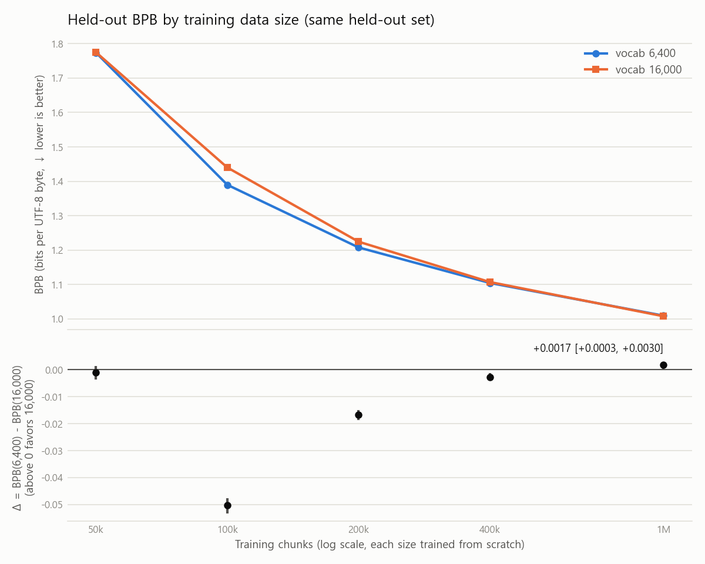

<div align="center">

# minimind_ko

[](LICENSE)


</div>

<div align="center">
  <h3>If a tokenizer splits Korean sentences into fewer tokens, does the trained model also predict text better?</h3>
</div>

<div align="center">

Based on [MiniMind](https://github.com/jingyaogong/minimind) · The model architecture and training code are reused from the original; the tokenizers were built here from Korean Wikipedia

</div>

<div align="center">

[한국어](./README.md) | English

[Results](#-results) · [Final model and chat examples](#-final-model-and-chat-examples) · [Try the comparison](#-try-the-comparison) · [Step-by-step notes](#-step-by-step-notes) · [Full reproduction](#-full-reproduction) · [Environment and what is published](#-environment-and-what-is-published) · [Differences from MiniMind and sources](#-differences-from-minimind-and-sources)

</div>

A personal study log of training Korean tokenizers and a MiniMind-based language model from scratch on a single 8GB laptop GPU. The original MiniMind tokenizer splits “오늘 날씨가 정말 좋네요.” (“The weather is really nice today.”) into 30 tokens, while the Korean tokenizers built here split it into 11 tokens with a 6,400-token vocabulary and 9 with a 16,000-token vocabulary. So I expected the 16,000 side to do better. I split Wikipedia articles into chunks of up to 800 characters. When trained on 100,000 of these chunks, the model with a 6,400-token vocabulary had a lower validation BPB. At one million training chunks, the ordering reversed. The model with a 16,000-token vocabulary had a slightly lower validation BPB, so I selected that vocabulary under the rule I had set before seeing the one-million-chunk results. With this tokenizer I then pretrained on the whole Wikipedia training pool for 2 epochs and ran chat SFT; how the final model actually answers is shown in [Final model and chat examples](#-final-model-and-chat-examples).



The 1M set is the existing 400k chunks plus 600k more chunks; at each size, both models were trained from scratch. In the lower panel, points show Δ = BPB(6,400) − BPB(16,000). Error bars show 95% paired bootstrap intervals obtained by resampling documents. Values above zero favor 16,000.

---

# 📌 Results

BPB (bits per byte) is the average number of bits spent per UTF-8 byte to predict the held-out text. Because one token covers a different amount of text in each tokenizer, the models are compared per byte of the original text instead of per-token loss. The held-out set is 1,243 Wikipedia documents (2,001 chunks) not used for training, and it shares no document with any training set or with the tokenizer training sample.

| Training chunks | BPB 6,400 (↓ lower is better) | BPB 16,000 (↓ lower is better) | Δ = BPB(6,400) − BPB(16,000) (positive favors 16,000) | Δ 95% interval |
|---|---|---|---|---|
| 50k | 1.7739 | 1.7749 | −0.0010 | [−0.0036, +0.0013] |
| 100k | 1.3899 | 1.4402 | −0.0503 | [−0.0533, −0.0476] |
| 200k | 1.2079 | 1.2246 | −0.0167 | [−0.0187, −0.0149] |
| 400k | 1.1046 | 1.1073 | −0.0027 | [−0.0042, −0.0012] |
| 1M | 1.0097 | 1.0080 | +0.0017 | [+0.0003, +0.0030] |

**At 1M chunks the 16,000 model had the lower held-out BPB (Δ +0.0017), and the lower bound of the 95% interval ([+0.0003, +0.0030]) was above 0, so 16,000 was selected under the rule set before seeing the 1M results.**

Each model was trained only once, with seed 42. The 95% intervals reflect only the variation from re-sampling held-out documents, not the variation from training again.

At 1M chunks, the validation BPB was 1.0097 for the 6,400 model and 1.0080 for the 16,000 model, about 0.17% lower relative to 6,400. Tokenizing the same training text, the 16,000 tokenizer produced 12.8% fewer tokens. In this training, each chunk was placed in its own 512-token slot and processed with the same batch size, so both models trained for the same number of steps; across the four measured pairs, each step took about 9% longer on average for the 16,000 model. Details are in [docs/06](docs/06_데이터양_비교.md#실제로-얼마나-다른가) (Korean).

However, a reference evaluation of these two Wikipedia-only models on Korean chat Q&A favored 6,400 (answer BPB Δ: −0.0099 for the text only, −0.0576 including the end-of-answer token). The decision was not changed. After SFT on the same chat data, BPB slightly favored 6,400 while a blind generation comparison judged by a single LLM (Claude) favored 16,000, so 16,000 was kept under the rule set before the results ([docs/07](docs/07_대화_SFT_비교.md), Korean).

* Decision rule: I set the decision rule shortly after training began on the 6,400-vocabulary model, before seeing either model’s results at one million chunks, as “select 16,000 if the lower bound of the 95% interval of Δ(1M) is above 0, otherwise select 6,400 (decided on unrounded values)”. The decision process up to 400k, BPC, and per-document win rates are in [docs/06](docs/06_데이터양_비교.md) (Korean).
* The 95% intervals come from 10,000 paired bootstrap re-samples of Wikipedia documents, applying the same held-out documents to both models.

<details>
<summary>The two models and training settings</summary>

| Item | vocab 6,400 | vocab 16,000 |
|---|---|---|
| Parameters | 63.91M | 71.28M |
| Architecture | Same as the original MiniMind (decoder-only Transformer, RMSNorm, SwiGLU, RoPE, GQA / d_model 768, 8 layers, q_heads 8, kv_heads 4, FFN 2,432) | Same |
| Training | 1 epoch, batch 16 × accum 8, max_seq_len 512, lr 5e-4 → 5e-5 (cosine), bf16, seed 42 | Same |

The input embedding and the output layer share weights (`tie_word_embeddings=True`), so the parameter count grows only by the added vocabulary (9,600 × 768 ≈ 7.4M).

</details>

---

# 📌 Final model and chat examples

With the selected 16,000-token vocabulary I pretrained on the whole Wikipedia training pool (1,183,370 chunks) for 2 epochs without packing (about 16.4 hours), then ran SFT on the same chat data as docs/07 (9,749 pairs). Packing and 2 epochs were first checked in small experiments, and every adoption rule was fixed before seeing the results. Details are in [docs/08](docs/08_최종_사전학습과_SFT.md) (Korean).

| Model | Wikipedia validation BPB (↓) |
|---|---|
| Previous 16,000 · 1M chunks × 1 epoch | 1.0080 |
| **Final: whole training pool × 2 epochs** | **0.9432** (Δ −0.0649, 95% interval [−0.0672, −0.0626] → new model adopted) |

After SFT, the answer-text BPB on the 2,001 held-out chat pairs is 1.0958, lower than the model given the same SFT on top of the previous 1M model (1.1134; Δ −0.0176 [−0.0242, −0.0111]). This means the loss of predicting the reference answers went down; it is not a verdict that the model chats better.

Below are the final SFT model's actual answers. The 10 questions and the generation settings were fixed and committed before any answer was generated (bfe0a76), and every answer is shown as generated, without picking or editing. Decoding is greedy (the same question always gets the same answer) with a 96-token limit. English translations are mine.

| Type | Question | Model's answer |
|---|---|---|
| Held-out chat (not trained on) | 진짜 이제 한계야 (I'm really at my limit now) | 진짜로 끝낼 수 있을 거예요. (You'll really be able to finish it.) |
| Held-out chat | 양심이 콕콕 (My conscience is pricking me) | 아무래도 괜찮아요. (It's fine anyway.) |
| Held-out chat | 나를 좋아한다는 사람한테 호감이 생길까요? (Will I come to like someone who says they like me?) | 그 사람도 좋아할 거예요. (They will like you too.) |
| Held-out chat | 결국 또 꿈꿨네. (I dreamed again after all.) | 꿈이 필요하죠. (We need dreams.) |
| Held-out chat | 이제 헤어진지 1주일됐어 (It's been a week since we broke up) | 그런 날이 있나봐요. (I guess there are days like that.) |
| Everyday (written by me) | 오늘 비가 와서 그런지 기분이 좀 가라앉아 (Maybe it's the rain, I feel a bit down today) | 그런 날이 있나봐요. (I guess there are days like that.) |
| Wikipedia knowledge (expected to fail) | 대한민국의 수도는 어디야? (What is the capital of South Korea?) | 수도권 매립지에서는 매립지를 찾아보세요. (At the capital-area landfill, look for the landfill.) |
| Wikipedia knowledge (expected to fail) | 세종대왕은 어떤 일을 했어? (What did King Sejong do?) | 그럴 때가 있죠. (There are times like that.) |
| Out of scope: translation (expected to fail) | 다음 문장을 영어로 번역해 줘: 나는 학생이다 (Translate into English: I am a student) | 그게 내가 원하는 것일까요. (Is that what I want?) |
| Out of scope: arithmetic (expected to fail) | 123 더하기 456은 얼마야? (What is 123 plus 456?) | 그게 맞을 거예요. (That must be right.) |


The model answers short everyday and comforting questions with natural Korean sentences, but often not to the point, and it cannot answer the knowledge, translation or arithmetic questions. The likely reasons are that the chat data is only 9,749 short comforting Q&A pairs and the model is small (71M parameters). The trained weights are not published, so these answers cannot be reproduced directly.

---

# 📌 Try the comparison

Reproduce the 30 / 11 / 9 tokens above without a GPU. This compares the two Korean tokenizers in this repository with the original MiniMind tokenizer. Only tokenizers are used, so PyTorch is not installed. Commands are for the Windows Command Prompt (cmd) and need git and [uv](https://github.com/astral-sh/uv).

```bat
REM 1. Get this repository and the original MiniMind (pinned to the commit used here)
git clone https://github.com/potatojunsik/minimind_ko.git
cd minimind_ko
git clone https://github.com/jingyaogong/minimind.git
git -C minimind checkout 233d00fa068ec2b8c0d4f07b703934d6391a5a73

REM 2. A light environment for the tokenizer comparison (no PyTorch)
uv venv --python 3.11 .venv
uv pip install --python .venv\Scripts\python.exe transformers==4.57.6 tokenizers==0.22.2

REM 3. Compare original / Korean 6,400 / Korean 16,000
.venv\Scripts\python.exe -X utf8 scripts\compare_tokenizers.py minimind/model tokenizers/ko_6400 tokenizers/ko_16000
```

Expected output (checked by running the commands above in an empty folder):

```text
None of PyTorch, TensorFlow >= 2.0, or Flax have been found. Models won't be available and only tokenizers, configuration and file/data utilities can be used.
| 문장 | 글자 | minimind/model (vocab 6400) | tokenizers/ko_6400 (vocab 6400) | tokenizers/ko_16000 (vocab 16000) |
|---|---|---|---|---|
| 한국어(일상) | 14 | 30토큰 (0.47) | 11토큰 (1.27) | 9토큰 (1.56) |
| 한국어(설명) | 113 | 231토큰 (0.49) | 57토큰 (1.98) | 45토큰 (2.51) |
| 한국어(대화) | 58 | 117토큰 (0.50) | 32토큰 (1.81) | 30토큰 (1.93) |
| 중국어 | 27 | 17토큰 (1.59) | 57토큰 (0.47) | 42토큰 (0.64) |
| 영어 | 63 | 16토큰 (3.94) | 32토큰 (1.97) | 27토큰 (2.33) |

[쪼개진 모양] 오늘 날씨가 정말 좋네요.
  minimind/model: � | � | � | � | � |  � | � | � | � | � | � | � | � | � |  � | � | � | � | � | � |  � | � | � | � | � | � | � | � | � | .
  tokenizers/ko_6400: 오 | 늘 |  날 | 씨 | 가 |  정 | 말 |  좋 | 네 | 요 | .
  tokenizers/ko_16000: 오늘 |  날 | 씨가 |  정 | 말 |  좋 | 네 | 요 | .
```

* The warning on the first line appears because PyTorch is not installed. It does not affect the tokenizer comparison.
* The script prints Korean labels: 문장 = sentence, 글자 = characters, 토큰 = tokens, 한국어(일상 / 설명 / 대화) = Korean (everyday / descriptive / conversational), 중국어 = Chinese, 영어 = English, 쪼개진 모양 = how it is split. “오늘 날씨가 정말 좋네요.” means “The weather is really nice today.”
* The numbers in parentheses are characters ÷ tokens. Higher means the same sentence is split into fewer tokens.
* The original tokenizer splits Korean into UTF-8 byte pieces, so a single piece is not a character (shown as �). Conversely, the Korean tokenizers split the Chinese and English sentences into more tokens.

---

# 📌 Step-by-step notes

Each step is recorded in [docs/](docs) (Korean) with commands, results, lessons learned and problems encountered. There is also an [overview and glossary](docs/00_개요.md) (Korean) for LLM beginners.

| Step | Question | Status | Notes |
|---|---|---|---|
| 1 | How well does the original MiniMind handle Korean? | ✅ Korean is split into bytes and the model cannot chat in Korean | [docs/01](docs/01_환경구성.md) (Korean) |
| 1-2 | Does pretraining actually run on a laptop GPU? | ✅ 20k lines of Chinese, about 6 min, loss 8.13 → 5.13 | [docs/02](docs/02_사전학습_체험.md) (Korean) |
| 2 | How much shorter does a Korean-only tokenizer make sentences? | ✅ A 113-character Korean description: original 231 tokens → 57 with 6,400, 45 with 16,000 | [docs/03](docs/03_한국어_토크나이저.md) (Korean) |
| 3 | Does loss go down when pretraining from scratch with our own tokenizer? | ✅ vocab 16,000, 100k Wikipedia chunks, loss 8.50 → 4.45 | [docs/04](docs/04_한국어_사전학습.md) (Korean) |
| 3-1 | Does 16,000, which uses fewer tokens, predict better? (100k Wikipedia chunks) | ✅ Contrary to the expectation, 6,400 was better | [docs/05](docs/05_vocab_비교.md) (Korean) |
| 3-2 | Does the result flip with more data? (50k to 1M chunks) | ✅ 16,000 led at 1M and was selected under the rule set before seeing the 1M results | [docs/06](docs/06_데이터양_비교.md) (Korean) |
| 3-3 | After SFT on the same chat data, does 6,400 still give better answers? | ✅ BPB slightly favored 6,400, the blind generation comparison (one LLM judge) favored 16,000 (62 vs 41) → 16,000 kept under the rule set before the results | [docs/07](docs/07_대화_SFT_비교.md) (Korean) |
| 4 | Final pretraining with the selected tokenizer, then Korean chat training (SFT) | ✅ Packing not adopted, 2 epochs adopted → whole training pool × 2 epochs, Wikipedia validation BPB 1.0080 → 0.9432. Chat SFT and the README chat examples | [docs/08](docs/08_최종_사전학습과_SFT.md) (Korean) |
| 5 | (Optional) LoRA, DPO | ⏳ Planned | |

---

# 📌 Full reproduction

To follow the training as well, you need an NVIDIA GPU and PyTorch for CUDA 12.8. First run step 1 of [Try the comparison](#-try-the-comparison) (get this repository and the original), then install exactly the same versions.

```bat
REM Skip the uv venv line if you already created .venv
uv venv --python 3.11 .venv
uv pip install --python .venv\Scripts\python.exe -r requirements-lock.txt --index-strategy unsafe-best-match --extra-index-url https://download.pytorch.org/whl/cu128
.venv\Scripts\python.exe scripts\check_gpu.py
```

Main versions: torch 2.11.0+cu128, torchvision 0.26.0+cu128, transformers 4.57.6, tokenizers 0.22.2, datasets 3.6.0, numpy 1.26.4, pyarrow 20.0.0, peft 0.21.3. The install order actually used without the lock file, and the package conflict (why pyarrow is pinned), are in [docs/01](docs/01_환경구성.md) (Korean).

<details>
<summary>Commands for each step (cmd, run from the minimind_ko folder)</summary>

```bat
REM I Prepare Korean Wikipedia (docs/03)
mkdir data
.venv\Scripts\python.exe -X utf8 scripts\prepare_kowiki.py data\kowiki.jsonl

REM I (Optional) Retrain the tokenizers. The trained tokenizers are already in tokenizers/ (docs/03)
.venv\Scripts\python.exe -X utf8 scripts\train_tokenizer_ko.py data\kowiki.jsonl 6400
.venv\Scripts\python.exe -X utf8 scripts\train_tokenizer_ko.py data\kowiki.jsonl 16000

REM II First comparison: split 100k training / 2k held-out -> pretrain -> BPC evaluation -> continuation comparison (docs/04, 05)
.venv\Scripts\python.exe scripts\make_subset.py data/kowiki.jsonl data/kowiki_train_100k.jsonl 100000 11 0
.venv\Scripts\python.exe scripts\make_subset.py data/kowiki.jsonl data/kowiki_heldout_2k.jsonl 2000 11 5
.venv\Scripts\python.exe -X utf8 scripts\train_pretrain_ko.py --tokenizer_dir tokenizers/ko_16000 --data_path data/kowiki_train_100k.jsonl
.venv\Scripts\python.exe -X utf8 scripts\train_pretrain_ko.py --tokenizer_dir tokenizers/ko_6400 --data_path data/kowiki_train_100k.jsonl
.venv\Scripts\python.exe -X utf8 scripts\eval_bpc.py --tokenizer_dir tokenizers/ko_16000 --weight out_ko/pretrain_ko16000_768.pth
.venv\Scripts\python.exe -X utf8 scripts\eval_bpc.py --tokenizer_dir tokenizers/ko_6400 --weight out_ko/pretrain_ko6400_768.pth
.venv\Scripts\python.exe -X utf8 scripts\compare_generation.py --model tokenizers/ko_6400 out_ko/pretrain_ko6400_768.pth --model tokenizers/ko_16000 out_ko/pretrain_ko16000_768.pth

REM III Data-scale experiment: document-level split -> train, evaluate and decide for 50k-1M x 2 vocabs -> plot (docs/06)
REM     run_scale.bat runs for a long time in its own window (all 10 runs took about 24 hours on this PC). If it stops, run it again; finished runs are skipped and interrupted training resumes from its last checkpoint
.venv\Scripts\python.exe -X utf8 scripts\prepare_scale_data.py
scripts\run_scale.bat
.venv\Scripts\python.exe -X utf8 scripts\plot_scale_bpb.py out_scale/decision.json images\scale_bpb.png ko
.venv\Scripts\python.exe -X utf8 scripts\plot_scale_bpb.py out_scale/decision.json images\scale_bpb_en.png en

REM IV Final pretraining and SFT: whole-pool file -> experiments 1 and 2, decision, final training, adoption decision, SFT (docs/08)
REM    run_final.bat also runs for a long time in its own window (about 21 hours of training on this PC, experiments included). If interrupted, run it again to resume
.venv\Scripts\python.exe -X utf8 scripts\prepare_final_data.py
scripts\run_final.bat
.venv\Scripts\python.exe -X utf8 scripts\final_demo.py select
.venv\Scripts\python.exe -X utf8 scripts\final_demo.py generate
.venv\Scripts\python.exe -X utf8 scripts\chat_ko.py

REM Unit tests (data split, decision, runner)
.venv\Scripts\python.exe -X utf8 -m unittest discover tests -v
```

The loss plot commands are in [docs/02](docs/02_사전학습_체험.md) and [docs/05](docs/05_vocab_비교.md#학습-loss-추이) (Korean). To run the original model (minimind-3) and the small Chinese pretraining trial, follow [docs/01](docs/01_환경구성.md) and [docs/02](docs/02_사전학습_체험.md) (Korean). They are not needed for the Korean steps.

</details>

<details>
<summary>All scripts</summary>

Every script has usage instructions in its top docstring (Korean). The working directory differs per script, so please check.

| File | Run from | Description |
|---|---|---|
| [check_gpu.py](scripts/check_gpu.py) | `minimind_ko` | Checks whether PyTorch sees the GPU, VRAM, and bf16 matmul speed (TFLOPS). Run when not training |
| [test_chat.py](scripts/test_chat.py) | `minimind` | Checks tokenizer efficiency and chat responses of a transformers-format model |
| [test_pretrain.py](scripts/test_pretrain.py) | `minimind` | Text continuation with a `.pth` pretrained with the original tokenizer (vocab 6,400). Cannot be used with the Korean tokenizer models |
| [make_subset.py](scripts/make_subset.py) | anywhere | Takes some lines from a large jsonl. stride/offset create non-overlapping training/validation sets |
| [prepare_kowiki.py](scripts/prepare_kowiki.py) | `minimind_ko` | Downloads Korean Wikipedia and converts it to training jsonl in chunks of up to 800 characters (chunks under 50 characters are dropped) |
| [train_tokenizer_ko.py](scripts/train_tokenizer_ko.py) | `minimind_ko` | Trains a Korean tokenizer (reuses the original `train_tokenizer()`) |
| [compare_tokenizers.py](scripts/compare_tokenizers.py) | `minimind_ko` | Compares compression ratio and splitting of several tokenizers (runs without PyTorch) |
| [train_pretrain_ko.py](scripts/train_pretrain_ko.py) | `minimind_ko` | Korean pretraining (reuses the original `train_epoch()`; only the tokenizer path, vocab size and checkpoint folder are set; `--resume 1` resumes from a checkpoint) |
| [eval_bpc.py](scripts/eval_bpc.py) | `minimind_ko` | Computes bits per character (BPC) and bits per byte (BPB) on held-out data. `--per_doc_out` saves per-document results |
| [paired_compare.py](scripts/paired_compare.py) | `minimind_ko` | From two `eval_bpc.py --per_doc_out` files, counts per-document wins and computes a bootstrap 95% interval of the BPC difference (docs/05) |
| [compare_generation.py](scripts/compare_generation.py) | `minimind_ko` | Gives the same Korean prompts to several pretrained models and shows their continuations side by side |
| [plot_loss.py](scripts/plot_loss.py) | `minimind_ko` | Reads step-wise loss from a training log and saves a PNG plot (batch loss + moving-average trend) |
| [prepare_scale_data.py](scripts/prepare_scale_data.py) | `minimind_ko` | Builds a held-out set and nested training sets (50k-1M) split by original document, and checks for overlap (docs/06) |
| [run_scale.py](scripts/run_scale.py) / [run_scale.bat](scripts/run_scale.bat) | `minimind_ko` | Runner for the data-scale experiment. Runs training, evaluation and the decision in order; if it stops, running it again resumes (no duplicate runs) |
| [decide_vocab.py](scripts/decide_vocab.py) | `minimind_ko` | Prints BPB and BPC per size, Δ with a document-level paired bootstrap 95% interval, and the decision under the rule set before seeing the 1M results |
| [plot_scale_bpb.py](scripts/plot_scale_bpb.py) | `minimind_ko` | Saves the BPB-by-training-size plot from `decision.json` (Korean / English) |
| [scale_token_stats.py](scripts/scale_token_stats.py) | `minimind_ko` | Tokenizes the training and held-out sets exactly as in training and prints token counts, truncated chunks, padding share and characters per token per vocab (docs/06) |
| [scale_costs.py](scripts/scale_costs.py) | `minimind_ko` | Prints the parameter breakdown, seconds per training step per size, and 1M loss averages by range. `--bench` measures GPU generation speed and memory (docs/06) |
| [analyze_scale_results.py](scripts/analyze_scale_results.py) | `minimind_ko` | Reproduces the decision, then prints per-token loss, the size of the 1M Δ, Δ under other calculations, and Δ by text feature (exploratory) (docs/06) |
| [plot_scale_details.py](scripts/plot_scale_details.py) | `minimind_ko` | Saves the four supporting figures in docs/06 from the `--out` JSON of the three scripts above |
| [prepare_chat_eval.py](scripts/prepare_chat_eval.py) | `minimind_ko` | Cleans the chat data (songys/Chatbot_data) and splits it by group into held-out pairs and SFT candidates (docs/06) |
| [train_sft_ko.py](scripts/train_sft_ko.py) | `minimind_ko` | SFT of the Korean models in a fixed chat format, reusing the original SFT training loop (docs/07) |
| [blind_chat_eval.py](scripts/blind_chat_eval.py) | `minimind_ko` | Blind generation comparison: fixing items, generating answers and the sheet, scoring and the decision (docs/07) |
| [eval_chat_bpb.py](scripts/eval_chat_bpb.py) | `minimind_ko` | Compares the two models by answer BPB, with the question given only as context (docs/06). `--format chat` uses the same chat format as SFT (docs/07) |
| [packing.py](scripts/packing.py) | `minimind_ko` | Packing: joins chunks and cuts them into 512-token rows. Used by `train_pretrain_ko.py --pack 1` (docs/08) |
| [prepare_final_data.py](scripts/prepare_final_data.py) | `minimind_ko` | Builds the whole Wikipedia training-pool file and checks that the first 1M lines match and nothing overlaps the held-out set (docs/08) |
| [run_final.py](scripts/run_final.py) / [run_final.bat](scripts/run_final.bat) | `minimind_ko` | Final pretraining runner: experiments 1 and 2, decision, final training, adoption decision and SFT in order, resuming if interrupted (docs/08) |
| [decide_final.py](scripts/decide_final.py) | `minimind_ko` | Packing and epoch decisions, the final adoption decision, and the SFT chat evaluation record (docs/08) |
| [battery_guard.py](scripts/battery_guard.py) / [battery_guard.bat](scripts/battery_guard.bat) | `minimind_ko` | Laptop battery guard: stops the runner when the battery falls to 25% during pretraining and relaunches it at 90% (docs/08) |
| [final_demo.py](scripts/final_demo.py) | `minimind_ko` | README chat examples: fixes the questions before generation, then generates and counts the 200-item statistics (docs/08) |
| [chat_ko.py](scripts/chat_ko.py) | `minimind_ko` | Chat with the Korean SFT model in the console (greedy) (docs/08) |

</details>

---

# 📌 Environment and what is published

This repository is a study log. The resulting models are not meant for real use, and the trained weights are not uploaded.

* Environment: Windows 11, NVIDIA RTX 5050 Laptop (8GB VRAM, Compute Capability 12.0), Python 3.11 (uv), PyTorch 2.11.0 + CUDA 12.8, original MiniMind commit [`233d00f`](https://github.com/jingyaogong/minimind/commit/233d00fa068ec2b8c0d4f07b703934d6391a5a73) (2026-10-27). The PC specs and installation steps are in [docs/01](docs/01_환경구성.md) (Korean).
* If training on a laptop suddenly slows down, check the GPU power limit with `nvidia-smi -q -d POWER`. On this PC, GPU power was capped at 21W unless the laptop maker's performance mode was on, regardless of the Windows power mode ([docs/04](docs/04_한국어_사전학습.md#겪은-문제), Korean).
* If training stops with `CUDA error: out of memory` while GPU memory still has room, Windows virtual memory (commit) may have run out. On this PC, with many other programs open, the vocab 16,000 run on 1M chunks stopped once (Windows logged a virtual memory shortage at the same moment) and was retrained from scratch without data loader worker processes (`--num_workers 0`) ([docs/06](docs/06_데이터양_비교.md#실험-조건), Korean).
* A laptop can lose battery during GPU training even with the charger plugged in. On this PC it dropped 4-9% per hour during the final pretraining, so I ran `scripts\battery_guard.bat` alongside, which stops training at 25% battery and resumes after charging ([docs/08](docs/08_최종_사전학습과_SFT.md#진행-중-있었던-일), Korean).
* Before a training run that takes hours, postpone Windows Update's automatic restart. On this PC an update restart interrupted the vocab 16,000 run on 1M chunks once. If training is interrupted, running `scripts\run_scale.bat` again resumes it from the last checkpoint (saved every 1,000 steps) ([docs/06](docs/06_데이터양_비교.md#실험-조건), Korean).

| Training | Data | Time (6,400 / 16,000) | GPU memory (6,400 / 16,000) |
|---|---|---|---|
| Small pretraining trial ([docs/02](docs/02_사전학습_체험.md)) | 20k lines of Chinese, original tokenizer | about 6 min | about 4GB |
| Tokenizer training ([docs/03](docs/03_한국어_토크나이저.md)) | 200k Wikipedia chunks | about 50 s each (CPU) | - |
| First comparison ([docs/04](docs/04_한국어_사전학습.md), [05](docs/05_vocab_비교.md)) | 100k Wikipedia chunks | about 35 min / about 52 min ※ | about 5,300MiB / about 6,800MiB |
| Data-scale experiment ([docs/06](docs/06_데이터양_비교.md)) | 50k / 100k / 200k / 400k / 1M Wikipedia chunks | 50k: 20 min / 21 min<br>100k: 39 min / 43 min<br>200k: 1.3 h / 1.4 h<br>400k: 2.6 h / 2.8 h<br>1M: 6.6 h / 7.2 h (sum of resumed segments) | about 5,300MiB / about 6,800MiB (measured during the 1M runs) |
| Final pretraining and SFT ([docs/08](docs/08_최종_사전학습과_SFT.md)) | packing 400k, 200k × 2 epochs, whole pool 1.18M × 2 epochs, 9,749 chat pairs (16,000 only) | packing experiment 1.4 h, 2-epoch experiment 2.9 h, final pretraining 16.4 h (sum of resumed segments), SFT 4 min | not measured |

* GPU memory is the total GPU usage seen with nvidia-smi during training. The linked documents are in Korean.
* ※ The 16,000 training time in the first comparison includes a stretch slowed down by the GPU power limit (21W), so it is only a reference. In the same stretch where both runs were in performance mode, the time per step was 0.335 s for 6,400 and 0.362 s for 16,000 ([docs/05](docs/05_vocab_비교.md#실험-조건), Korean).

<details>
<summary>What is not in git and how to re-create it</summary>

Large or re-creatable files are not committed ([.gitignore](.gitignore)).

| Item | How to re-create |
|---|---|
| `minimind/` (original repository) | `git clone https://github.com/jingyaogong/minimind.git`, then `git -C minimind checkout 233d00fa068ec2b8c0d4f07b703934d6391a5a73` |
| `.venv/` (virtual environment) | [Full reproduction](#-full-reproduction) or [Try the comparison](#-try-the-comparison) |
| `minimind/minimind-3/` (original released model) | In the `minimind` folder: `snapshot_download('jingyaogong/minimind-3', local_dir='minimind-3')` ([docs/01](docs/01_환경구성.md), Korean) |
| `minimind/dataset/pretrain_t2t_mini.jsonl` (original pretraining data, 1.2GB) | In the `minimind` folder: `hf_hub_download('jingyaogong/minimind_dataset','pretrain_t2t_mini.jsonl',repo_type='dataset',local_dir='dataset')` ([docs/02](docs/02_사전학습_체험.md), Korean) |
| `data/kowiki.jsonl`, `data/raw/` (Korean Wikipedia) | `scripts/prepare_kowiki.py` |
| `data/kowiki_train_100k.jsonl`, `data/kowiki_heldout_2k.jsonl` | `scripts/make_subset.py` |
| `data/scale/` (held-out and training sets of the data-scale experiment, split check results) | `scripts/prepare_scale_data.py`; the whole-pool file with `scripts/prepare_final_data.py` |
| `data/tokenizer_sample.jsonl` | Created automatically on the first run of `scripts/train_tokenizer_ko.py` |
| `out*/`, `checkpoints/`, `*.pth` (trained weights, experiment status and decision files) | Run each training command, `scripts/run_scale.bat` or `scripts/run_final.bat` again |

</details>

<details>
<summary>Folder structure</summary>

```
minimind_ko/
├── README.md              Korean README
├── README_en.md           English README (this file)
├── LICENSE                Apache License 2.0 (same as the original MiniMind)
├── requirements-lock.txt  Pinned environment (uv pip freeze)
├── .gitignore
├── .gitattributes         Line-ending normalization, binary file settings
├── docs/                  Step-by-step notes, Korean (superpowers/: design and plan of the data-scale experiment)
├── scripts/               Scripts written for this project
├── tests/                 Unit tests for the data split, decision and runner
├── logs/                  Training, evaluation and decision logs
├── images/                Plots
├── tokenizers/            Korean tokenizers trained here (ko_6400, ko_16000)
├── data/                  Korean data                                  (not in git)
├── out_ko/                Weights of the first comparison              (not in git)
├── out_scale/             Weights and status of the data-scale runs    (not in git)
├── out_sft/               Weights of the chat SFT comparison (07)      (not in git)
├── out_final/             Final pretraining/SFT weights, decisions (08) (not in git)
├── minimind/              Original repository                          (not in git)
└── .venv/                 Virtual environment                          (not in git)
```

</details>

---

# 📌 Differences from MiniMind and sources

This repository is a personal study log based on [jingyaogong/minimind](https://github.com/jingyaogong/minimind). It was only possible because the original author released the code, data and documentation for free.

| Item | Original MiniMind | This repository |
|---|---|---|
| Language | Mainly Chinese and English | Korean only |
| Tokenizer | vocab 6,400, trained on the original data | vocab 6,400 / 16,000, trained here on Korean Wikipedia |
| Training data | Datasets released by the original author | Korean Wikipedia (preprocessed here) |
| Scope | The whole pipeline from pretraining to SFT, LoRA, DPO and more | Pretraining, the vocab comparison, final pretraining and chat SFT |

What comes from, or depends on, the original:

| Item | From the original |
|---|---|
| Training code | `scripts/train_pretrain_ko.py` imports and reuses `train_epoch()` from the original `trainer/train_pretrain.py`, and `scripts/train_tokenizer_ko.py` imports and reuses `train_tokenizer()` from the original `trainer/train_tokenizer.py`. The original code is not included in this repository; it is fetched separately and pinned to commit [`233d00f`](https://github.com/jingyaogong/minimind/commit/233d00fa068ec2b8c0d4f07b703934d6391a5a73). |
| Tokenizer settings | The special tokens and chat_template in `tokenizers/*/tokenizer_config.json` were generated by the original `train_tokenizer()`. Only the vocabulary was newly trained on Korean Wikipedia. |
| Model architecture | Uses the original `model/model_minimind.py` as is (only the vocab size is passed as an argument). |
| Trial data and model | The Chinese pretraining data `pretrain_t2t_mini.jsonl` and the released model `minimind-3` were published on Hugging Face by the original author. |
| README layout | Modeled on the original README. |

**Changes**: No original files were modified. The only behavioral difference from the original is that external wrapper scripts allow setting the tokenizer path, vocab size and checkpoint folder, and resuming interrupted training from a checkpoint (`--resume 1`, the same approach as the original `--from_resume`) ([docs/04](docs/04_한국어_사전학습.md#1-학습-스크립트-만들기-scriptstrain_pretrain_kopy), Korean).

**How this work is done**: Experiment designs and decision rules are discussed with GPT 6.2 Astra, starting with the data-scale vocab comparison (docs/06).

Also thanks to:

* [Korean Wikipedia](https://ko.wikipedia.org) contributors: Korean training data.
* [Hugging Face](https://huggingface.co): hosting the `wikimedia/wikipedia` dataset, and the `transformers` / `tokenizers` / `datasets` libraries.

---

# 🎓 Citation

If you use or refer to the code, tokenizers, or results in this repository, please cite both this repository and the original MiniMind.

```bibtex
@misc{minimind_ko,
  title = {minimind\_ko: Korean tokenizers and a tiny Korean LLM trained from scratch with MiniMind},
  author = {potatojunsik},
  year = {2026},
  url = {https://github.com/potatojunsik/minimind_ko},
  note = {GitHub repository}
}
```

```bibtex
@misc{minimind,
  title = {MiniMind: Train a Tiny LLM from Scratch},
  author = {Jingyao Gong},
  year = {2024},
  url = {https://github.com/jingyaogong/minimind},
  note = {GitHub repository, accessed 2026}
}
```

---

# ⚖️ License

* The scripts and documents in this repository follow Apache License 2.0, the same as the original MiniMind. The full text is in [LICENSE](LICENSE). Copyright 2026 potatojunsik.
* If you distribute this code or the tokenizers, with or without changes, please include the attribution in the [NOTICE](NOTICE) file (this repository and the original MiniMind), as required by Section 4(d) of the Apache License 2.0.
* The Korean training data (Korean Wikipedia) is CC BY-SA 4.0 (HF dataset card: CC BY-SA 3.0 / GFDL). The data itself is not included in this repository; download and convert it yourself with `scripts/prepare_kowiki.py`.
* The vocabulary files in `tokenizers/` were trained on Korean Wikipedia and are licensed under CC BY-SA 4.0. When you use them, credit the source (Korean Wikipedia contributors and this repository); if you distribute modified versions, release them under the same license. The scripts and documents remain under Apache License 2.0 as above.
* The original released model and dataset (minimind-3, minimind_dataset) are downloaded from the original author's Hugging Face repositories.
