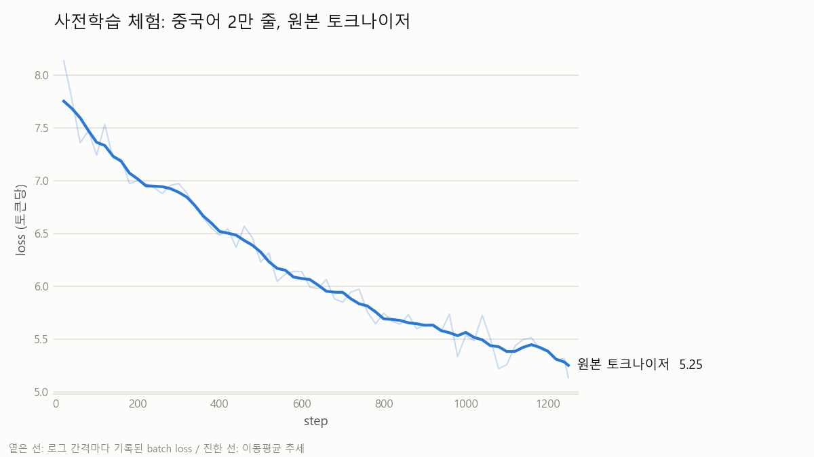

# 02. 작은 데이터로 사전학습 체험

작업일: 2026-11-18

## 목표

- 원본 학습 스크립트(`trainer/train_pretrain.py`)가 내 노트북에서 돌아가는지 확인
- 처음부터(무작위 가중치) 학습했을 때 loss가 내려가고, 모델이 글자를 흉내 내기 시작하는 과정 직접 보기

## 데이터 준비

공식 데이터셋 중 `pretrain_t2t_mini.jsonl`(1.2GB, 약 127만 줄)을 받은 뒤, 앞 2만 줄만 잘라서 사용했다.

```bat
REM 데이터 받기 (minimind 폴더에서: dataset 폴더에 저장됨)
cd /d D:\minimind_ko\minimind
..\.venv\Scripts\python.exe -c "from huggingface_hub import hf_hub_download; hf_hub_download('jingyaogong/minimind_dataset','pretrain_t2t_mini.jsonl',repo_type='dataset',local_dir='dataset')"

REM 앞 2만 줄 자르기 (minimind_ko 폴더에서)
cd /d D:\minimind_ko
.venv\Scripts\python.exe scripts\make_subset.py minimind/dataset/pretrain_t2t_mini.jsonl minimind/dataset/pretrain_small_20k.jsonl 20000
```

(`make_subset.py`는 파일 경로만 맞으면 어디서 실행해도 되지만, 다른 스크립트와 맞춰 minimind_ko 폴더 기준으로 적었다. 결과 파일은 같다.)

데이터 형식은 한 줄에 `{"text": "..."}` 하나이고, 내용은 대부분 중국어다.

## 학습 실행

원본 스크립트는 `minimind\trainer` 폴더 안에서 실행해야 한다. 데이터, 저장 경로(`../dataset`, `../out_test`)와 체크포인트 경로(`../checkpoints`)가 이 폴더 기준 상대 경로로 돼 있기 때문이다.

```bat
cd /d D:\minimind_ko\minimind\trainer
..\..\.venv\Scripts\python.exe -X utf8 train_pretrain.py ^
  --data_path ../dataset/pretrain_small_20k.jsonl ^
  --epochs 1 --batch_size 16 --max_seq_len 340 ^
  --num_workers 4 --log_interval 20 --save_interval 500 ^
  --save_dir ../out_test
```

| 설정 | 값 | 원본 기본값 | 바꾼 이유 |
|---|---|---|---|
| batch_size | 16 | 32 | VRAM 8GB에 맞춤 |
| epochs | 1 | 2 | 체험용이라 짧게 |
| num_workers | 4 | 8 | 노트북 환경 |
| log_interval | 20 | 100 | loss 변화를 자주 보기 위해 |
| save_dir | ../out_test | ../out | 나중에 할 본 학습 결과와 섞이지 않게 |

## 결과

- 모델: 63.9M 파라미터, 처음부터(무작위 가중치) 학습
- 1,250 step, **약 6분** 소요
- GPU 사용률 약 97%, VRAM 약 4GB, 온도 68°C
- 전체 로그: [logs/01_pretrain_small_20k.log](../logs/01_pretrain_small_20k.log)
- 결과 가중치: `minimind/out_test/pretrain_768.pth` (원본 코드가 `minimind/checkpoints/`에도 `pretrain_768.pth`와 이어서 학습용 `pretrain_768_resume.pth`를 함께 저장한다)
- 로그의 `epoch_time`은 이름과 달리 **남은 예상 시간**이다. 그래서 학습 초반에는 크게 나오고(48분) 끝에서는 0분이 된다. 로그에는 시각이 찍히지 않아서, 소요 시간 약 6분은 작업 중에 직접 본 값이다.
- 로그의 `loss`는 그 순간 배치 1개의 값이라 줄마다 오르내림이 있다. 아래 표는 흐름을 보기 위해 몇 개 지점만 뽑은 것이다.

### loss 변화

| step | loss |
|---|---|
| 20 | 8.13 |
| 180 | 6.97 |
| 420 | 6.54 |
| 540 | 6.05 |
| 780 | 5.65 |
| 1020 | 5.48 |
| 1250 | 5.13 |



옅은 선은 로그에 찍힌 batch loss, 진한 선은 이동평균 추세다. 그래프 끝의 값(5.25)은 추세선 값이라 위 표의 마지막 batch loss(5.13)와 다르다. 그래프는 `scripts/plot_loss.py`로 그렸다.

```bat
cd /d D:\minimind_ko
.venv\Scripts\python.exe -X utf8 scripts\plot_loss.py images\loss_pretrain_small_20k.png "사전학습 체험: 중국어 2만 줄, 원본 토크나이저" "원본 토크나이저=logs\01_pretrain_small_20k.log"
```

> 참고: 어휘 6,400개 중 하나를 무작위로 찍으면 loss는 ln(6400) ≈ 8.76이다.
> 시작값 8.13은 거의 "아무것도 모르는" 상태이고, 5.13까지 내려갔다는 것은 어떤 글자가 자주 나오는지, 어떤 글자 다음에 무엇이 오는지를 배우기 시작했다는 뜻이다.

### 문장 이어 쓰기

```bat
cd /d D:\minimind_ko\minimind
..\.venv\Scripts\python.exe -X utf8 ..\scripts\test_pretrain.py out_test/pretrain_768.pth
```

| 입력 | 출력 (앞부분) |
|---|---|
| 秋天的早晨， | 秋天的早晨，一年夜空一，清黄天，一天里秋秋天。好的，那我给我描述你一首诗吗？… |
| 人工智能是 | 人工智能是人工智能的。…自然语言处理、广泛、智能、安全、文化等。人工智能技术在人工智能在… |
| 我最喜欢的食物是 | 我最喜欢的食物是很好。给我介绍一下你想您喜欢… |
| 오늘 날씨가 | 오늘 날씨가，她在天空中，我是我去在我们心”… |

관찰한 점:
- 문법은 엉망이지만 **실제 중국어 단어**(天空, 人工智能, 自然语言处理, 医疗领域)와 문장부호를 제대로 쓴다.
- "人工智能" 다음에 "自然语言处理", "医疗"처럼 **관련 있는 단어를 연결**한다.
- "好的，那我给我描述…"처럼 학습 데이터에 섞여 있던 질문-답변 말투도 따라 한다.
- 한국어로 시작해도 바로 중국어로 넘어간다. 한국어를 전혀 배우지 않았기 때문이다.

## 배운 점

- 사전학습은 결국 "다음 토큰 맞히기"를 반복하는 것이고, loss는 그 예측이 얼마나 틀렸는지를 나타낸다.
- 데이터 2만 줄, 6분 학습만으로도 단어 수준의 패턴은 생긴다. 의미가 통하는 문장을 쓰려면 훨씬 많은 데이터와 시간이 필요하다.
- 모델은 **학습 데이터에 있는 언어만** 쓴다. 한국어 모델을 만들려면 한국어 데이터로 학습해야 한다.
- 노트북 GPU(8GB)로도 64M 모델 학습은 충분히 돌아간다. 전체 mini 데이터(127만 줄)는 단순 계산으로 약 6~7시간 정도로 예상된다.

## 겪은 문제

| 문제 | 원인 | 해결 |
|---|---|---|
| 학습이 바로 끝남 (`pyarrow requires NumPy 2.0`) | numpy 1.26.4 고정과 최신 pyarrow 충돌 | `pyarrow==20.0.0` 설치 ([01번 문서](01_환경구성.md) 참고) |
| 학습 중 로그 파일이 비어 있음 | 출력을 파이프(`\| grep -v warning`)로 넘기면 버퍼링이 두 군데서 생긴다. ① Python은 출력 대상이 콘솔이 아니면 stdout을 모아 두었다가 내보내고, ② grep도 출력 대상이 파일이면 모아 두었다가 내보낸다. 이 첫 실행에는 둘 다 끄지 않았다 | 둘 다 끈다: Python 쪽은 `PYTHONUNBUFFERED=1` 또는 `python -u`, grep 쪽은 `grep --line-buffered` (실제 명령 예는 [04번 문서](04_한국어_사전학습.md#5-실행)) |
