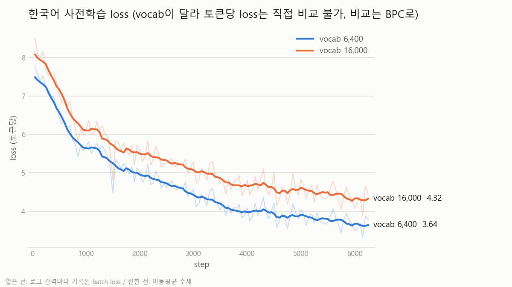

# 05. vocab 6,400 vs 16,000 비교

작업일: 2026-11-18

## 목표

- [03번 문서](03_한국어_토크나이저.md)에서 만든 한국어 토크나이저 두 개(vocab 6,400 / 16,000) 중 어느 쪽이 모델 학습에 더 좋은지 확인한다.
- 토크나이저만 다르고 나머지(데이터, 모델 구조, 학습 설정)는 모두 같게 해서 두 모델을 학습하고, 공정한 지표로 비교한다.

## 왜 loss가 아니라 BPC로 비교하나

학습 로그의 loss는 **토큰 하나를 맞히는 데 드는 어려움**이다. 그런데 두 토크나이저는 토큰 하나의 크기가 다르다.

| 토크나이저 | "오늘 날씨가 정말 좋네요." |
|---|---|
| 6,400 | `오 \| 늘 \| 날 \| 씨 \| 가 \| …` (이 문장은 한 글자씩 쪼개짐. 6,400에도 "인간의", "데이터" 같은 다음절 조각이 3천 개 넘게 있다 — [03 관찰한 점](03_한국어_토크나이저.md#관찰한-점)) |
| 16,000 | `오늘 \| 날 \| 씨가 \| …` (자주 쓰는 단어는 한 덩어리) |

16,000 모델은 한 번에 "오늘"을 맞혀야 하고, 6,400 모델은 "오"와 "늘"을 두 번에 나눠 맞힌다. 한 번에 맞혀야 하는 양이 다르니 **토큰당 loss는 16,000 쪽이 원래 더 높게 나온다.** 시험 문제 수가 다른 두 시험의 "문제당 평균 점수"를 비교하는 것과 같다.

그래서 단위를 **글자**로 맞춘다. 같은 텍스트 전체를 맞히는 데 든 정보량을 합해서 글자 수로 나누면, 토크나이저와 상관없이 비교할 수 있다.

```
BPC (bits per character, 글자당 비트)
  = (텍스트 전체 토큰의 NLL 합, 단위 nats) ÷ ln 2 ÷ (총 글자 수)
```

- NLL: 모델이 정답 토큰에 준 확률의 -log. 모델이 정답을 확신할수록 0에 가깝다.
- ln 2로 나누면 단위가 비트가 된다. "한 글자를 맞히는 데 평균 몇 번의 예/아니오 질문이 필요한가"로 생각하면 된다.
- **낮을수록 좋다.** 같은 텍스트를 더 적은 정보로 맞혔다 = 한국어를 더 잘 예측한다.

### 평가 규칙 (두 토크나이저에 똑같이 적용)

스크립트: [scripts/eval_bpc.py](../scripts/eval_bpc.py)

- 입력은 학습 때와 같은 모양: `[bos] + 텍스트 토큰 + [eos]`
- 예측 대상은 bos **다음**의 모든 토큰 = 텍스트 토큰 전부 + eos 1개. bos는 항상 주어지는 시작 신호라 채점하지 않는다.
- 기본 BPC는 **eos 예측까지 포함**한다(문서가 어디서 끝나는지 아는 것도 정보다). 텍스트 토큰만 채점한 BPC도 따로 출력한다. 두 값의 차이는 0.006 이하라 결론에는 영향이 없다.
- 글자 수는 원문 텍스트의 `len()`(유니코드 글자 수)이다. bos/eos는 글자로 세지 않는다.
- 텍스트를 자르지 않는다. 다만 모델은 학습 때 512 위치까지만 봤으므로, 512토큰이 넘는 조각은 **512토큰 창을 256씩 밀면서** 평가한다(창마다 앞에 bos를 붙이고, 새로 들어온 토큰만 채점). 512 초과 조각은 6,400이 84개, 16,000이 17개다.
  - 창 제한 없이 한 번에 넣어서도 평가해 봤는데 BPC가 소수점 넷째 자리까지 거의 같았다(6,400: 3.2290 → 3.2287, 16,000: 3.2997 → 3.2997). 750토큰 정도까지는 위치 문제가 없었다.
- 가중치는 fp16으로 저장돼 있지만 평가는 fp32로 한다.

## 실험 조건

두 모델 모두 [scripts/train_pretrain_ko.py](../scripts/train_pretrain_ko.py)의 기본 설정 그대로이고, `--tokenizer_dir`만 다르다.

> 이 문서의 명령은 실제 실행에 쓴 **Git Bash** 문법이다. Windows 명령 프롬프트(cmd)용 명령은 [README](../README.md)의 "빠른 시작 → Ⅱ 사전학습 / Ⅲ 평가" 절을 참고한다. Git Bash에서는 경로에 `/`를 쓰고, `PYTHONUNBUFFERED=1 명령`처럼 환경 변수를 앞에 붙일 수 있다.

```bash
cd /d/minimind_ko
PYTHONUNBUFFERED=1 .venv/Scripts/python.exe -X utf8 scripts/train_pretrain_ko.py --tokenizer_dir tokenizers/ko_16000 --data_path data/kowiki_train_100k.jsonl
PYTHONUNBUFFERED=1 .venv/Scripts/python.exe -X utf8 scripts/train_pretrain_ko.py --tokenizer_dir tokenizers/ko_6400 --data_path data/kowiki_train_100k.jsonl
```

| 항목 | vocab 6,400 | vocab 16,000 |
|---|---|---|
| 학습 데이터 | 한국어 위키 10만 조각 (`kowiki_train_100k.jsonl`, 약 5,068만 자), 1 epoch | 같음 |
| 학습 데이터 토큰 수 (512 자른 뒤) | 2,917만 | 2,561만 |
| 512에서 잘린 조각 / 잘려서 못 본 글자 | 4,501개 / 약 33만 자 (0.66%) | 1,292개 / 약 10만 자 (0.19%) |
| step (micro-batch) | 6,250 | 6,250 |
| batch_size × accumulation | 16 × 8 (optimizer 업데이트 약 782번) | 같음 |
| max_seq_len | 512 | 512 |
| learning rate | 5e-4 → 5e-5 (cosine) | 같음 |
| 모델 | hidden 768, 8층, bf16 | 같음 |
| 파라미터 수 | 63.91M | 71.28M |
| GPU 메모리 (nvidia-smi 전체 사용량) | 약 5,310MB | 약 6,770MB |
| step당 시간 (성능 모드, 2,850~6,200 step 구간) | 0.335초 | 0.362초 |
| 총 학습 시간 (참고치) | 약 35분 | 약 52분 (아래 주의 참고) |
| 로그 | [logs/03_pretrain_ko6400_100k.log](../logs/03_pretrain_ko6400_100k.log) | [logs/02_pretrain_ko16000_100k.log](../logs/02_pretrain_ko16000_100k.log) |

> **학습 시간 주의:** 16,000 학습 도중 약 1,700~2,200 step 구간에서 노트북 제조사 전원 모드 때문에 GPU 전력 상한이 21W로 묶여 클럭이 510~630MHz까지 떨어졌다. 성능 모드로 바꾼 뒤(약 2,250 step 이후)에는 55~62W, 약 2,300MHz로 돌아왔다(이 비교 작업에서 30초 간격으로 기록한 값. [docs/04](04_한국어_사전학습.md#겪은-문제)의 55~59W, 2,200~2,280MHz는 전환 직후 몇 초간 확인한 값이라 범위가 조금 다르다). 그래서 **총 학습 시간은 직접 비교할 수 없다.** 대신 두 학습이 모두 성능 모드였던 같은 구간(2,850~6,200 step)의 step당 시간으로 비교했다. 이 속도로 계산하면 16,000도 전체 학습에 약 38분(0.362초 × 6,250)이 걸렸을 것이다(추정치). 학습 품질(BPC)은 같은 step 수, 같은 데이터라 이 문제의 영향을 받지 않는다.

- 학습 데이터는 모두 512로 패딩되므로 step당 계산량은 거의 같다. 16,000이 조금 느린 이유는 출력층(lm_head)이 2.5배 크기 때문이다.
- 반대로 같은 글자를 더 잘게 쪼개는 6,400은 같은 512칸 안에 실제 토큰이 더 많이 들어간다. 그래서 같은 step 동안 **맞힌 토큰 수(학습 신호)는 6,400이 약 14% 더 많다**.

## 결과

### 학습 loss 추이

로그는 50 step마다 한 배치의 loss만 찍어서 들쭉날쭉하다. 그래서 특정 지점 값과 1,000 step 구간 평균을 같이 적는다. **토큰당 loss라서 두 모델 사이에 직접 비교하면 안 된다**(위 설명 참고). 각자 잘 내려가는지만 본다.



```bash
.venv/Scripts/python.exe -X utf8 scripts/plot_loss.py images/loss_pretrain_ko_compare.png "한국어 사전학습 loss (vocab이 달라 토큰당 loss는 직접 비교 불가, 비교는 BPC로)" "vocab 6,400=logs/03_pretrain_ko6400_100k.log" "vocab 16,000=logs/02_pretrain_ko16000_100k.log"
```

| step | 6,400 loss | 16,000 loss |
|---|---|---|
| 50 | 7.766 | 8.496 |
| 500 | 6.467 | 7.044 |
| 1,000 | 5.645 | 6.128 |
| 2,000 | 5.031 | 5.597 |
| 3,000 | 4.568 | 5.282 |
| 4,000 | 4.082 | 4.811 |
| 5,000 | 4.038 | 4.830 |
| 6,000 | 3.496 | 4.068 |
| 6,250 (마지막) | 3.790 | 4.449 |

| 구간 평균 | 6,400 | 16,000 |
|---|---|---|
| 1 ~ 1,000 | 6.526 | 7.074 |
| 1,001 ~ 2,000 | 5.285 | 5.781 |
| 2,001 ~ 3,000 | 4.710 | 5.308 |
| 3,001 ~ 4,000 | 4.155 | 4.818 |
| 4,001 ~ 5,000 | 3.932 | 4.604 |
| 5,001 ~ 6,000 | 3.764 | 4.435 |
| 마지막 500 step | 3.682 | 4.343 |

두 모델 모두 끝까지 loss가 내려가는 중이었다. 아직 덜 학습된 상태라는 뜻이다.

### held-out 평가 (BPC)

학습에 쓰지 않은 검증 조각 2,000개(`kowiki_heldout_2k.jsonl`, 1,257,882자) 전체로 평가했다.

```bash
.venv/Scripts/python.exe -X utf8 scripts/eval_bpc.py --tokenizer_dir tokenizers/ko_6400 --weight out_ko/pretrain_ko6400_768.pth
.venv/Scripts/python.exe -X utf8 scripts/eval_bpc.py --tokenizer_dir tokenizers/ko_16000 --weight out_ko/pretrain_ko16000_768.pth
```

| 지표 | vocab 6,400 | vocab 16,000 |
|---|---|---|
| **BPC (텍스트+eos)** | **3.2290** | 3.2997 |
| BPC (텍스트만) | 3.2234 | 3.2945 |
| 토큰당 loss (텍스트+eos) | 3.8849 | 4.5627 |
| 토큰당 평균 글자 수 | 1.741 | 2.001 |
| 텍스트 토큰 수 | 722,685 | 628,543 |
| 학습 마지막 500 step 평균 loss (참고) | 3.682 | 4.343 |

- **vocab 6,400의 BPC가 0.071 낮다(약 2.1% 좋다).**
- 같은 문서끼리 짝지어 보면 2,000개 중 **1,666개(83%)에서 6,400이 더 낮은 NLL**을 냈다.
- 문서별 우세와 부트스트랩은 `--per_doc_out`으로 저장한 문서별 결과를 [scripts/paired_compare.py](../scripts/paired_compare.py)로 계산한다 (`--per_doc_out` 경로는 `minimind_ko` 폴더 기준이고, `*.jsonl`이라 git에는 올라가지 않는다):
  ```bash
  .venv/Scripts/python.exe -X utf8 scripts/eval_bpc.py --tokenizer_dir tokenizers/ko_6400 --weight out_ko/pretrain_ko6400_768.pth --per_doc_out doc_6400.jsonl
  .venv/Scripts/python.exe -X utf8 scripts/eval_bpc.py --tokenizer_dir tokenizers/ko_16000 --weight out_ko/pretrain_ko16000_768.pth --per_doc_out doc_16000.jsonl
  .venv/Scripts/python.exe -X utf8 scripts/paired_compare.py doc_6400.jsonl doc_16000.jsonl
  ```
  출력: `문서별 A 우세: 1666/2000 (83.3%), 동점 0`, `부트스트랩 2000회 (seed 0) BPC 차이 95% 구간: 0.0675 ~ 0.0740`
- 문서를 다시 뽑는 부트스트랩(2,000회)으로 BPC 차이(16,000 − 6,400)의 95% 구간은 0.068 ~ 0.074였다. 즉 "검증 문서를 어떻게 골랐느냐"에 따른 흔들림보다 차이가 확실히 크다. (단, 학습 시드를 바꿨을 때의 흔들림은 재보지 않았다. 아래 한계 참고)
- 토큰당 loss만 보면 3.88 vs 4.56으로 차이가 훨씬 커 보이지만, 이건 토큰 크기 차이가 섞인 값이라 BPC 쪽이 실제 차이다.

### 이어 쓰기 예시

```bash
.venv/Scripts/python.exe -X utf8 scripts/compare_generation.py --model tokenizers/ko_6400 out_ko/pretrain_ko6400_768.pth --model tokenizers/ko_16000 out_ko/pretrain_ko16000_768.pth
```

설정: seed 0/1(프롬프트마다 2개씩), temperature 0.8, top_p 0.9, top_k 50, repetition_penalty 1.1. vocab마다 토큰 하나의 길이가 달라서 출력은 **100글자**에서 잘라 길이를 맞췄다.

| 프롬프트 | vocab 6,400 | vocab 16,000 |
|---|---|---|
| 대한민국의 수도는 | 동해안에 있다. 역사 1985년 7월 3일 : 상하이 시, 남쪽으로는 동해안에 의해 동해안에 편입되었다. … | 1960년 1월 30일, 중국인민군(FI)에서 제1차 세계 대전 때 소련군에서 제2차 세계 대전에 대항한 영국군은 … |
| | 대한민국의 국무장이다. 각주 외부 링크 대한민국의 대통령 대한민국의 국회의원 목록 … | 1986년 7월 17일에 개봉된 중화민국 베이징에서 열린 제2차 세계 대전과 러시아 연방이 … |
| 인공지능은 | 다음과 같은 뜻이 있다. 인공지능(Infientive https://web.org/…) … | 미국을 위한 인신화 이론에 대한 이력(International Enitecture)의 연구를 수행하고, … |
| | 광범위한 감정을 통해 소멸하는 질병, 기동성, 조경과 같은 일단에는 각료가 없는 … | 다음을 가리킨다. 인공지능 (코즈니) 같이 보기 |
| 조선 시대에는 | ‘조선 시대’이 남아있던 '제6의 나라'가 '공화'로 나뉜다. … | 조선을 위한 국가경제정책(國大民主民會)으로 임명되고, 청나라, 조선의 독립운동운동에서 … |
| | 남해에 조선후기에 이르렀다. 조선 초기에 조선의 종실과 함께 조선의 제후들이 … | 조선 시대에 의해서, 한나라의 제9대 황제(1661년 ~ 1779년)는 조선시대에 세워진 고원이다. 본관은 고흥(高興), … |
| 오늘 날씨가 | 죽은 후, 주친은 전제 강점기(楊濟會)를 보내다가, 제갈량, 한중 양자군에서 … | ‘나는 곳’이 아니냐는 없다.”라고 말했다. 하지만 결국 "내가 … |
| | 한 번에 모르고, "그렇게 나는 일일 기다리는 점, 또 다른 두 가지가 … | 한 번에 '무의지'를 쓴 〈나는 것 같다. 저명한 사람과 동명서 사랑하는 사람들과 … |

- 두 모델 모두 **위키 문체("각주", "외부 링크", "같이 보기", 연도, 한자 병기)는 흉내 내지만 사실과 의미는 맞지 않는다.** "대한민국의 수도는 서울"을 맞힌 모델은 없다.
- 문법과 띄어쓰기 수준은 비슷해 보이고, 이 정도 샘플로는 눈으로 우열을 가리기 어렵다. 우열은 BPC로 판단한다.

## 결론

**이 실험 규모(위키 10만 조각, 1 epoch, 6,250 step)에서는 vocab 6,400이 16,000보다 낫다.**

근거:
1. held-out BPC가 6,400이 3.229, 16,000이 3.300으로 6,400이 약 2% 좋다. 검증 문서의 83%에서 6,400이 이겼다.
2. 파라미터가 7.4M 적고(63.9M vs 71.3M), GPU 메모리도 약 1.5GB 덜 쓰며, step당 약 7% 빠르다.

왜 이렇게 됐는지에 대한 추정 (검증하지는 않았다):
- **토큰마다 배울 기회가 적다.** 16,000은 단어 조각이 2.5배 많은데 데이터는 같아서, 토큰 하나가 학습 중 나오는 평균 횟수가 6,400의 약 1/3이다(2,917만÷6,400 ≈ 4,560번 vs 2,561만÷16,000 ≈ 1,600번). 드문 토큰의 임베딩이 덜 학습됐을 수 있다.
- **같은 step에서 받는 학습 신호가 적다.** 512칸 패딩이라 계산량은 같은데, 6,400은 실제 토큰이 약 14% 더 많아서 그만큼 더 많이 맞히는 연습을 한다.
- 일반적으로 데이터와 학습량이 커지면 큰 vocab이 유리해진다고 알려져 있다. 이번 결과는 "작은 실험에서는 작은 vocab이 낫다"는 것이지 "16,000이 원래 나쁘다"는 뜻이 아니다.

## 한계

- **작은 실험이다.** 데이터 10만 조각(약 5천만 자), 1 epoch이고, loss가 아직 내려가는 중에 끝났다. 더 오래 학습하면 순위가 바뀔 수 있다.
- **학습 시드 1개로만 비교했다.** 부트스트랩 구간은 검증 문서 선택에 따른 흔들림만 반영한다. 시드를 바꿔 다시 학습했을 때 차이가 얼마나 흔들리는지는 모른다.
- **같은 step 수로 맞췄기 때문에 토큰 수는 다르다.** "같은 글자를 보여줬을 때"(같은 데이터)의 비교이고, "같은 토큰 수"로 맞추면 결과가 달라질 수 있다.
- **데이터 분할 문제** (두 모델에 똑같이 적용되므로 둘 사이의 상대 비교는 공정하지만, BPC 절대값은 실제보다 좋게 나왔을 수 있다):
  1. 검증 세트(`kowiki_heldout_2k.jsonl`)는 `make_subset.py`가 2,000줄을 채우면 멈추는 방식이라, 원본 `kowiki.jsonl`의 앞부분(5~21,994번째 줄)에서만 뽑혔다. 위키 전체를 대표하지 않을 수 있다.
  2. 조각(최대 800자) 단위로 나눴기 때문에, 같은 위키 문서의 다른 조각이 학습과 검증에 나뉘어 들어갔을 수 있다(완전히 같은 줄은 0개).
  3. 토크나이저 학습 샘플(앞쪽 0~999,995번째 줄에서 5줄마다 1줄)에 검증 조각 2,000개 중 400개(20%)가 들어 있다.
  - 다음 실험부터는 **문서 단위로** 학습/검증을 나눈다.
- 생성 예시는 프롬프트 4개 × 2샘플뿐이라 품질 판단 근거로는 약하다.

## 이번에 만든 스크립트

| 파일 | 역할 |
|---|---|
| [scripts/eval_bpc.py](../scripts/eval_bpc.py) | held-out BPC, 토큰당 loss, 토큰당 글자 수 계산. `--per_doc_out`으로 문서별 NLL 저장(짝 비교용) |
| [scripts/compare_generation.py](../scripts/compare_generation.py) | 토크나이저/가중치 쌍을 여러 개 받아 같은 시드, 같은 설정으로 이어 쓰기 비교 |
