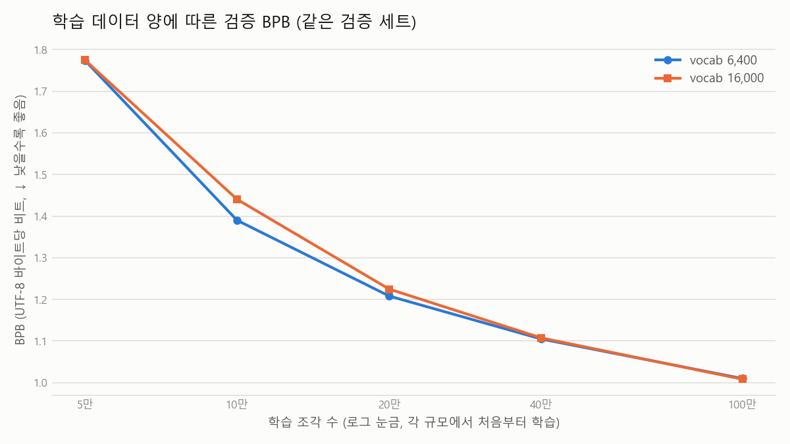
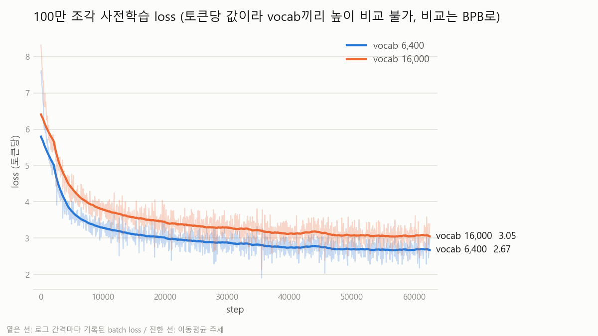

# 06. 데이터 양에 따른 vocab 비교 (5만 ~ 100만 조각)

작업일: 2026-11-18 ~ 2026-11-20

## 목표

- [05번 문서](05_vocab_비교.md)에서는 위키 10만 조각, 1 epoch 조건에서 vocab 6,400이 16,000보다 좋았다. "데이터가 많아지면 큰 vocab이 유리해진다"는 일반론이 이 규모에서도 보이는지 직접 확인한다.
- 목적은 두 가지다.
  1. **결정**: 최종 사전학습과 4단계(SFT)에 쓸 토크나이저(6,400 / 16,000)를 고른다.
  2. **경향 관찰**: 데이터 양이 늘 때 두 vocab의 차이가 어떻게 변하는지 본다.
- 05번 문서의 한계에서 정한 대로 학습/검증을 **원문 문서 단위**로 나누고, 토크나이저 학습 샘플과 겹치지 않는 검증 세트를 쓴다.
- 실험 설계와 판정 규칙은 GPT 6.2 Astra와 상의해서 정했고, 판정 규칙은 결과를 보기 전에 고정했다. 설계와 실행 계획: [설계 문서](superpowers/specs/2026-11-18-data-scale-bpc-design.md), [계획 문서](superpowers/plans/2026-11-18-data-scale-bpc.md).

## 판정 지표: BPB

05번 문서의 BPC(글자당 비트)처럼 토크나이저와 상관없이 비교할 수 있는 지표로, 이번 실험은 **BPB(bits per byte, UTF-8 바이트당 비트)**로 판정한다.

```
BPB = (검증 텍스트 전체 토큰의 NLL 합, 단위 nats) ÷ ln 2 ÷ (총 UTF-8 바이트 수)
BPC = 같은 NLL 합 ÷ ln 2 ÷ (총 글자 수)
```

- 분자(손실 합)는 같고 분모만 다르다. 같은 검증 텍스트에서 두 모델의 바이트 수와 글자 수는 같으므로, **두 모델의 차이 Δ의 부호는 BPB와 BPC가 같고 크기만 비례해서 다르다.** BPC는 05번 문서와 이어 보기 위해 표에 함께 적는다.
- 문서별 BPB의 평균이 아니라 **손실 합 ÷ 바이트 합**이다. 부트스트랩에서도 매번 뽑힌 문서들의 손실 합과 바이트 합으로 다시 나눈다.
- **Δ = BPB(6,400) − BPB(16,000)**. Δ가 양수면 16,000이 앞선다. 05번 문서의 "16,000 − 6,400"과 **부호가 반대**다.
- 평가 방식(입력 모양, eos 포함, 512토큰 창을 256씩 밀기, fp32)은 05번 문서와 같다. [scripts/eval_bpc.py](../scripts/eval_bpc.py)가 BPC와 BPB를 함께 출력한다.

## 데이터 분할 (원문 문서 단위)

스크립트: [scripts/prepare_scale_data.py](../scripts/prepare_scale_data.py) (분할 시드 20261118)

1. 로컬 위키 parquet를 [prepare_kowiki.py](../scripts/prepare_kowiki.py)와 같은 규칙으로 다시 조각내며 원문 문서 id를 붙였다. 결과는 기존 `data/kowiki.jsonl`(문서 647,897개, 조각 1,185,371개)과 줄 단위로 같다.
2. **검증 세트**: 모든 조각이 1,000,000번째 줄 이후에 있는 문서만 후보로 했다. 토크나이저 학습 샘플은 0~999,995번째 줄에서만 뽑혔기 때문이다. 다른 문서와 똑같은 조각 글이 있는 문서는 뺐다. 후보 문서를 섞어 조각이 약 2,000개가 될 때까지 문서 단위로 뽑았다(문서의 조각을 전부 넣음).
3. **학습 세트**: 전체 조각에서 검증 문서의 조각을 모두 뺀 학습 풀을 한 번 섞고, 앞에서부터 5만·10만·20만·40만·100만 조각을 잘랐다. 그래서 작은 세트는 항상 큰 세트의 앞부분이다(100만 세트의 앞 40만 조각 = 40만 세트).

| 확인 항목 | 결과 |
|---|---|
| 검증 세트 | 문서 1,243개, 조각 2,001개, 873,447자, 1,925,591바이트 |
| 평가 텍스트 sha256 (검증 조각 2,001개의 글을 줄바꿈으로 이어 UTF-8로 계산) | `706d5eb07c3d4dead7d191a53bbfd03a74d2c77e594c68a357ea215f8bcf0212` |
| 검증 조각과 같은 글이 토크나이저 학습 샘플(20만 줄)에 있는 경우 | 0개 |
| 검증 문서의 조각이 토크나이저 학습 샘플에 들어간 경우 | 0개 |
| 학습 세트 5개(5만~100만)와 검증 세트의 겹침 (문서 id / 같은 글) | 모두 0개 / 0개 |
| (참고) 05번 문서의 학습 세트 `kowiki_train_100k.jsonl`에 검증 조각과 같은 글이 있는 경우 | 87개 (이번 실험의 학습에는 쓰지 않음) |

확인 결과는 `data/scale/split_report.json`에 저장된다(`data/`는 git에 올리지 않는다).

sha256은 내용을 64자리 확인값으로 줄인 것으로, 내용이 한 글자만 달라도 완전히 다른 값이 된다. 10개 평가 모두 이 값이 같았다(평가 로그 `logs/06_scale_*_eval.log`의 `평가 텍스트 sha256:` 줄, `out_scale/status.json`의 `eval_sha256`). 실행기 `run_scale.py`는 기대값을 그때 디스크에 있는 `heldout.jsonl`에서 계산하므로, 평가가 지금 파일과 같은지만 확인하고 이 문서에 실린 값과 같은지는 확인하지 않는다. `prepare_scale_data.py`로 데이터를 다시 만들었다면, 오래 걸리는 학습 전에 아래 명령으로 이 표의 값과 같은지 확인한다(출력: 조각 수와 sha256).

```bat
.venv\Scripts\python.exe -X utf8 -c "import hashlib, json; t = [json.loads(l)['text'] for l in open('data/scale/heldout.jsonl', encoding='utf-8')]; print(len(t), hashlib.sha256(chr(10).join(t).encode('utf-8')).hexdigest())"
```

**이렇게 나눈 이유** ([설계 문서](superpowers/specs/2026-11-18-data-scale-bpc-design.md)에 적힌 것)

- 작은 학습 세트는 큰 학습 세트의 앞부분이고, 검증 세트는 모든 크기에 같은 것을 쓴다. 데이터 양 말고 다른 조건(어떤 글로 학습했는지, 무엇으로 평가하는지)이 크기마다 함께 바뀌지 않게 하려는 것이다. 학습 풀을 한 번 섞은 뒤 앞에서부터 잘랐으므로 작은 세트도 파일 앞쪽 글에 몰리지 않는다.
- 검증 세트는 토크나이저 학습 샘플과 떼어 놓았다. 토크나이저가 본 글이 검증에 섞이면 어휘가 많은 16,000 쪽이 그 글을 더 잘 외워 유리해질 수 있다. 두 vocab을 비교하는 데는 이 독립이 더 중요하다고 보고, 파일 뒤쪽 문서만 쓰는 치우침(아래 한계)을 감수했다.

## 실험 조건

모든 실행이 [scripts/train_pretrain_ko.py](../scripts/train_pretrain_ko.py)의 기본 설정 그대로이고, `--tokenizer_dir`와 `--data_path`만 다르다(저장 위치 `--out_dir`, `--ckpt_dir`는 실행마다 따로 둔다). 05번 문서와 같은 설정이다: hidden 768, 8층, max_seq_len 512, batch 16 × accum 8, lr 5e-4 → 5e-5 (cosine), bf16, seed 42, 1 epoch. 파라미터 수는 6,400이 63.91M, 16,000이 71.28M이다.

데이터 로더 작업 프로세스 수(`--num_workers`)는 실제로는 16,000·100만 재시도만 0이었고 나머지 9개는 기본값 4였다(아래 첫 시도 설명 참고). 지금의 [scripts/run_scale.py](../scripts/run_scale.py)는 모든 학습에 0을 넘기므로 다시 돌리면 10개 모두 0으로 도는데, 데이터 순서와 배치 내용은 같아서 결과도 같을 것으로 보고(아래 첫 시도와 재시도의 loss 비교) 학습 속도만 다를 수 있다.

**크기마다 처음부터 따로 학습한 이유** ([설계 문서](superpowers/specs/2026-11-18-data-scale-bpc-design.md#접근-방식-검토한-것)): 가장 큰 데이터로 한 번만 학습하고 중간 저장본을 크기별로 평가하는 방법도 검토했다. 하지만 학습률(lr)은 학습이 끝날 때까지 코사인 모양으로 줄어들도록 짜여 있어서, 중간 저장본은 lr이 덜 내려간 상태라 같은 양을 끝까지 학습한 모델보다 불리하게 나온다. 결정 근거로 쓰려고 크기마다 lr 스케줄이 끝까지 가도록 따로 학습했다.

크기마다 6,400 → 16,000 순서로, 실행기 [scripts/run_scale.py](../scripts/run_scale.py) 하나가 학습과 평가를 차례로 돌렸다.

- 학습 완료는 "종료 코드 0 + 로그의 `완료:` 줄"일 때만 인정했다. 원본 `train_epoch()`가 학습 도중에도 같은 이름으로 가중치를 저장하기 때문에, 가중치 파일이 있다고 학습이 끝난 것은 아니다.
- 평가는 조각 수와 평가 텍스트 sha256이 기대값과 같을 때만 기록했다. 10개 모델 모두 같은 2,001조각을 평가했다.
- 끊기면 [scripts/run_scale.bat](../scripts/run_scale.bat)을 다시 실행해 끝난 실행은 건너뛰고, 학습 중에 끊긴 실행은 1,000 step마다 저장한 체크포인트에서 이어서 학습한다(체크포인트가 없거나 평가 중에 끊겼으면 처음부터 다시 학습).
- 16,000·100만은 첫 시도가 6,050 step을 넘긴 직후(2026-11-19 16:19) `CUDA error: out of memory`로 멈췄다. 같은 시각 Windows 이벤트 로그에 '가상 메모리 부족'이 기록됐다(이 PC의 커밋 한도는 RAM 32GB + 페이징 파일 32GB, 약 63.5GB). 가상 메모리를 가장 많이 쓴 프로세스는 python.exe 세 개(11.1GB, 2.2GB, 2.2GB)로, 학습 본 프로세스와 데이터 로더 작업 프로세스로 보인다. 학습이 멈춘 뒤에도 함께 켜 둔 다른 프로그램들이 약 45GB를 쓰고 있었다. 학습 중 잰 GPU 메모리는 약 6.8GB(8GB 중)였다. 그래서 실행기가 학습 스크립트에 `--num_workers 0`을 넘기도록 바꿔(작업 프로세스 없이 본 프로세스에서 데이터를 읽음) 처음부터 다시 학습했다. 데이터 순서(본 프로세스의 `randperm`)와 배치 내용은 작업 프로세스 수와 상관없다. 첫 시도와 겹치는 50~6,050 step의 loss 기록 121개가 재시도와 (로그에 찍힌 소수 넷째 자리까지) 모두 같았다. 첫 시도 로그: [logs/06_scale_ko16000_n1000000_attempt1_oom.log](../logs/06_scale_ko16000_n1000000_attempt1_oom.log).
- 16,000·100만 재시도는 도중에 두 번 더 끊겼다. 2026-11-19 17:29에는 8,500 step에서 노트북 배터리가 부족해(충전기를 꽂은 상태에서도 학습 중에는 배터리가 줄었다) 학습 프로세스를 일시정지했는데, 그 직후 PC가 블루스크린으로 멈췄다(원인은 확인하지 못했다). 20:59에는 21,900 step에서 Windows 업데이트가 PC를 자동으로 다시 시작했다. 첫 번째 중단 뒤 학습 스크립트에 이어서 하기(`--resume 1`)를 추가했다. 1,000 step마다 저장한 체크포인트에서 모델·옵티마이저·스케일러·epoch·step을 되살리고, 시드로 고정된 데이터 순서에서 이미 학습한 배치만 건너뛴다. 실행기는 학습 중에 끊긴 실행에 체크포인트가 있으면 이 옵션으로 이어서 학습한다(위 첫 시도 때는 이 기능이 없어 처음부터 다시 학습했다). 그래서 8,001 step, 21,001 step부터 이어서 학습했고, 끊기기 전 기록과 겹치는 8,050~8,500 step, 21,050~21,900 step의 loss 기록 28개가 (로그에 찍힌 소수 넷째 자리까지) 모두 같았다.

| 학습 조각 수 | step | 6,400 학습 시간 | 16,000 학습 시간 | 학습 로그 |
|---|---|---|---|---|
| 5만 | 3,125 | 19.8분 | 21.5분 | [6,400](../logs/06_scale_ko6400_n50000.log) / [16,000](../logs/06_scale_ko16000_n50000.log) |
| 10만 | 6,250 | 39.1분 | 42.6분 | [6,400](../logs/06_scale_ko6400_n100000.log) / [16,000](../logs/06_scale_ko16000_n100000.log) |
| 20만 | 12,500 | 1시간 18분 | 1시간 26분 | [6,400](../logs/06_scale_ko6400_n200000.log) / [16,000](../logs/06_scale_ko16000_n200000.log) |
| 40만 | 25,000 | 2시간 36분 | 2시간 47분 | [6,400](../logs/06_scale_ko6400_n400000.log) / [16,000](../logs/06_scale_ko16000_n400000.log) |
| 100만 | 62,500 | 6시간 39분 | 7시간 12분 | [6,400](../logs/06_scale_ko6400_n1000000.log) / [16,000](../logs/06_scale_ko16000_n1000000.log) |

- 시간은 실행기가 기록한 학습 시작·종료 시각의 차이다(평가는 실행마다 1분 안팎). 16,000·100만은 실제로 학습이 돈 세 구간의 합이다(멈춰 있던 시간은 빼고, 끊긴 뒤 다시 계산한 약 1,400 step은 포함). 끊긴 시각은 일시정지 기록과 Windows 이벤트 로그에서 가져왔다.
- GPU 메모리(nvidia-smi 전체 사용량): 6,400은 약 5,309MiB, 16,000은 약 6,773MiB (둘 다 100만 학습 중 측정).

```bat
.venv\Scripts\python.exe -X utf8 scripts\prepare_scale_data.py
scripts\run_scale.bat
```

**디스크 용량** (2026-11-20 측정. 1GB = 10억 바이트 기준이라 Windows 탐색기에는 조금 작게 보인다. `data/`와 `out_scale/`은 git에 올리지 않는다)

| 위치 | 크기 | 내용 |
|---|---|---|
| `data/scale/` | 약 2.0GB | 검증 세트, 학습 세트 6개(시험 실행용 2천 조각 포함), 학습 조각의 문서 id 목록, `split_report.json` |
| `out_scale/` 전체 | 약 11.5GB | 실행 10개 폴더, `status.json`, `decision.json`(최종 판정), `decision_400k.json`(40만 판정 시점) |
| 실행 폴더의 `pretrain_ko<V>_768.pth` | 6,400 약 138MB / 16,000 약 167MB | 최종 가중치(fp16). 평가와 생성에 쓴다 |
| 실행 폴더의 `per_doc.jsonl` | 약 143KB | 조각별 NLL. `decide_vocab.py`가 읽는다 |
| `checkpoints/pretrain_ko<V>_768.pth` | 위와 같은 크기 | 마지막 step에 함께 저장된 가중치. 실행 폴더의 가중치와 값이 같다 |
| `checkpoints/pretrain_ko<V>_768_resume.pth` | 6,400 약 787MB / 16,000 약 905MB | 끊긴 학습을 이어서 마칠 때 쓰는 파일: fp32 모델, 옵티마이저 상태, epoch·step |
| `checkpoints/` 폴더 10개 합 | 약 10.0GB | |

- `status.json`에서 `state`가 `done`인 실행은 `out_scale/ko<V>_n<N>/checkpoints/` 폴더를 지워도 이 문서의 결과를 다시 내는 데 지장이 없다. `run_scale.py`는 done인 실행을 건너뛰고, 체크포인트는 학습 중에 끊긴 실행을 같은 설정으로 이어서 마칠 때만 찾는다. `decide_vocab.py`는 `status.json`에 적힌 `per_doc.jsonl`만 읽고, 다시 평가할 때는 실행 폴더의 가중치를 쓴다.
- 10개 모두 지우면 약 10.0GB가 줄고 `out_scale/`에는 약 1.5GB가 남는다.
- 실행 폴더의 가중치와 `per_doc.jsonl`, `status.json`, `decision.json`, `decision_400k.json`은 지우지 않는다.

## 판정 규칙 (결과를 보기 전에 정함)

**40만 기준** (2026-11-18 확정, 학습 시작 전). 위에서부터 차례로 적용한다.

1. Δ(40만)의 95% 구간 하한 > 0 → 16,000 선택.
2. Δ(40만) < 0 이고, `Δ(40만) − Δ(20만)`의 95% 구간 하한 > 0 → 100만 조각 실험을 추가할지 사용자에게 먼저 묻는다.
3. 그 밖 → 6,400 선택.

**100만 추가 후 최종 선택** (2026-11-19 09:00 확정, 100만 결과 확인 전).

- Δ(100만)의 95% 구간 하한 > 0이면 16,000, ≤ 0이면 6,400을 선택한다. 경계는 반올림 전 값으로 판정한다.
- 구간에 0이 포함되면 "16,000의 우위가 확인되지 않아 사전 규칙에 따라 6,400을 선택했다"고 적는다.
- `Δ(100만) − Δ(40만)`과 그 구간은 경향 설명용으로만 본다. 토크나이저 비교 실험은 100만에서 마무리한다.

**95% 구간**: 같은 검증 문서를 두 모델에 짝지어 **위키 문서 단위**로 복원추출(10,000회, seed 0)한 백분위 구간이다. 한 번 뽑은 문서 목록을 모든 모델에 똑같이 적용한다. 검증 세트는 한 문서의 조각을 모두 넣었기 때문에, 조각 단위로 뽑으면 구간이 실제보다 좁게 나온다.

## 결과

```bat
.venv\Scripts\python.exe -X utf8 scripts\decide_vocab.py --status out_scale/status.json --heldout data/scale/heldout.jsonl
```

| 학습 조각 수 | BPB 6,400 ↓ | BPB 16,000 ↓ | Δ BPB (6,400 − 16,000) | Δ 95% 구간 | BPC 6,400 ↓ | BPC 16,000 ↓ | 6,400 우세 (조각 / 문서) |
|---|---|---|---|---|---|---|---|
| 5만 | 1.7739 | 1.7749 | −0.0010 | [−0.0036, +0.0013] | 3.9108 | 3.9130 | 51.8% / 54.9% |
| 10만 | 1.3899 | 1.4402 | −0.0503 | [−0.0533, −0.0476] | 3.0641 | 3.1751 | 90.4% / 87.8% |
| 20만 | 1.2079 | 1.2246 | −0.0167 | [−0.0187, −0.0149] | 2.6629 | 2.6997 | 72.3% / 72.2% |
| 40만 | 1.1046 | 1.1073 | −0.0027 | [−0.0042, −0.0012] | 2.4353 | 2.4412 | 53.2% / 53.4% |
| 100만 | 1.0097 | 1.0080 | +0.0017 | [+0.0003, +0.0030] | 2.2261 | 2.2223 | 44.4% / 43.0% |

95% 신뢰구간은 검증 문서 표본에 따른 변동을 나타낸다. 학습 시드에 따른 변동은 포함하지 않는다(모델마다 한 번씩 학습).

- 6,400 우세: 같은 조각(또는 같은 문서)에서 6,400의 손실이 더 작았던 비율.
- 판정 로그: [logs/06_scale_decision.log](../logs/06_scale_decision.log) (100만 포함 최종), [logs/06_scale_decision_400k.log](../logs/06_scale_decision_400k.log) (40만 판정 시점). 실행별 학습·평가 로그는 `logs/06_scale_ko<vocab>_n<조각 수>.log`, `logs/06_scale_ko<vocab>_n<조각 수>_eval.log`다.



```bat
.venv\Scripts\python.exe -X utf8 scripts\plot_scale_bpb.py out_scale/decision.json images\scale_bpb.png ko
.venv\Scripts\python.exe -X utf8 scripts\plot_scale_bpb.py out_scale/decision.json images\scale_bpb_en.png en
```

### 40만 판정: 판정 2 → 100만 추가

- Δ(20만) = −0.0167 [−0.0187, −0.0149]
- Δ(40만) = −0.0027 [−0.0042, −0.0012]
- Δ(40만) − Δ(20만) = +0.0140 [+0.0125, +0.0157]

40만에서도 6,400이 앞섰지만(Δ(40만)의 구간 전체가 음수), 20만 → 40만 사이에 격차가 16,000 쪽으로 줄어든 폭의 구간 하한이 0보다 커서 판정 2에 해당했다. 규칙대로 100만 조각 실험을 추가할지 사용자에게 먼저 물었고, 사용자가 승인했다(2026-11-19). 100만 학습 파일은 같은 시드로 섞은 학습 풀의 앞 100만 조각이고, 검증 세트와 설정은 그대로다.

### 100만 결과와 최종 선택

- Δ(100만) = +0.0017 [+0.0003, +0.0030]
- 반올림 전 값: Δ +0.001707, 95% 구간 [+0.000274, +0.002970]. Δ의 크기는 6,400 BPB의 약 0.17%다.
- Δ(100만) − Δ(40만) = +0.0044 [+0.0031, +0.0056] (경향 설명용). 40만 → 100만 사이에도 차이가 16,000 쪽으로 움직였다.

**100만 조각에서는 16,000 모델의 검증 BPB가 더 낮았고(Δ +0.0017), 95% 구간([+0.0003, +0.0030])의 하한이 0보다 커서 사전 규칙에 따라 16,000을 선택했다.**

### 0.17%는 어느 정도인가

이 절과 [결론은 얼마나 튼튼한가](#결론은-얼마나-튼튼한가), [토큰당 손실로 보면](#토큰당-손실로-보면), [어떤 글에서 차이가 났나](#어떤-글에서-차이가-났나-탐색적-분석)의 숫자는 모두 아래 스크립트로 다시 계산한다. 새 학습이나 평가 없이, 저장된 조각별 평가 결과(`per_doc.jsonl`)만 읽는다(1~2분). 먼저 판정 결과(5개 크기의 Δ와 95% 구간)를 그대로 재현하는지 확인하고, 다르면 멈춘다.

```bat
.venv\Scripts\python.exe -X utf8 scripts\analyze_scale_results.py
```

100만 조각에서 16,000이 앞선 폭(Δ +0.0017 BPB)은 6,400 BPB(1.0097)의 약 0.17%다. 몇 가지 기준에 견주어 보면 다음과 같다.

| 기준 | 6,400 | 16,000 | 차이 |
|---|---|---|---|
| 검증 세트 전체(873,447자, 1,925,591바이트)의 손실 합을 비트로 | 1,944,356.5비트 | 1,941,069.6비트 | 3,286.9비트 (약 411바이트) |
| 1,000자당 비트 (= BPC × 1,000) | 2,226.1비트 | 2,222.3비트 | 약 3.8비트 |
| 6,400이 40만 → 100만에서 좋아진 폭(0.0949 BPB)에 비하면 | | | 약 1.8% |
| 10만에서 6,400이 앞선 폭(Δ −0.0503)에 비하면 | | | 약 1/29 |
| 6,400이 BPB를 Δ만큼 낮추는 데 필요한 학습 조각 (거친 추정) | | | 약 2% 더 (100만 기준 약 1만 7천 ~ 2만 2천 조각) |

- **손실 합을 비트로 바꾼 값**은 그 모델로 글을 압축할 때 이론상 압축 크기에 해당한다. 6,400 모델로 검증 글 전체를 압축하면 약 243,045바이트, 16,000 모델은 약 242,634바이트가 된다. 그 차이가 약 411바이트다.
- **거친 추정 방법**: 6,400의 BPB를 log(조각 수) 눈금에 놓고, 100만 지점의 기울기로 BPB를 0.0017 낮추려면 조각 수를 몇 % 늘려야 하는지 계산했다. 40만·100만 두 점을 직선으로 이으면 약 1.7%(16,619조각)다. 그런데 기울기는 데이터가 늘수록 완만해지고 있다(20만→40만 −0.149, 40만→100만 −0.104). 그래서 두 점 직선은 필요한 양을 작게 잡을 가능성이 크다. 20만·40만·100만 세 점을 지나는 곡선의 100만 지점 기울기를 쓰면 약 2.2%(22,201조각)다. 두 방법 모두 몇 개 점으로 그은 어림이고, 100만 너머에서 어떻게 될지는 모른다. 여기서는 "몇 % 수준"이라는 크기 감각으로만 쓴다.
- 정리하면, 100만 조각에서 vocab을 16,000으로 바꿔 얻은 이득은 6,400 모델에 학습 데이터를 2% 정도 더 준 것과 비슷한 작은 크기다. 다만 같은 검증 문서에서 두 모델을 짝지어 잰 차이라, 작아도 95% 구간 하한이 0보다 컸다(다음 절).
- BPB 말고 실제로 달라지는 점(같은 글의 토큰 수, 학습·생성 속도, 메모리)은 [실제로 얼마나 다른가](#실제로-얼마나-다른가)에 있다.

### 결론은 얼마나 튼튼한가

판정은 한 가지 계산 방식(전체 손실 합 ÷ 바이트 합, 문서 단위 부트스트랩 10,000회, seed 0)으로 했다. 계산 방식을 바꿔도 같은 방향이 나오는지 100만 결과로 확인했다. **이 절의 점검은 100만 결과를 본 뒤 정한 것이다(탐색적 분석: 결과를 본 뒤 정한 분석이라 판정 근거가 아니다).** 판정을 다시 하는 것이 아니라, 판정이 계산 방식 하나에만 기대고 있지 않은지 보는 점검이다. 그래서 결론에 유리한 점검만 고르지 않도록, 결론에 가장 불리하게 문서를 빼는 계산도 함께 실었다. 구간은 모두 판정과 같은 문서 단위 부트스트랩 10,000회의 95% 구간이다.

| 계산 방식 | Δ (100만) | 95% 구간 | 참고 |
|---|---|---|---|
| 판정 방식: 전체 손실 합 ÷ 바이트 합 | +0.0017 | [+0.0003, +0.0030] | 부트스트랩 10,000번 중 Δ ≤ 0은 103번 (1.0%) |
| 문서마다 같은 무게: 문서별 Δ의 평균 | +0.0027 | [+0.0010, +0.0043] | 문서별 Δ의 중앙값 +0.0036, 16,000이 나은 문서 57.0% |
| 가장 큰 문서 빼기 (91조각, 검증 바이트의 6.9%) | +0.0016 | [+0.0001, +0.0030] | 남은 1,242개 문서로 다시 복원추출 |
| 부트스트랩 seed 0~9 (10개) | +0.0017 | 하한 +0.00026 ~ +0.00034<br>상한 +0.00297 ~ +0.00301 | 10개 seed 모두 하한 > 0 |
| 텍스트만 (조각 끝 eos 예측 빼기) | 약 +0.0015 | 계산하지 않음 | 평가 로그의 BPC(텍스트만) 2.2210 / 2.2177에서 바꾼 값 |

- **Δ ≤ 0인 회차 1.0%**: 검증 문서를 다시 뽑는 흉내(부트스트랩)에서 부호가 바뀐 회차의 비율이다. "16,000이 실제로 더 나쁠 확률 1%"라는 뜻은 아니다.
- **문서마다 같은 무게**: 판정 방식에서는 바이트가 많은 문서일수록 무게가 크다. 문서마다 Δ를 따로 구해 평균하면 짧은 문서도 긴 문서와 같은 무게를 갖는다. 이렇게 보면 Δ가 오히려 커진다. 이 검증 세트에서는 짧은 문서에서 Δ가 더 컸다는 뜻이다(아래 탐색적 분석의 길이 구간과 같은 방향이지만, 그 길이 대비 자체는 0과 구별되지 않았다).
- **seed 0~9**: seed는 부트스트랩에서 문서를 뽑는 순서만 바꾼다. 데이터나 모델을 바꾸는 점검이 아니라, 10,000회가 충분해서 구간 끝자리가 거의 흔들리지 않는지 보는 확인이다.
- **텍스트만**: 평가에서는 조각 끝을 알리는 eos 토큰을 맞히는 것도 점수에 넣었다(05번 문서와 같은 규칙). eos를 빼도 Δ는 약 +0.0015로 방향이 같다. 로그 값으로 보면 Δ BPC가 eos 포함 +0.0038, 텍스트만 +0.0033이라, Δ의 약 1/8은 조각 끝을 맞히는 데서 나왔다(대략값). 조각별 결과 파일에는 eos 몫이 따로 저장되지 않아 이 경우만 구간을 계산하지 못했고, 로그 값이 소수 넷째 자리까지라 Δ도 대략값이다.
- **기여가 큰 문서 빼 보기**: 문서마다 두 모델의 비트 차이를 구하면, 16,000이 나은 문서 709개의 합은 +13,090비트, 6,400이 나은 문서 534개의 합은 −9,803비트다. 둘이 상쇄되고 남은 +3,287비트가 Δ다. 남은 차이가 작아서, 어느 쪽이든 기여가 큰 문서 몇 개를 빼면 Δ가 크게 움직인다.
  - 결론에 불리하게: 16,000 쪽 기여가 큰 문서부터 빼면 20개(문서의 1.6%, 검증 바이트의 22.2%)를 뺐을 때 부호가 뒤집힌다. 문서 수로는 1.6%인데 바이트로는 22%일 만큼 긴 문서들이다.
  - 반대로: 6,400 쪽 기여가 큰 문서 20개(검증 바이트의 8.5%)를 빼면 Δ는 +0.0035로 약 두 배가 된다.

정리하면 다음과 같다.

- 계산 방식을 바꿔도 Δ는 모두 양수였고, 구간을 계산한 경우는 하한도 모두 0보다 컸다. 문서의 57%에서 16,000이 앞서, 몇몇 문서만의 결과도 아니다.
- 다만 하한이 0에 가깝고(+0.0001 ~ +0.0003), 상쇄되고 남은 차이가 작아서 기여가 큰 문서 20개를 골라 빼면 부호가 바뀐다. 이 결과가 말할 수 있는 범위는 "이 검증 세트에서 16,000이 근소하게 앞섰고, 검증 문서를 어떻게 뽑았느냐에 따른 흔들림만으로는 설명하기 어렵다"까지다.
- 여기 구간은 모두 검증 문서를 다시 뽑았을 때의 흔들림만 반영한다. 학습 시드를 바꿔 다시 학습했을 때의 흔들림은 여전히 모른다([한계](#한계)).

### 학습 loss 추이 (100만)

로그는 50 step마다 batch 하나(16조각)의 loss만 찍어서 출렁임이 크다. 그래서 그래프와 함께 구간 평균을 적는다. **토큰당 loss라서 두 vocab의 높이를 직접 비교하면 안 된다.** 어느 쪽이 나은지는 위의 BPB로만 본다.



옅은 선은 로그에 찍힌 batch loss, 진한 선은 이동평균 추세다. 그래프 끝의 값(2.67 / 3.05)은 추세선 값이라 아래 표의 마지막 구간 평균(2.691 / 3.077)과 조금 다르다.

```bat
.venv\Scripts\python.exe -X utf8 scripts\plot_loss.py images\scale_loss_1m.png "100만 조각 사전학습 loss (토큰당 값이라 vocab끼리 높이 비교 불가, 비교는 BPB로)" "vocab 6,400=logs\06_scale_ko6400_n1000000.log" "vocab 16,000=logs\06_scale_ko16000_n1000000.log"
.venv\Scripts\python.exe -X utf8 scripts\scale_costs.py
```

아래 표는 `scale_costs.py` 출력의 [3]이다. ± 뒤의 값은 표준오차(구간 안 기록들의 표준편차 ÷ √기록 수)로, batch마다 출렁이는 정도를 감안한 구간 평균의 흔들림이다. 단, 첫 구간(1 ~ 10,000)의 ±는 구간 안에서 loss가 크게 내려가는 추세까지 섞여서 커진 값이다.

| 구간 (step) | 기록 수 | 6,400 평균 | 16,000 평균 | 16,000 ÷ 6,400 |
|---|---|---|---|---|
| 1 ~ 10,000 | 200 | 4.121 ± 0.072 | 4.720 ± 0.074 | 1.145 |
| 10,001 ~ 20,000 | 200 | 3.124 ± 0.015 | 3.588 ± 0.017 | 1.148 |
| 20,001 ~ 30,000 | 200 | 2.920 ± 0.014 | 3.337 ± 0.016 | 1.143 |
| 30,001 ~ 40,000 | 200 | 2.808 ± 0.014 | 3.205 ± 0.016 | 1.141 |
| 40,001 ~ 50,000 | 200 | 2.730 ± 0.014 | 3.117 ± 0.016 | 1.142 |
| 50,001 ~ 55,000 | 100 | 2.686 ± 0.018 | 3.070 ± 0.021 | 1.143 |
| 55,001 ~ 60,000 | 100 | 2.679 ± 0.017 | 3.057 ± 0.020 | 1.141 |
| 60,001 ~ 62,500 | 50 | 2.691 ± 0.028 | 3.077 ± 0.033 | 1.143 |

- **높이 차이는 대부분 토큰 크기 차이다.** 16,000의 loss는 처음부터 끝까지 6,400의 1.14배 안팎이다. 토큰 하나가 담는 글자 수의 비(1.146배, 아래 "실제로 얼마나 다른가"의 토큰 수 표)와 거의 같다. 토큰이 클수록 한 번에 맞혀야 하는 양이 많아서 토큰당 loss가 높게 나온다. BPB 차이(6,400 BPB의 약 0.17%)는 이 그래프로는 보이지 않는 크기다.
- **마지막 12,500 step에서는 뚜렷하게 더 내려가지 않았다.** 40,001 ~ 50,000에서 50,001 ~ 55,000으로 갈 때는 두 모델 모두 0.04~0.05 내려갔다. 그 뒤 세 구간의 평균은 6,400 2.679~2.691, 16,000 3.057~3.077이다. 이웃한 구간 평균의 차이(0.02 이하)가, 두 구간 평균의 차이가 우연히 흔들리는 폭(√(표준오차₁² + 표준오차₂²), 약 0.025~0.04)보다 작다. 그래서 "끝까지 내려가는 중"이라고도, "완전히 멈췄다"고도 말할 수 없다. 0.03 안팎의 완만한 하강은 이 표로 가려낼 수 없다. 10만 조각([05번 문서](05_vocab_비교.md#학습-loss-추이))에서는 두 모델 모두 끝까지 내려가는 중이었다.
  - 학습률은 끝으로 갈수록 처음(5e-4)의 1/10인 5e-5까지 줄어드는 설정(cosine)이다. 끝에서 덜 내려간 이유가 학습률이 줄어서인지, 모델 크기의 한계인지는 이 로그만으로 알 수 없다.
- 1 epoch이라 학습 batch는 모두 모델이 처음 보는 글이다. 마지막 구간의 학습 loss(2.691 / 3.077)는 검증 세트의 토큰당 loss(2.691 / 3.080, [6,400 평가 로그](../logs/06_scale_ko6400_n1000000_eval.log) / [16,000 평가 로그](../logs/06_scale_ko16000_n1000000_eval.log))와 거의 같다. 다만 검증 세트는 다른 문서에서 뽑았고 자르지 않고 평가하므로 참고로만 본다.
- 16,000은 학습이 세 번에 나뉘었다(위 "실험 조건" 참고). 끊긴 뒤 다시 계산해서 기록이 겹치는 step(8,050~8,500, 21,050~21,900)은 마지막 기록을 썼다. 겹친 기록의 값은 끊기기 전과 같았다.

### 토큰당 손실로 보면

학습 로그의 loss와 평가 로그의 "토큰당 loss"는 토큰 하나를 맞히는 평균 손실이다. 단위는 nats(자연로그 단위. 비트로 바꾸려면 ln 2 ≈ 0.693으로 나눈다)다. 두 vocab은 토큰 하나의 크기가 달라서 이 값으로는 비교할 수 없다([05번 문서](05_vocab_비교.md#왜-loss가-아니라-bpc로-비교하나)). 같은 검증 글에서 재 보면 이유가 숫자로 보인다.

| 학습 조각 수 | 토큰당 손실 6,400 (nats) | 토큰당 손실 16,000 (nats) | 16,000 ÷ 6,400 | Δ BPB |
|---|---|---|---|---|
| 5만 | 4.7472 | 5.4477 | 1.148 | −0.0010 |
| 10만 | 3.7194 | 4.4203 | 1.188 | −0.0503 |
| 20만 | 3.2324 | 3.7585 | 1.163 | −0.0167 |
| 40만 | 2.9561 | 3.3986 | 1.150 | −0.0027 |
| 100만 | 2.7022 | 3.0939 | 1.145 | +0.0017 |

- 토큰당 손실 = 검증 손실 합(nats) ÷ 검증 텍스트 토큰 수(6,400 498,758개, 16,000 434,870개). 평가 로그의 "토큰당 loss (텍스트+eos)"는 eos도 토큰으로 세서 조금 작다(100만: 2.6914 / 3.0797).
- 16,000의 토큰당 손실은 모든 크기에서 약 15~19% 높다. 그런데 16,000 토큰 하나는 평균 4.428바이트, 6,400은 3.861바이트를 담아 16,000 토큰이 약 14.7% 크다(1.147배).
- 토큰당 손실 = BPB × ln 2 × (토큰 하나가 담는 바이트)다. 그래서 토큰당 손실 비(16,000 ÷ 6,400)가 1.147보다 크면 6,400이, 작으면 16,000이 BPB에서 앞선다. 100만에서는 1.145로 1.147보다 조금 작아 16,000이 앞섰다(1.145 ÷ 1.147 = 0.998, BPB가 약 0.17% 낮음).
- 학습 loss 그래프에서 16,000 곡선이 위에 있는 것도 같은 이유다. 토큰당 손실 차이의 대부분은 토큰 크기 차이로 설명되고, 남는 차이(0.17%)가 BPB 차이다.

## 실제로 얼마나 다른가

판정은 BPB로만 했다. 이 절은 판정과 별개로, 두 토크나이저를 실제로 쓸 때 무엇이 얼마나 다른지 정리한 참고 자료다. 새로 학습하지 않고 이미 있는 데이터, 로그, 가중치로 계산했다.

### 토큰 수

학습 때와 똑같이 토큰화해서 셌다. 조각마다 텍스트를 510토큰에서 자르고, 앞에 bos(시작 표시)와 뒤에 eos(끝 표시)를 붙인 뒤, 512칸이 될 때까지 pad(빈칸)를 채운다(MiniMind 원본 `PretrainDataset`).

- **자르기 전 / 자른 뒤 텍스트 토큰**: 조각의 글 전체를 토큰으로 바꾼 수 / 510토큰에서 자르고 남은 수. 자른 뒤 값이 실제로 학습에 들어간 양이다.
- **채점 토큰**: loss를 계산하는 위치. 자른 뒤 텍스트 토큰 + eos 1개다. bos와 pad는 채점하지 않는다.
- **패딩 비율**: 512칸 중 pad가 차지한 비율. 모든 조각을 512칸으로 맞춰 넣으므로, pad가 많을수록 같은 계산으로 맞히는 토큰이 적다.
- **글자/토큰, 바이트/토큰**: 자르기 전 전체 텍스트 기준. 토큰 하나가 평균 몇 글자(몇 바이트)를 담는지, 즉 토크나이저가 글을 얼마나 크게 묶는지다.

**100만 학습 세트** (1,000,000조각, 501,030,634자)

| 항목 | vocab 6,400 | vocab 16,000 | 16,000 ÷ 6,400 |
|---|---|---|---|
| 자르기 전 텍스트 토큰 | 291,071,220 | 253,913,809 | 0.872 (16,000이 12.8% 적음) |
| 자른 뒤 텍스트 토큰 | 288,281,052 | 253,084,258 | 0.878 (16,000이 12.2% 적음) |
| 채점 토큰 (자른 뒤 텍스트 + eos) | 289,281,052 | 254,084,258 | 0.878 |
| 글자/토큰 | 1.721 | 1.973 | 1.146 |
| 바이트/토큰 | 3.813 | 4.371 | 1.146 |
| 잘린 조각 (텍스트 토큰 510개 초과) | 44,702개 (4.47%) | 12,982개 (1.30%) | |
| 잘려서 못 본 글자 | 3,359,777자 (0.67%) | 994,708자 (0.20%) | |
| 패딩 비율 (512칸 중 pad) | 43.30% | 50.18% | |
| 토큰 종류 하나가 나오는 평균 횟수 (자른 뒤 텍스트 토큰 ÷ vocab 크기) | 45,044번 | 15,818번 | |

- 같은 글을 16,000은 더 큰 조각으로 묶어서 토큰이 12.8% 적다(자르기 전, 글자/토큰 1.146배의 역수). 512칸에서 자르면 6,400이 더 많이 잘려서(잘린 조각 4.47% vs 1.30%), 실제로 학습에 들어간 토큰의 차이는 12.2%로 조금 줄어든다. 16,000은 글이 덜 잘리는 대신 빈칸이 더 많다.
- "16,000이 12.2% 적다"와 "6,400이 13.9% 많다"는 같은 차이를 기준만 바꿔 쓴 것이다(1 ÷ 0.878 = 1.139). 05번 문서의 "6,400은 실제 토큰이 약 14% 더 많다"와 같은 값이다. eos는 두 모델에 1개씩 똑같이 붙어서 채점 토큰의 비도 텍스트 토큰의 비와 거의 같다.
- 이 실험은 크기마다 두 vocab의 조각 수와 step 수를 맞췄다. 그래서 같은 step 동안 채점되는 토큰(맞히는 연습을 하는 토큰)은 6,400이 13.9% 많다. 05번 문서의 "같은 step에서 받는 학습 신호" 설명과 같은 이야기다.
- 마지막 행은 토큰 종류 하나가 학습 중 평균 몇 번 나오는지다. 05번 문서는 10만 조각 학습에서 이 값이 약 4,560번 / 1,600번이라 "토큰마다 배울 기회가 적다"는 추정(검증하지 않음)을 적었다. 100만에서는 16,000도 15,818번으로, 그때의 6,400보다 많다. 이 숫자와 결과 사이의 관계는 확인하지 않았다.

**크기별** (작은 세트는 100만의 앞부분이라 비율이 거의 같다)

| 학습 조각 수 | 자른 뒤 텍스트 토큰 6,400 | 16,000 | 잘린 조각 6,400 / 16,000 | 패딩 6,400 / 16,000 |
|---|---|---|---|---|
| 5만 | 14,377,935 | 12,619,210 | 4.36% / 1.21% | 43.45% / 50.32% |
| 10만 | 28,785,845 | 25,266,748 | 4.45% / 1.27% | 43.39% / 50.26% |
| 20만 | 57,568,103 | 50,534,142 | 4.46% / 1.29% | 43.39% / 50.26% |
| 40만 | 115,195,800 | 101,129,177 | 4.47% / 1.31% | 43.36% / 50.23% |
| 100만 | 288,281,052 | 253,084,258 | 4.47% / 1.30% | 43.30% / 50.18% |

모든 크기에서 16,000 ÷ 6,400 비가 자르기 전 0.872, 자른 뒤 0.878로 같다.

**검증 세트** (2,001조각, 873,447자, 1,925,591바이트)

| 항목 | vocab 6,400 | vocab 16,000 | 16,000 ÷ 6,400 |
|---|---|---|---|
| 텍스트 토큰 (자르지 않음) | 498,758 | 434,870 | 0.872 (16,000이 12.8% 적음) |
| 글자/토큰 | 1.751 | 2.009 | 1.147 |
| 바이트/토큰 | 3.861 | 4.428 | 1.147 |

평가는 자르지 않으므로 검증 세트는 자르기 전 값을 본다. 학습 세트(자르기 전)와 같이 16,000의 토큰이 12.8% 적다.

> 05번 문서의 10만 값(자른 뒤 2,917만 / 2,561만, 잘린 조각 4,501 / 1,292)과 다른 것은 그때 학습 파일이 `kowiki_train_100k.jsonl`로 달랐기 때문이다. 같은 스크립트에 `--data data\kowiki_train_100k.jsonl`을 주면 29,171,869 / 25,610,601, 4,501 / 1,292로 그대로 나온다.

### 파라미터 수

`scale_costs.py` 출력의 [1]. 100만 모델 가중치를 모델에 올려 나눠 셌다.

| 구성 | vocab 6,400 | vocab 16,000 | 차이 |
|---|---|---|---|
| 임베딩 (= lm_head) | 4,915,200 (7.7%) | 12,288,000 (17.2%) | +7,372,800 |
| 어텐션 (8층) | 14,157,312 | 14,157,312 | 0 |
| MLP (8층) | 44,826,624 | 44,826,624 | 0 |
| 정규화 | 13,056 | 13,056 | 0 |
| **합계** | **63,912,192** | **71,284,992** | **+7,372,800 (+11.5%)** |
| 가중치 파일 크기 (fp16) | 131.3 MiB | 159.4 MiB | +28.1 MiB |

- 임베딩은 토큰 번호를 숫자 벡터(768개 값)로 바꾸는 표이고, lm_head(출력층)는 다음 토큰의 점수를 vocab 개수만큼 내는 층이다. MiniMind는 두 층이 같은 가중치를 함께 쓴다(tie). 그래서 한 번만 센다.
- 차이 7,372,800개는 전부 임베딩이다. 늘어난 토큰 종류 9,600개 × 768 = 7,372,800. 어텐션과 MLP는 똑같다.
- 가중치 파일에는 임베딩과 lm_head가 따로 저장돼 같은 값이 두 번 들어 있다(원본 MiniMind 저장 방식). 그래서 파일 크기는 파라미터 수 × 2바이트보다 크다.

### 학습 속도

`scale_costs.py` 출력의 [2]. 학습 시작~종료 시각(`out_scale/status.json`) ÷ step 수다. 학습 준비(데이터·모델 적재)와 마지막 저장 시간도 들어 있다.

| 학습 조각 수 | step | 6,400 (초/step) | 16,000 (초/step) | 16,000 ÷ 6,400 |
|---|---|---|---|---|
| 5만 | 3,125 | 0.380 | 0.412 | 1.083 |
| 10만 | 6,250 | 0.375 | 0.409 | 1.090 |
| 20만 | 12,500 | 0.374 | 0.415 | 1.108 |
| 40만 | 25,000 | 0.374 | 0.402 | 1.074 |
| 100만 | 62,500 | 0.383 | 비교에서 뺌 | |

- **16,000이 step당 약 9% 느리다** (4쌍 평균 1.089배, 1.074~1.108배). 모든 조각을 512칸으로 맞춰 넣어서 계산하는 위치 수는 같고, 늘어나는 계산은 주로 출력층(lm_head와 그 뒤 softmax)이 2.5배 커진 만큼이다(05번 문서와 같은 설명).
- 16,000·100만은 비교에서 뺐다. 학습이 세 번에 나뉘어 시작~종료 시각에 멈춰 있던 시간이 들어가고 일부 step을 다시 계산했으며, 데이터 로더 작업 프로세스 수도 다르다(`--num_workers 0`, 나머지는 4). 참고로 위 "실험 조건" 표의 7시간 12분(멈춘 시간을 뺀 값)을 62,500 step으로 나누면 0.415초, 다시 계산한 약 1,400 step까지 넣어 나누면 0.406초로, 6,400·100만(0.383초)의 약 1.06~1.08배다. 다른 크기와 비슷한 범위다.
- 05번 문서의 10만 값(0.335 / 0.362초)보다 10% 넘게 느린데, 측정한 날의 PC 상태(함께 켠 프로그램, 전원·발열 등)가 달라서로 보인다(원인은 확인하지 않았다). 같은 날 연달아 잰 두 vocab의 비율은 05번 문서(1.08배)와 비슷하다.

### 생성 속도와 메모리

`scale_costs.py --bench`(출력의 [4])로 두 100만 모델을 GPU에서 쟀다.

- 설정: fp32, batch 1(한 번에 글 하나), KV 캐시 사용(앞에서 계산한 값을 저장해 다시 쓰는 생성 방식). [scripts/compare_generation.py](../scripts/compare_generation.py)와 같은 프롬프트 4개, 같은 샘플링 설정(temperature 0.8, top_p 0.9, top_k 50, repetition_penalty 1.1, seed 0).
- 두 모델이 같은 토큰 수를 만들도록 프롬프트마다 새 토큰 256개를 만들고 eos가 나와도 멈추지 않았다.
- 같은 프롬프트를 두 모델로 바로 이어서 재어 짝으로 비교했다(5회 반복 × 프롬프트 4개 = 짝 20개). 반복마다 두 모델 순서를 바꿨다.

| 항목 | vocab 6,400 | vocab 16,000 | 16,000 ÷ 6,400 |
|---|---|---|---|
| 토큰/초 (모델별 중앙값) | 108.1 | 107.4 | 0.993 (짝 비의 중앙값) |
| 만든 글의 글자/토큰 (eos 뒤에 이어 만든 글 포함) | 1.802 | 2.136 | 1.185 |
| 같은 글자 수를 만드는 시간 | | | 0.849 |
| 모델을 올린 메모리 (가중치 + 위치 정보 표) | 269.4 MiB | 297.4 MiB | +28.0 MiB |
| 생성 중 최대 메모리 | 283.3 MiB | 311.5 MiB | +28.1 MiB |

토큰/초 칸은 모델마다 따로 낸 중앙값이고, 비율은 짝마다 나눈 값(16,000 토큰/초 ÷ 6,400 토큰/초)의 중앙값이다. 그래서 두 칸을 나눈 값과 비율이 조금 다를 수 있다(두 번째 측정에서는 108.6 / 104.9인데 짝 비의 중앙값은 0.992였다). 같은 글자 수를 만드는 시간은 글자/토큰 비와 짝 비의 중앙값으로 계산했다.

- **토큰 하나를 만드는 속도는 거의 같다.** 두 번 재서 토큰/초 비가 0.993, 0.992였다. 짝 하나하나는 흔들림이 커서 가운데 절반이 0.93~1.04(첫 번째), 0.91~1.05(두 번째) 사이였다.
- 그래서 토큰 하나에 글자를 더 많이 담는 16,000이 **같은 길이의 글을 만드는 시간이 약 12~15% 짧다**(글자/초로 보면 약 14~18% 많다). 같은 글자 수를 만드는 시간은 이번에 만든 글 기준 0.849배(두 번째 측정 0.850배), 검증 세트의 글자/토큰 비(1.147배)로 계산하면 약 0.88배다. 이번에 만든 글의 글자/토큰에는 eos 뒤에 이어 만든 글도 들어 있고, 글의 내용에 따라 글자/토큰이 달라지므로 범위로 적는다.
- 학습은 9% 느린데 생성 속도는 같은 이유: 학습은 한 step에 512칸 × 16조각 = 8,192위치를 한꺼번에 계산해서 출력층 크기가 시간에 드러난다. batch 1 생성은 토큰 하나마다 GPU에 작은 계산을 여러 번 맡기는 준비 시간이 대부분이라 출력층 크기 차이가 거의 드러나지 않는 것으로 보인다(추정).
- 메모리 차이 28MiB는 늘어난 임베딩 7,372,800개 × 4바이트(fp32)와 같다.
- 위 "실험 조건"의 GPU 메모리(5,309 / 6,773MiB)는 학습 중 nvidia-smi로 본 전체 사용량이라, 옵티마이저 상태·기울기와 8,192위치마다 vocab 개수만큼 나오는 출력값처럼 학습에만 필요한 메모리까지 들어 있다. 여기 값은 batch 1 생성 때 PyTorch가 잡은 최대 메모리라 훨씬 작고 차이도 작다.
- 측정 환경: 전원 연결. 스크립트가 시작 전에 nvidia-smi로 다른 프로그램의 GPU 사용량이 500MiB 기준 아래임을 확인한 뒤 측정했다. batch 1 생성은 CPU가 바쁘면 느려져서 CPU 사용률을 함께 기록했다. 측정 중 전체 CPU 사용률은 18~22%(그중 측정 프로세스 5~6%)였다.

### 실질적 의미

- **모델 크기**: 16,000이 파라미터 7,372,800개(11.5%) 많고 전부 임베딩이다. 가중치 파일은 28MiB, 생성할 때 메모리도 28MiB(fp32) 더 쓴다. 이 규모 모델에서는 작은 차이다.
- **학습 비용**: 같은 조각 수를 학습하는 데 step당 약 9% 더 걸리고, 학습 중 GPU 메모리를 약 1,460MiB 더 썼다(5,309 / 6,773MiB. nvidia-smi로 학습 중 한 번씩 본 전체 사용량이라 다른 프로그램 몫과 PyTorch가 잡아 둔 캐시도 들어 있고, 두 값은 다른 시각에 쟀다). 8GB GPU에서는 남는 메모리가 그만큼 줄어든다.
- **같은 step에서 보는 양**: 같은 글을 16,000은 약 13% 적은 토큰으로 나눈다(자르기 전 12.8%, 학습에 실제로 들어간 토큰은 12.2%). 512칸에 글이 덜 잘리지만, 같은 step에서 채점되는 토큰은 6,400이 13.9% 많다(같은 차이를 6,400 기준으로 쓴 값).
- **생성**: 토큰 하나 만드는 속도가 거의 같아서, 같은 길이의 글은 16,000이 약 12~15% 덜 걸린다. 같은 512토큰 창에 글자가 약 15% 더 들어간다.
- 이 절의 숫자는 판정에 쓰지 않았다. 판정은 앞에서 정한 규칙대로 BPB로만 했다.

### 다시 계산하는 명령

```bat
.venv\Scripts\python.exe -X utf8 scripts\scale_token_stats.py
.venv\Scripts\python.exe -X utf8 scripts\scale_token_stats.py --data data\kowiki_train_100k.jsonl
.venv\Scripts\python.exe -X utf8 scripts\scale_costs.py
.venv\Scripts\python.exe -X utf8 scripts\scale_costs.py --bench
```

- `scale_token_stats.py`: 약 3분(CPU). 100만 세트를 vocab마다 한 번씩 토큰화하고, 5만~40만은 그 앞부분으로 센다. 잘린 조각 전부와 안 잘린 조각 일부를 실제 학습 호출과 비교해 결과가 같은지 확인한다(이번 실행에서 다른 결과 0개). 두 번째 줄은 05번 문서의 10만 값 확인용이다.
- `scale_costs.py`: 10초 안팎(CPU). 파라미터 구성, 학습 step당 시간, 100만 학습 loss 구간 평균을 출력한다. 그래프 스크립트(`plot_loss.py`)를 가져다 쓰므로 `--bench` 없이 돌려도 matplotlib이 필요하다([01번 문서](01_환경구성.md) 참고).
- `--bench`: 약 2분(GPU). 측정 전 GPU 사용량을 출력하고, 다른 프로그램이 GPU를 500MiB 넘게 쓰고 있으면 측정하지 않는다. 생성 속도는 PC 상태에 따라 몇 % 흔들린다.

## 관찰한 점

- 5만에서는 두 모델의 차이가 0과 구별되지 않았다 (Δ −0.0010, 구간 [−0.0036, +0.0013]).
- 10만에서 6,400이 가장 크게 앞섰다 (Δ −0.0503, 문서의 87.8%에서 6,400 우세). 05번 문서(다른 검증 세트, BPC)에서 본 결과와 같은 방향이다.
  - 05번 문서의 10만(BPC 6,400 3.2290 vs 16,000 3.2997, 차이 약 0.071)과 이 문서의 10만(BPC 3.0641 vs 3.1751, 차이 약 0.111)은 숫자가 다르다. 모델 설정과 step 수는 같지만 검증 세트와 학습 세트가 모두 다르기 때문이다.

    | | 05번 문서 | 이 문서의 10만 |
    |---|---|---|
    | 검증 세트 | `kowiki_heldout_2k.jsonl`: 파일 앞부분(5~21,994번째 줄)에서 11줄마다 1줄, 2,000조각, 1,257,882자(조각 평균 약 629자) | `data/scale/heldout.jsonl`: 1,000,000번째 줄 이후의 위키 문서 1,243개, 2,001조각, 873,447자(조각 평균 약 437자) |
    | 검증 세트와 겹침 | 토크나이저 학습 샘플에 400조각(20%). 같은 위키 문서의 다른 조각이 학습에 들어갔을 수 있음 | 토크나이저 학습 샘플·학습 세트와 문서 단위로 0 |
    | 학습 세트 | `kowiki_train_100k.jsonl`: 파일 앞부분(약 110만 번째 줄까지)에서 11줄마다 1줄 | `train_100000.jsonl`: 검증 문서를 뺀 학습 풀을 섞은 앞 10만 조각 |

    그래서 BPC 절대값이나 차이의 크기는 두 문서끼리 비교하지 않는다. 두 결과가 함께 보여 주는 것은 "위키 10만 조각에서는 6,400이 앞섰다"는 방향뿐이다.
- 20만, 40만으로 갈수록 격차가 줄었다 (Δ −0.0167 → −0.0027).
- 100만에서는 순서가 뒤집혀 16,000이 근소하게 앞섰다 (Δ +0.0017, 구간 [+0.0003, +0.0030], 6,400 BPB의 약 0.17%).
- 추정 (검증하지 않음): 05번 문서에서 추정한 대로 데이터가 적을 때는 토큰 종류가 많은 16,000이 토큰마다 배울 기회가 적어 불리할 수 있다. 데이터가 늘수록 그 불리함이 줄어드는 것으로 보인다(10만 → 100만 내내 격차가 16,000 쪽으로 움직였다). 5만에서 차이가 거의 없었던 이유는 이 실험만으로는 알 수 없다.

## 어떤 글에서 차이가 났나 (탐색적 분석)

**이 절은 100만 결과를 본 뒤에 정한 분석이다(결과를 본 뒤 정한 분석이라 판정 근거가 아니다).** 원인을 확인한 것도 아니다.

방법

- 검증 조각 2,001개를 글 특징 하나로 몇 개 구간으로 나누고, 구간마다 Δ를 판정과 같은 방식(구간 안 손실 합 ÷ 바이트 합)으로 다시 계산했다. 구간은 대부분 사분위(조각 수가 같도록 4등분)로 나눴다. 95% 구간은 판정과 같은 문서 단위 부트스트랩(10,000회, seed 0)에서, 뽑힌 문서의 그 구간 조각만 모아 계산했다.
- 글자 비율은 공백을 뺀 글자 기준이다(숫자 = 0~9, 라틴 = A~Z·a~z, 한글 = 완성형 음절).
- 처음 탐색에서 특징 8가지를 봤다: 조각 길이, 압축 이득(같은 조각의 6,400 토큰 수 ÷ 16,000 토큰 수), 한글·숫자·라틴·한자·기타 글자 비율, 문서 안 위치(조각 1개짜리 문서 / 여러 조각 문서의 첫 조각 / 이후 조각). 맨 위 구간과 맨 아래 구간의 Δ 차이(대비)가 0과 구별된 것(95% 구간에 0이 들어 있지 않음)은 **숫자 비율 하나뿐**이었다. 그래서 숫자 비율을 자세히 적고, 나머지는 한 줄씩 적는다.

**숫자 비율별 Δ (100만)**

| 숫자 비율 | 조각 | 바이트 비중 | Δ 40만 | Δ 100만 | 100만 95% 구간 | 16,000이 나은 조각 | 100만 Δ 비트 몫 |
|---|---|---|---|---|---|---|---|
| 1.6% 미만 | 503 | 23.1% | −0.0047 | −0.0023 | [−0.0055, +0.0010] | 51.3% | −31% |
| 1.6% ~ 5.5% | 496 | 29.3% | −0.0030 | +0.0018 | [−0.0004, +0.0039] | 53.4% | +30% |
| 5.5% ~ 10.6% | 506 | 28.2% | −0.0026 | +0.0025 | [+0.0003, +0.0042] | 56.1% | +41% |
| 10.6% 이상 | 496 | 19.4% | +0.0000 | +0.0052 | [+0.0026, +0.0077] | 61.5% | +59% |
| 전체 | 2,001 | 100% | −0.0027 | +0.0017 | [+0.0003, +0.0030] | 55.6% | 100% |

- **Δ 비트 몫**: 100만에서 두 모델의 검증 세트 전체 비트 차이(약 3,287비트) 가운데 그 구간 조각에서 나온 비율이다. 음수면 그 구간에서는 6,400이 앞서 전체 차이를 줄였다는 뜻이다. 맨 아래 구간이 −31%라서 양수 구간만 더하면 130%다. 숫자 비율 10.6% 이상 조각은 바이트의 19%인데 Δ 비트의 59%를 차지했다.
- 숫자가 많을수록 Δ가 커졌다. 맨 위 − 맨 아래 대비는 +0.0075, 95% 구간 [+0.0033, +0.0115]다. **여러 특징을 보다 보면 우연히 0을 벗어나는 대비가 하나쯤 나오기 쉽다.** 본 특징 수(8개)만큼 기준을 엄격하게 한 넓은 구간(99.375%, 본페로니식)으로도 [+0.0015, +0.0131]로 0보다 컸다. 다만 이 보정은 100만의 대비 8개만 센 것이다. 실제로는 크기별·층별로도 여러 번 봤으므로 이 넓은 구간도 낙관적인 쪽이다.
- 한 문서에 기댄 결과인지도 봤다. 숫자 많은 구간의 조각 496개는 문서 429개에서 나왔다. 가장 큰 검증 문서를 빼면 대비는 +0.0073이고, 두 구간의 문서 763개를 하나씩 빼 보면 +0.0064 ~ +0.0078이었다.
- 같은 대비가 크기별로는 5만 −0.0008, 10만 +0.0038, 20만 +0.0078, 40만 +0.0047, 100만 +0.0075였다(95% 구간이 0보다 큰 것은 20만·40만·100만). 하지만 다섯 크기 모두 같은 검증 문서를 썼고 학습 세트도 겹친다(작은 세트가 큰 세트의 앞부분). 그래서 이것은 세 번 따로 확인한 것이 아니다. 40만에서는 숫자 많은 구간만 Δ가 0 근처(+0.0000)였고 나머지 세 구간은 6,400이 앞섰다.
- 숫자가 많은 조각은 한글이 적다(구간별 평균 한글 비율: 숫자 적은 구간 84% → 숫자 많은 구간 67%). 한글 비율 81%를 기준으로 조각을 둘로 나눈 뒤 각각에서 같은 대비를 보면, 한글 81% 이상 +0.0086 [+0.0016, +0.0154], 81% 미만 +0.0067 [−0.0034, +0.0148]이었다. 두 층 모두 한쪽 칸이 작다(한글 81% 이상 층의 숫자 많은 조각 51개(문서 45개), 81% 미만 층의 숫자 적은 조각 125개(문서 96개)). 그래서 두 층 다 같은 방향이었다는 것까지만 말할 수 있다. 한글 비율 자체로 나눈 구간에서는 일정한 방향이 없었다(아래).
- 학습 데이터(100만 조각)에서도 숫자 비율 10.6% 이상 조각이 25.8%로, 검증 세트(24.8%)와 비슷하다.

**나머지 특징 (100만, 한 줄 요약)**

- 길이: 모든 구간에서 16,000이 앞섰다(176자 미만 +0.0036, 176~441자 +0.0023, 441~703자 +0.0007, 703자 이상 +0.0020). 맨 위 − 맨 아래 대비 −0.0016 [−0.0052, +0.0019]로 0과 구별되지 않았다.
- 한글 비율: 70% 미만 +0.0015, 70~81% +0.0029, 81~89% +0.0018, 89% 이상 +0.0006으로 일정한 방향이 없었다. 대비 −0.0009 [−0.0050, +0.0030].
- 라틴 문자 비율: 15% 이상 조각(바이트의 15.8%)만 Δ −0.0013 [−0.0056, +0.0030]으로 6,400 쪽이었고, 나머지 구간은 +0.0018 ~ +0.0028이었다. 대비(15% 이상 − 0%) −0.0034 [−0.0081, +0.0014]로 0과 구별되지 않았다. 크기별로는 5만 +0.0128, 10만 −0.0216, 20만 −0.0099에서 95% 구간이 0을 벗어났지만 방향이 크기마다 달랐다(40만 −0.0033, 100만 −0.0034는 0과 구별되지 않음). 크기에 따라 움직인 특징이 숫자 비율만은 아니라는 뜻이다.
- 압축 이득, 한자 비율, 기타 글자 비율, 문서 안 위치도 대비의 95% 구간이 모두 0을 포함했다.

주의할 점

- 결과를 보고 고른 분석이다. 숫자 비율을 고른 것도 8가지 특징을 본 뒤다. 새 검증 세트에서 같은 경향이 다시 나오는지는 확인하지 않았다.
- 특징끼리 서로 얽혀 있다(숫자가 많으면 한글이 적고, 길이와 문서 안 위치도 관련이 있다). 왜 숫자가 많은 조각에서 차이가 났는지는 이 분석으로 알 수 없다. 숫자 자체가 아니라 숫자와 함께 나타나는 다른 특성(예: 목록·연표 같은 형식)과 관련됐을 수도 있다(검증하지 않음).
- 모델마다 학습을 한 번씩만 했다. 구간은 검증 문서 표본의 흔들림만 반영한다.

## 한계

- **학습 시드 1개.** 모델마다 한 번씩만 학습했다. 95% 구간은 검증 문서 선택에 따른 흔들림만 반영하고, 시드를 바꿔 다시 학습했을 때의 흔들림은 모른다. 두 모델의 차이가 작은 크기일수록 이 한계가 크다.
- **검증 문서가 파일 뒤쪽에서만 뽑혔다.** 토크나이저와 독립인 검증 세트를 만들려고 1,000,000번째 줄 이후 문서만 썼다. 비교적 최근에 생긴 문서 쪽으로 치우쳤을 수 있다. 두 모델에 똑같이 적용되므로 상대 비교는 공정하지만, BPB 절대값은 위키 전체를 대표하지 않을 수 있다.
- **검증 세트가 작고, 짧은 글 쪽으로 치우쳤다.** 검증 문서는 1,243개로 위키 문서 647,897개의 약 0.2%다. 조각 평균 길이는 검증 437자, 학습 100만 조각 501자이고(조각 길이 중앙값 441자 / 556자), 문서당 조각 수는 검증 1.61개, 위키 전체 1.83개다. 반대로 가장 큰 검증 문서 하나(91조각)가 검증 바이트의 6.9%, 큰 문서 10개가 21.8%를 차지해 몇몇 긴 문서가 BPB에 큰 무게를 갖는다. 글자 구성(공백 제외, 검증 / 학습: 한글 76.0% / 75.8%, 숫자 6.7% / 7.5%, 라틴 10.4% / 8.3%)은 대체로 비슷하고, 라틴 문자는 검증 쪽이 조금 많다.
- **같은 데이터(조각 수)로 맞췄고 토큰 수는 다르다.** 같은 조각을 6,400은 더 많은 토큰으로, 16,000은 더 적은 토큰으로 본다. step 수는 같다.
- **같은 학습 시간으로 맞추면 결과가 다를 수 있다.** 사전 규칙이 물은 질문은 "같은 데이터(조각 수)를 주면 어느 vocab이 나은가"이고, 이번 비교는 조각 수와 step 수를 같게 맞췄다. 이 프로젝트에서 쓸 수 있는 위키 학습 풀은 1,183,370조각이고 100만이 이미 그 84.5%라, 학습 시간보다 데이터가 먼저 모자란다. 그래서 같은 데이터 비교가 이 프로젝트의 실제 조건에 가깝다. 같은 학습 시간으로 맞추면 다른 질문이 된다. 16,000은 학습 step당 약 9% 느려서([실제로 얼마나 다른가](#실제로-얼마나-다른가)), 같은 시간이면 데이터를 약 8% 덜 봤을 것이다. 거친 추정으로는 16,000이 데이터를 약 2%(1.6 ~ 2.3%)만 덜 봐도 Δ(+0.0017)만큼 나빠지는 크기라, 같은 학습 시간 기준이었다면 순서가 바뀌었을 수 있다(검증하지 않은 추정). 반대로 생성할 때는 같은 글자 수를 만드는 시간이 16,000이 약 0.86배로 짧다([실제로 얼마나 다른가](#실제로-얼마나-다른가)).
- **크기마다 1 epoch.** 같은 데이터를 여러 번 보는 학습이나 더 큰 데이터에서의 경향은 이 실험으로 알 수 없다.
- 토크나이저 자체는 다시 학습하지 않았다(03번 문서의 ko_6400, ko_16000 그대로).

## 다음 단계

사전 규칙에 따라 고른 vocab 16,000 토크나이저(`tokenizers/ko_16000`)로 최종 모델을 새로 사전학습하고, 같은 토크나이저로 SFT(대화 학습)를 진행한다. 최종 사전학습의 데이터 양, epoch, 학습 설정은 아직 정하지 않았고 사용자가 정한다. 아래는 정할 때 생각해 볼 거리를 이번 실험 데이터로 정리한 것이다. 결정이 아니다.

**1. 남은 위키 데이터** (`data/scale/split_report.json`으로 계산)

| 항목 | 조각 수 | 비율 |
|---|---|---|
| 위키 전체 | 1,185,371 | |
| 검증 세트 (이번 실험의 학습에 쓰지 않음) | 2,001 | |
| 학습 풀 (전체 − 검증) | 1,183,370 | 100% |
| 이번 100만 세트 (학습 풀의 앞부분) | 1,000,000 | 84.5% |
| 이번 실험(5만~100만)의 학습 세트에 들어가지 않은 조각 | 183,370 (약 9,182만 자) | 15.5% |

- 마지막 줄의 조각에는 04·05번 문서 모델의 학습 세트(`kowiki_train_100k.jsonl`, 위키 앞부분(약 110만 번째 줄까지)에서 11줄마다 1줄)와 토크나이저 학습 샘플에 들어갔던 조각도 섞여 있다. 어떤 모델도 본 적 없는 글이라는 뜻은 아니다.
- 한국어 위키만으로는 100만보다 약 18% 더 늘릴 수 있다. 학습 풀 전체를 1 epoch 학습하면 같은 batch 16에서 73,961 step이다(100만은 62,500 step).
- 그보다 많이 학습하려면 같은 데이터를 여러 epoch 보거나 다른 데이터를 더해야 한다. 이번 실험은 모든 크기를 1 epoch로만 학습해서, 여러 epoch의 효과는 이 실험으로 알 수 없다(위 한계).

**2. 패딩과 패킹**

100만 학습에서 512칸 중 패딩(빈칸)이 6,400은 43.30%, 16,000은 50.18%였다. 패딩 칸도 계산은 하지만 loss에서는 빠진다. 최종 학습에서는 패킹(packing: 조각 여러 개를 이어 붙여 512칸을 빈칸 없이 채우기)을 검토할 수 있다.

- 크기 감각(계산상 근사): 100만 조각을 패킹하면 512칸 줄이 지금(조각마다 한 줄, 100만 줄)의 약 57%(6,400)·50%(16,000)면 되고, 1 epoch의 step 수도 같은 비율로 준다. 조각의 텍스트 토큰을 자르지 않고 센 값에 조각마다 bos·eos 2칸을 더해 512로 나눴다.
- 장점: 같은 step 수와 비슷한 계산량으로 더 많은 글자를 학습한다. 512에서 잘려 버려지던 조각 끝부분도 다음 줄(다음 512칸 묶음)로 이어진다.
- 단점: 원본 MiniMind의 데이터셋(조각마다 512로 자르고 패딩)을 그대로 못 써서 데이터 처리를 따로 만들어야 하고, 이어 붙인 앞 조각을 보고 다음 조각을 예측해도 되는지(조각 경계에서 어텐션을 끊을지) 정해야 하며, 이번 비교 실험과 학습 조건이 달라진다.

**3. 검증 세트를 계속 빼 두면 이어 볼 수 있다**

- 최종 학습에서도 `data/scale/heldout.jsonl`의 위키 문서 1,243개를 빼 두면, 최종 모델을 같은 검증 세트와 같은 평가 방법(`eval_bpc.py`, 평가 텍스트 sha256으로 같은 세트인지 확인)으로 재서 이 문서의 숫자(16,000·100만 BPB 1.0080)와 이어 볼 수 있다.
- 학습 풀에서만 데이터를 고르면 검증 문서는 저절로 빠진다. 다른 시점의 위키 덤프나 다른 출처의 데이터를 더하면 같은 문서가 들어 있을 수 있으므로 겹침을 다시 확인해야 한다.

**4. 대화체로는 평가하지 않았다**

- 이번 비교의 학습·검증 데이터는 모두 위키 설명문이다. 구어체나 질문·답변 같은 대화체 문장에서 두 토크나이저와 모델이 어떤지는 재지 않았다.
- SFT 전에 확인할 거리:
  - SFT 데이터를 `ko_16000`으로 나눴을 때 대화 하나가 몇 토큰인지. 원본 SFT 스크립트(`minimind/trainer/train_full_sft.py`)의 기본 max_seq_len은 768이고, 이 프로젝트의 사전학습은 512 위치까지만 학습했다. 05번 문서의 평가에서는 512를 넘겨 750토큰 정도까지 한 번에 넣어도 BPC가 거의 같았다([05번 문서 평가 규칙](05_vocab_비교.md#평가-규칙-두-토크나이저에-똑같이-적용)).
  - 원본 SFT 스크립트도 사전학습 원본처럼 토크나이저를 `minimind/model`에서 불러오고 vocab 크기가 6,400으로 고정돼 있다([04번 문서](04_한국어_사전학습.md#왜-새-스크립트가-필요했나)와 같은 문제). 그래서 SFT도 `train_pretrain_ko.py`처럼 원본을 감싸는 스크립트가 필요할 수 있다.
  - 대화용 특수 토큰(`<|im_start|>` 등)과 대화 템플릿은 원본과 같다([03번 문서](03_한국어_토크나이저.md)).

**5. 정하는 사람**

최종 사전학습의 데이터 양, epoch, 패킹 여부를 포함한 학습 설정은 사용자가 정한다.

## 이번에 만들거나 고친 스크립트

| 파일 | 역할 |
|---|---|
| [scripts/prepare_scale_data.py](../scripts/prepare_scale_data.py) | 원문 문서 id를 붙여 다시 조각내고, 문서 단위 검증 세트와 중첩 학습 세트를 만든 뒤 겹침을 확인해 `split_report.json`에 기록 |
| [scripts/run_scale.py](../scripts/run_scale.py), [scripts/run_scale.bat](../scripts/run_scale.bat) | 크기별 × vocab별 학습 → 평가를 차례로 돌리고 끝나면 판정까지 실행. 끊겨도 다시 실행하면 끝난 실행은 건너뛰고, 중단된 학습은 체크포인트에서 이어감(중복 실행 방지). 가상 메모리를 아끼려고 학습은 데이터 로더 작업 프로세스 없이(`--num_workers 0`) 띄움(16,000·100만 재시도부터) |
| [scripts/decide_vocab.py](../scripts/decide_vocab.py) | 크기별 BPB·BPC, Δ와 문서 단위 쌍 부트스트랩 95% 구간, 판정 출력. 결과를 `out_scale/decision.json`에 저장 |
| [scripts/plot_scale_bpb.py](../scripts/plot_scale_bpb.py) | `decision.json`으로 학습 조각 수별 BPB 그래프 저장 (한국어 / 영어) |
| [scripts/eval_bpc.py](../scripts/eval_bpc.py) (수정) | BPB 출력, 조각별 UTF-8 바이트 수, 평가 텍스트 sha256 출력 추가 |
| [scripts/train_pretrain_ko.py](../scripts/train_pretrain_ko.py) (수정) | `--ckpt_dir` 추가 (실행마다 체크포인트 폴더를 분리. 원본 파일은 고치지 않고 이 스크립트 안에서만 저장 위치를 바꿈), `--resume 1` 추가 (체크포인트에서 모델·옵티마이저·스케일러·epoch·step을 되살려 이어서 학습) |
| [scripts/scale_token_stats.py](../scripts/scale_token_stats.py) | 학습·검증 세트를 학습 때와 같은 방식(510토큰 자르기, bos/eos, 512칸 패딩)으로 vocab별 토큰화해 토큰 수(자르기 전·자른 뒤), 채점 토큰, 잘린 조각, 패딩 비율, 글자/토큰 표 출력. 실제 학습 호출과 결과가 같은지도 확인 |
| [scripts/scale_costs.py](../scripts/scale_costs.py) | 100만 모델의 파라미터 구성, 크기별 학습 step당 시간, 100만 학습 loss 구간 평균 출력. `--bench`로 GPU 생성 속도·메모리 측정(GPU가 비어 있을 때만, 측정 전 GPU 사용량과 CPU 부하 기록) |
| [scripts/plot_loss.py](../scripts/plot_loss.py) (수정) | 끊긴 뒤 이어서 학습해 같은 step이 여러 번 찍힌 로그는 마지막 기록만 쓰도록 수정. 100만 학습 loss 그래프(`images/scale_loss_1m.png`)를 그림 |
| [scripts/analyze_scale_results.py](../scripts/analyze_scale_results.py) | 저장된 조각별 평가 결과로 판정(Δ와 95% 구간)을 먼저 재현한 뒤, 크기별 토큰당 손실, 100만 Δ의 크기 감각(데이터 양 환산 포함), 계산 방식을 바꾼 Δ(문서마다 같은 무게, 가장 큰 문서 빼기, 부트스트랩 seed 0~9, 기여 큰 문서를 양쪽으로 빼기, eos 제외), 글 특징별 Δ(탐색적, 크기별 대비·한 문서 빼기·한글 층별 확인 포함), 검증 세트와 학습 데이터 비교를 출력. 새 학습·평가 없음. `--out`으로 JSON 저장 |
| [tests/](../tests) | 데이터 분할, 판정, 실행기 단위 테스트 (`.venv\Scripts\python.exe -X utf8 -m unittest discover tests -v`) |
