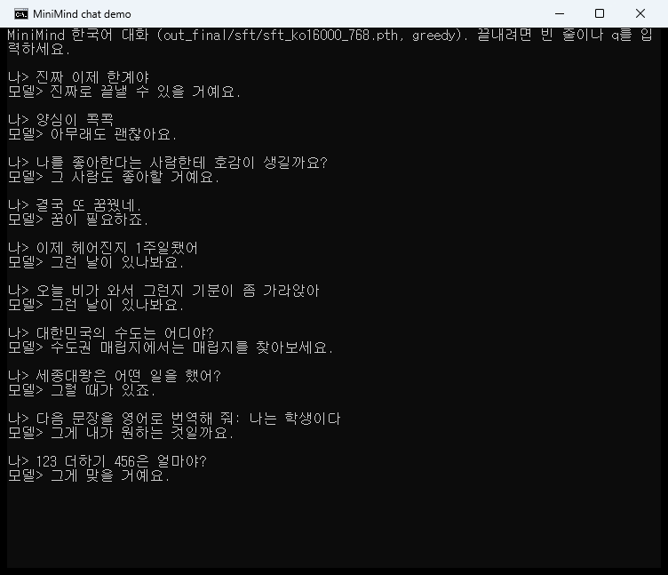

# 08. 최종 사전학습과 대화 SFT (vocab 16,000)

작업일: 2026-11-23 ~ 2026-11-24

## 목표

- [06번 문서](06_데이터양_비교.md)에서 고른 vocab 16,000으로 최종 사전학습 모델을 만든다. 지금 있는 16,000·100만 조각 모델(위키 검증 BPB 1.0080)보다 확실히 나을 때만 새 모델을 쓴다.
- 노트북 GPU 한 장이라 학습 시간이 비용이다. 그래서 [06 다음 단계](06_데이터양_비교.md#다음-단계)의 후보 중 패킹과 여러 epoch를 작은 실험으로 먼저 확인하고, 효과가 확인된 것만 최종 학습에 넣었다.
- 새 모델이 채택되면 [07번 문서](07_대화_SFT_비교.md)와 같은 조건으로 대화 SFT를 하고, 실제로 어떤 답을 내는지 README 대화 예시로 보여 준다.

## 결과를 보기 전에 정한 것

설계: [docs/superpowers/specs/2026-11-23-final-pretrain-design.md](superpowers/specs/2026-11-23-final-pretrain-design.md), 구현 계획: [docs/superpowers/plans/2026-11-23-final-pretrain.md](superpowers/plans/2026-11-23-final-pretrain.md)

| 단계 | 채택 기준 (반올림 전 값, 위키 문서 단위 쌍 부트스트랩 10,000회) |
|---|---|
| 실험 1: 패킹 | Δp = BPB(패킹 40만) − BPB(기존 40만)의 95% 구간 상한 < +0.005 |
| 실험 2: 2 epoch | g = BPB(20만×1) − BPB(20만×2), G = BPB(20만×1) − BPB(40만×1)일 때 g/G ≥ 0.5, g의 95% 구간 하한 > 0, BPB(2 epoch 끝) < BPB(1 epoch 끝) 세 가지 모두 |
| 최종 사전학습 | Δf = BPB(새 모델) − BPB(기존 100만, 1.0080)의 95% 구간 상한 < 0이면 새 모델 사용, 아니면 기존 모델 유지(SFT 생략) |
| 최종 SFT | 판정 없음. 07번 16,000 SFT 모델과 답 본문 BPB를 나란히 기록 |

- 기준은 실험을 시작하기 전(2026-11-23 오전)에 문서로 정했다. 다만 커밋은 결과가 나온 뒤에 했다(bfe0a76). 그래서 커밋 시각으로는 순서를 확인할 수 없고, 이 문서의 서술과 실행 로그 시각으로만 확인된다.
- 결과를 본 뒤 기준은 바꾸지 않았다. 실험 판정 뒤, 최종 학습 전에 기록 항목 두 가지만 더했다(설계 문서 끝 변경 기록): 최종 모델의 1 epoch 끝 가중치 참고 평가, SFT 비교의 답 끝 EOS 손실.
- 기준은 사용자가 GPT 6.2 Astra와 상의해 승인했고, 실험 결과의 해석도 같은 방식으로 검토했다.

## 고정 조건

hidden 768, 8층(71.28M), max_seq_len 512, batch 16 × accum 8, lr 5e-4 → 5e-5 (원본 cosine, 전체 step 기준, warmup 없음), bf16, seed 42. 평가는 06번과 같은 `eval_bpc.py`(fp32, window 512 / stride 256)로 `data/scale/heldout.jsonl` 2,001조각(위키 문서 1,243개)을 재고, 평가 텍스트의 sha256이 06번과 같은지 매번 확인했다.

## 실험 1: 패킹 (40만 조각)

- 방식: 학습 파일 순서대로 조각마다 `[bos] + 텍스트 + [eos]`를 만들어 한 줄로 이어 붙이고 512토큰씩 잘랐다. 조각은 자르거나 버리지 않고(512를 넘는 조각은 다음 줄로 이어짐), 마지막 줄만 pad로 채웠다. 조각 경계에서 어텐션은 끊지 않았다. 라벨에서는 pad와 bos를 뺐다(bos는 항상 eos 바로 뒤라 맞힐 정보가 없음). 줄들에서 pad를 빼고 이으면 원래 토큰 열과 같은지 테스트로 확인했다.
- 40만 조각 → 102,274,489토큰 → 512칸 줄 199,755개(마지막 줄 pad 71칸) → 12,485 step. 학습 1시간 26분.

| 모델 | step (가중치 갱신) | 검증 BPB |
|---|---|---|
| 기존 40만 (06번, 조각마다 padding) | 25,000 (3,125) | 1.1073 |
| 패킹 40만 | 12,485 (1,561) | 1.1763 |

같은 위키 원문 40만 조각을 한 번씩 학습했을 때, 패킹 모델의 검증 BPB는 비패킹 모델보다 0.0690 높았습니다(문서 단위 쌍 부트스트랩 95% 구간 [+0.0669, +0.0715]). 사전에 정한 허용 폭을 넘어 이번 최종 학습에는 패킹을 채택하지 않았습니다. 가중치 업데이트가 3,125회에서 1,561회로 줄어든 것을 한 원인으로 추정합니다. 긴 조각의 뒷부분을 처리하는 방식과 조각 경계에서 모델이 볼 수 있는 문맥도 달라졌으므로, 이번 비교만으로 각 요인의 영향을 분리할 수는 없습니다.

## 실험 2: 2 epoch (20만 조각, 패킹 없음)

- 20만 조각을 2 epoch(25,000 step) 학습했다. lr cosine은 두 epoch 전체에 걸친다. 1 epoch 끝 가중치도 따로 저장해 평가했다. 학습 2시간 51분.

| 모델 | 검증 BPB |
|---|---|
| 20만 × 1 epoch (06번) | 1.2246 |
| 40만 × 1 epoch (06번) | 1.1073 |
| 20만 × 2 epoch, 1 epoch 끝 (학습 중간 지점) | 1.1947 |
| **20만 × 2 epoch** | **1.1130** |

- g = +0.1116 [+0.1088, +0.1145], G = 0.1172, **g/G = 0.95**, 2 epoch 끝 1.1130 < 1 epoch 끝 1.1947 → 세 조건 모두 충족, **2 epoch 채택**.
- 같은 20만 조각을 두 번 학습해서 새 데이터를 40만으로 늘린 효과의 95%를 얻었다. 이 비교는 20만 규모에서만 한 것이고, 데이터가 커지면 반복 효과가 줄 수 있다(설계 때 적어 둔 한계).

## 최종 사전학습 (학습 풀 전체 × 2 epoch)

- 데이터: 위키 학습 풀 전체 1,183,370조각(`data/scale/train_1183370.jsonl`, 약 5.9억 자). 06번과 같은 방법·시드로 섞은 순서라 앞 100만 줄이 06번의 `train_1000000.jsonl`과 같고, 검증 문서와 겹치는 문서·텍스트는 0개다(만들 때 확인, `scripts/prepare_final_data.py`).
- 설정: 패킹 없이 2 epoch, epoch당 73,961 step, 총 147,922 step(가중치 갱신 18,492회). 기존 100만 모델은 62,500 step(갱신 7,813회)이었다.
- 학습 시간: 16시간 26분(두 구간 합, 아래 "진행 중 있었던 일"), 시작부터 SFT 끝까지 18시간 5분. 기존 100만 모델은 7.2시간이었다.

| 모델 | 검증 BPB |
|---|---|
| 기존 16,000 · 100만 × 1 epoch (06번) | 1.0080 |
| 새 모델, 1 epoch 끝 (학습 중간 지점, 참고) | 0.9963 |
| **새 모델, 2 epoch 끝 (최종)** | **0.9432** |

- **Δf = −0.0649 [−0.0672, −0.0626]. 상한이 0보다 작아 사전 기준에 따라 새 모델을 채택했다.** 기존 모델보다 BPB가 약 6.4% 낮다.
- 이 비교는 학습 방법 전체의 비교다. 데이터 18% 증가, 2회 반복, step 수 2.4배가 섞여 있어 어느 것이 얼마나 기여했는지는 나눌 수 없다.
- 참고(판정에 쓰지 않음): 2 epoch 끝 − 1 epoch 끝 = −0.0532 [−0.0549, −0.0517]. 1 epoch 끝 가중치는 lr이 아직 2.75e-4(최대의 55%)인 학습 중간 지점이라 "1 epoch만 학습한 모델"이 아니다. 따라서 이 차이는 두 번째 epoch의 효과와 lr이 내려간 효과가 합쳐진 값이다. 실험 2에서도 이 중간 지점(1.1947)이 따로 1 epoch를 끝까지 학습한 모델(1.2246)보다 낮았다. 2 epoch의 효과를 보여 주는 근거는 실험 2의 g뿐이다.
- 개선은 일부 문서에 몰리지 않았다. 검증 문서 1,243개 중 1,193개(96%)에서 새 모델의 BPB가 낮았다(탐색적).

## 최종 SFT

- 07번 비교와 같은 조건: Chatbot_data SFT 후보 9,749쌍, 3 epoch(1,830 step), lr 1e-5 → 1e-6 cosine, batch 16, max_seq_len 128, seed 42, 대화 형식 하나로 고정. 평가용 2,001쌍은 계속 뺐다. 학습 3분 36초.
- 비교 대상은 07번의 16,000 SFT 모델(기존 100만 모델 위에서 같은 조건으로 SFT)이다. 95% 구간은 07번과 같은 질문·답 묶음(1,294개) 단위 쌍 부트스트랩 10,000회다. 기록용이며 판정에 쓰지 않았다.

| 항목 (평가용 2,001쌍, 대화 형식) | 최종 SFT | 07번 16,000 SFT | 차이 [95% 구간] |
|---|---|---|---|
| **답 본문 BPB** | **1.0958** | 1.1134 | **−0.0176 [−0.0242, −0.0111]** |
| EOS 포함 BPB | 1.1001 | 1.1176 | −0.0174 [−0.0242, −0.0110] |
| 답 끝 EOS 손실 (답 하나당 평균) | 0.1115 nats (0.1608비트) | 0.1081 nats (0.1559비트) | +0.0034 nats [−0.0090, +0.0179] (= +0.0049비트 [−0.0130, +0.0258]) |
| 답 끝 EOS에 준 확률 (답마다의 평균) | 0.963 | 0.962 | |

- 정답 답변을 예측하는 손실은 줄었다(답 본문 BPB 1.6% 감소, 구간이 0을 포함하지 않음). 사전학습 개선(6.4%)보다는 작다.
- 답 끝 EOS 손실은 두 모델 모두 낮고(EOS에 준 확률 평균 0.96, 0.5 미만인 답은 1.7% / 1.8%), 새 모델이 조금 높지만(양수는 새 모델이 나쁜 방향) 구간이 0을 포함해 **방향을 말할 수 없다**. 동등하다고 볼 경계를 미리 정하지 않았으므로 "같다"고는 쓰지 않는다. 답 전체 손실에서 EOS가 차지하는 몫이 작아서 EOS 포함 BPB 차이와 답 본문 차이가 거의 같다. 이 값은 정답 위치에서 EOS를 얼마나 예측하는지이고, 생성할 때 일찍 또는 늦게 끊는 행동은 재지 못한다.
- **BPB가 좋아졌다고 대화를 더 잘한다는 뜻은 아니다.** 07번에서는 BPB와 블라인드 생성 비교의 결론이 반대로 나왔다. 그래서 아래에서 생성 결과를 자동 집계로만 따로 확인했다.

## 생성 확인: 07번 200문항 자동 집계

07번 블라인드 비교의 200문항을 같은 설정(필터 없는 greedy, 새 토큰 상한 96, `<|im_end|>`에서 멈춤)으로 최종 SFT 모델에 생성하고, 07번 문서와 같은 기준으로 셌다. 평가자가 답의 질을 판단한 것이 아니라 반복·상투 답의 개수만 센 것이다.

| 항목 (200문항) | 07번 16,000 SFT | 최종 SFT |
|---|---|---|
| 상한에서 잘린 답 (반복 루프) | 4 | 3 |
| 서로 다른 답 | 132 | 152 |
| 3번 이상 나온 같은 답이 차지한 문항 | 71 | 51 |
| "그런 사람 만나지 마세요." | 27 | 21 |
| "그런 사람 만나세요." | 6 | 6 |

- 같은 상투 답을 되풀이하는 경우가 줄고 답이 더 다양해졌다. 다만 가장 흔한 답은 여전히 질문과 상관없는 "그런 사람 만나지 마세요."(21번)이다.
- 답의 질이 나아졌는지는 이 집계로 알 수 없다(블라인드 평가는 하지 않았다).

## README 대화 예시

- 질문 10개와 생성 설정을 답을 생성하기 전에 [docs/08_demo_questions.json](08_demo_questions.json)에 고정하고 커밋했다(bfe0a76, 2026-11-24 09:49). 생성은 그 뒤에 했다.
- 구성: 평가용 대화 쌍(학습에 쓰지 않음)에서 시드 20261124로 뽑은 5개(민감 단어가 든 질문은 건너뛰는 규칙, 이번에는 해당 없음), 직접 쓴 일상 1개, 위키 지식 2개, 학습 범위 밖 2개. 직접 쓴 질문은 SFT 후보·평가 쌍과 띄어쓰기·문장부호를 무시하고 같은 문장이 없는지 확인했다.
- 생성: 07번 블라인드 비교와 같은 함수(`blind_chat_eval.generate_one`). greedy(do_sample=False, temperature 1.0, top_k 0, top_p 1.0, repetition_penalty 1.0), 새 토큰 상한 96, `<|im_end|>`에서 멈춤, fp32, PyTorch 2.11.0+cu128, RTX 5050 Laptop. 같은 질문에는 항상 같은 답이 나온다. repetition_penalty를 쓰지 않은 이유: 원본 구현은 질문을 포함한 모든 입력 토큰에 벌점을 줘서, 질문 부분의 `<|im_end|>`(EOS) 때문에 답을 끝내는 것 자체가 억제되고 반복 루프도 가려진다.
- 답은 고르거나 고치지 않았고, 다시 생성하지도 않았다. 결과 전체: [docs/08_demo_results.json](08_demo_results.json).

| # | 유형 (미리 적은 예상) | 질문 | 최종 SFT 모델의 답 | 데이터의 참고 답 |
|---|---|---|---|---|
| 1 | 평가용 대화 (짧은 공감 답) | 진짜 이제 한계야 | 진짜로 끝낼 수 있을 거예요. | 당신의 잠재력을 믿어보세요. |
| 2 | 평가용 대화 | 양심이 콕콕 | 아무래도 괜찮아요. | 그런 일은 하지 마세요. |
| 3 | 평가용 대화 | 나를 좋아한다는 사람한테 호감이 생길까요? | 그 사람도 좋아할 거예요. | 꾸준히 만나다보면 생길 수 있어요. |
| 4 | 평가용 대화 | 결국 또 꿈꿨네. | 꿈이 필요하죠. | 다른 생각 하고 주무세요. |
| 5 | 평가용 대화 | 이제 헤어진지 1주일됐어 | 그런 날이 있나봐요. | 긴 시간이었을거라 생각해요. |
| 6 | 일상, 직접 씀 (짧은 공감 답) | 오늘 비가 와서 그런지 기분이 좀 가라앉아 | 그런 날이 있나봐요. | |
| 7 | 위키 지식 (실패 예상) | 대한민국의 수도는 어디야? | 수도권 매립지에서는 매립지를 찾아보세요. | |
| 8 | 위키 지식 (실패 예상) | 세종대왕은 어떤 일을 했어? | 그럴 때가 있죠. | |
| 9 | 범위 밖: 번역 (실패 예상) | 다음 문장을 영어로 번역해 줘: 나는 학생이다 | 그게 내가 원하는 것일까요. | |
| 10 | 범위 밖: 계산 (실패 예상) | 123 더하기 456은 얼마야? | 그게 맞을 거예요. | |



- 화면은 `scripts/chat_ko.py --questions docs/08_demo_questions.json`을 콘솔 창에서 실행해 찍었다. 위 표와 같은 답이다. `--questions` 없이 실행하면 직접 질문을 입력할 수 있다.
- 짧은 일상·위로형 질문에는 한국어 문장 형태의 짧은 답을 내지만, 질문에 꼭 맞는 답은 아닌 경우가 많다(2, 4, 5번). "그런 날이 있나봐요."는 이 모델이 자주 내는 답이다(200문항 중 4번).
- 위키로 사전학습했지만 지식 질문에는 답하지 못했다. 7번은 "수도"라는 단어에서 "수도권 매립지"로 엉뚱하게 이어졌다. SFT 데이터에 지식 문답이 없어서, 사전학습에서 본 내용을 대화 답으로 꺼내는 법을 배우지 못한 것으로 보인다(추정).
- 번역·계산 같은 지시는 배운 적이 없어 모두 실패했다. 예상과 같다.

## 진행 중 있었던 일

- **실험 사이에 두 번 멈춤(사용자 요청).** 실험 1 뒤, 실험 2·판정 뒤(최종 학습 직전)에 실행기를 멈췄다가 다시 실행했다. 멈춘 시점에 막 시작한 학습은 체크포인트가 없어 처음부터 다시 시작했다.
- **배터리.** 충전기를 연결해 두었는데도 학습 중에는 배터리가 줄었다(처음 5시간 시간당 약 9%, 첫 구간 전체 평균 약 8%, 재개 뒤에는 약 4%). 그래서 배터리 지킴이(`scripts/battery_guard.py`)를 붙였다. 사전학습 중 배터리가 25% 이하가 되면 실행기를 멈추고, 90%까지 차면 다시 띄워 체크포인트에서 이어 간다.
- **지킴이 버그로 재시작이 안 됨.** 2026-11-23 22:13에 배터리 25%에서 지킴이가 학습을 멈췄다. 하지만 바로 뒤에 실행기 창이 실행기 기록 파일을 `>>`로 열어 둔 상태에서 같은 파일에 쓰려다 PermissionError가 났고, 지킴이도 꺼졌다. 23:46에 진행 상황을 확인하다 발견해 직접 다시 시작했다. 22:13~23:46 사이에는 원래 필요한 충전 시간(25% → 90%)도 들어 있다. 그동안 지킴이 기록이 비어 있어서, 버그 때문에 늘어난 시간이 정확히 얼마인지는 알 수 없다. 수정: 기록 파일이 잠겨 있으면 1초 간격으로 다시 시도하고, 감시 중 오류가 나도 지킴이는 꺼지지 않게 했다(같은 상황을 재현해 확인).
- **이어서 학습한 것이 결과에 영향이 없다는 근거.** 22:09 체크포인트(epoch 2, 9,000 step)에서 이어서 학습했다. 재개 전후로 같은 step(9,050~9,500)의 loss 10개가 소수 넷째 자리까지 같았다(`logs/08_final_final.log` 1666~1675줄과 1680~1689줄).
- **코드 점검 뒤 고친 것(학습이 끝난 뒤).** 평가 중에 끊긴 단계를 다시 실행하면 학습을 처음부터 하던 문제를 고쳤다(평가만 다시 함). 이번 실행에서는 이 경우가 생기지 않았다. 그 밖에 지킴이가 SFT 단계는 멈추지 않게 했고, 배터리 값을 알 수 없을 때(255)를 처리했다.

## 한계

- **학습은 각 설정마다 한 번(seed 42)씩만 했다.** 95% 구간은 검증 문서(SFT는 질문·답 묶음)를 다시 뽑을 때의 흔들림만 반영하고, 학습을 다시 했을 때의 흔들림은 포함하지 않는다. 사전학습 차이(0.065)는 크지만, SFT 차이(0.0176)가 시드에 따라 얼마나 흔들리는지는 모른다.
- **같은 위키 검증 세트를 여러 번 썼다.** vocab 선택(06번), 패킹·epoch 선택과 최종 판정에 모두 같은 검증 세트를 써서, 0.9432는 약간 좋게 나왔을 수 있다.
- 2 epoch 효과는 20만 규모에서만 확인했고, 패킹과 2 epoch를 함께 쓴 조합은 시험하지 않았다.
- 1 epoch 끝 값은 학습 중간 지점이라 "1 epoch 학습 모델"의 성능이 아니다.
- 대화 품질은 반복·상투 답 개수만 자동으로 셌고, 답의 질을 판단하는 블라인드 평가는 하지 않았다. README 대화 예시 10개는 평가가 아니라 예시다.
- 학습한 가중치는 공개하지 않아 독자가 같은 답을 직접 재현할 수는 없다. 가중치 sha256은 [08_demo_questions.json](08_demo_questions.json)에 적었다.

## 다음 단계

- 이 기록으로 "토크나이저 → 사전학습 → 대화 SFT" 한 바퀴를 마쳤다.
- 대화 품질을 높이려면 지식 문답을 포함한 더 다양한 한국어 대화 데이터가 필요하다(라이선스 확인 후). SFT 데이터의 일부(예: 20%)를 다른 문답으로 바꿔 보는 실험은 별도 후속 실험으로 남긴다.
- (선택) LoRA, DPO 체험. → 진행 결과는 [09번 문서](09_LoRA_DPO_체험.md).

## 다시 실행하는 명령

```bat
REM 학습 풀 전체 파일 만들기 (data/scale/train_1183370.jsonl, 앞 100만 줄·검증 겹침 확인)
.venv\Scripts\python.exe -X utf8 scripts\prepare_final_data.py

REM 실험 1·2 → 판정 → 최종 사전학습 → 채택 판정 → 최종 SFT를 차례로 (별도 창, 끊기면 다시 실행하면 이어 감)
scripts\run_final.bat
REM (선택) 배터리 지킴이: run_final.bat을 띄운 뒤 실행
scripts\battery_guard.bat

REM README 대화 예시: 질문 고정(답을 보기 전에 실행하고 커밋) → 생성과 200문항 집계
.venv\Scripts\python.exe -X utf8 scripts\final_demo.py select
.venv\Scripts\python.exe -X utf8 scripts\final_demo.py generate

REM 콘솔에서 직접 대화
.venv\Scripts\python.exe -X utf8 scripts\chat_ko.py
```

판정 결과는 `out_final/decision.json`, 실행 상태는 `out_final/status.json`, 가중치는 `out_final/`(최종 사전학습 `final/`, 최종 SFT `sft/`)에 있고 git에 올리지 않는다. 로그는 `logs/08_final_*.log`.

## 이번에 만든 스크립트

| 파일 | 역할 |
|---|---|
| [scripts/packing.py](../scripts/packing.py) | 조각을 `[bos]+텍스트+[eos]`로 이어 512칸 줄로 자르는 패킹과 학습용 Dataset(pad·bos 라벨 제외) |
| [scripts/train_pretrain_ko.py](../scripts/train_pretrain_ko.py) (수정) | `--pack 1`(패킹 학습), `--keep_epoch_weights 1`(epoch마다 가중치 따로 저장) 추가. 기본값은 기존 동작 그대로 |
| [scripts/prepare_final_data.py](../scripts/prepare_final_data.py) | 06번과 같은 방법·시드로 학습 풀 전체 파일을 만들고 앞 100만 줄 일치·검증 겹침 0을 확인 |
| [scripts/decide_final.py](../scripts/decide_final.py) | setup(패킹·epoch 판정), accept(최종 채택 판정, 1 epoch 끝 참고), sft(대화 평가 기록) |
| [scripts/run_final.py](../scripts/run_final.py) / [run_final.bat](../scripts/run_final.bat) | 실험부터 SFT까지 차례로 돌리는 실행기. 끊기면 다시 실행해 이어 감(중복 실행 방지, 평가 중 끊기면 평가만 다시) |
| [scripts/battery_guard.py](../scripts/battery_guard.py) / [battery_guard.bat](../scripts/battery_guard.bat) | 배터리 지킴이: 사전학습 중 25% 이하면 멈추고 90%에서 다시 띄움 |
| [scripts/final_demo.py](../scripts/final_demo.py) | README 대화 예시 질문 고정(select)과 생성·200문항 자동 집계(generate) |
| [scripts/chat_ko.py](../scripts/chat_ko.py) | 콘솔에서 한국어 SFT 모델과 대화(greedy, `--questions`로 고정 질문 차례로 넣기) |
| [tests/test_final_pretrain.py](../tests/test_final_pretrain.py), [tests/test_final_demo.py](../tests/test_final_demo.py) | 패킹 복원·잘림 없음·라벨, 판정 경계, 06번 결과 재현, 실행기·지킴이 안전 장치, 질문 고르기·07번 집계 재현 |
